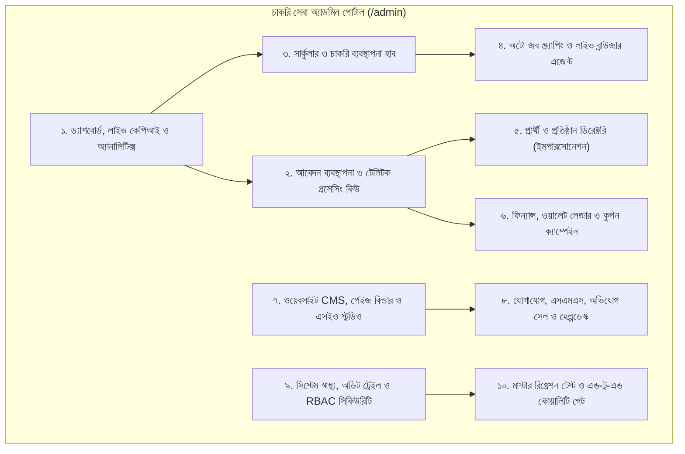

# চাকরি সেবা (Chakri Sheba) — অ্যাডমিন পোর্টালের সকল পেইজ, ফাংশন ও গভীর অডিট গাইড
**Admin Portal Architecture, Comprehensive Feature Inventory & Deep Audit Manual**

> **ডকুমেন্ট তৈরি:** ১০ নভেম্বর ২০২৬  
> **সংস্করণ:** ৩.২.০ (Next.js 15.5.29 • React 19.3.1 • Tailwind CSS 3.4.1 • TypeScript 5.8)  
> **উদ্দেশ্য:** চাকরি সেবা প্ল্যাটফর্মের সম্পূর্ণ অ্যাডমিন ও গভর্নেন্স প্যানেলের (`/admin`) সকল মডিউল, ৫০টি সাব-ট্যাব, ব্যাকএন্ড এপিআই, ডাটাবেজ মডেল, নিরাপত্তা স্তর এবং প্রতিটি ফাংশনের গভীর অডিট রূপরেখার পূর্ণাঙ্গ কারিগরি বিবরণী।

---

## ১. ভূমিকা ও অ্যাডমিন পোর্টালের স্থাপত্য (Admin Portal Architecture Overview)

চাকরি সেবা প্ল্যাটফর্মের অ্যাডমিন পোর্টালটি একটি সমন্বিত, রিয়েল-টাইম এবং এআই-পাওয়ার্ড গভর্ন্যান্স প্ল্যাটফর্ম। এর মাধ্যমে প্ল্যাটফর্মের সার্বিক কার্যক্রম পরিচালিত হয়—যার মধ্যে রয়েছে সার্কুলার পোস্টিং, অলজবস টেলিটকের অটোমেটেড লাইভ ব্রাউজার স্ক্র্যাপিং, প্রার্থীদের আবেদন প্রক্রিয়াকরণ, টেলিটক ইউজার আইডি ও প্রবেশপত্র বিতরণ, আর্থিক ওয়ালেট অডিট, ভিজ্যুয়াল ড্র্যাগ-অ্যান্ড-ড্রপ পেইজ বিল্ডিং এবং সাপোর্ট টিকেট ম্যানেজমেন্ট।

সমগ্র অ্যাডমিন সিস্টেমটি অনুমোদিত বাংলা ডিজাইন স্ট্যান্ডার্ড (`SolaimanLipi` টাইপোগ্রাফি, ডিপ স্লেট `#0b0f19` সাইডবার ও এমারেল্ড `#006a4e` ব্র্যান্ড টোকেন) বজায় রেখে **১০টি সুনির্দিষ্ট ফাংশনাল ক্লাস্টারে (Core Functional Clusters)** বিন্যস্ত:

---

## ২. অ্যাডমিন পোর্টালের বৈশ্বিক নেভিগেশন ও সাব-ট্যাব ম্যাপিং (Navigation & Sub-Tab Map)

অ্যাডমিন প্যানেলে প্রধান ৯টি মেনু ক্যাটাগরি এবং সর্বমোট **৫০টি ডেডিকেটেড সাব-ট্যাব** রয়েছে, যা URL কুয়েরি প্যারামিটার `?tab=...` দ্বারা সম্পূর্ণ রিফ্রেশ ছাড়া এবং ব্যাক-বাটন হিস্ট্রি অক্ষুণ্ন রেখে লোড হয়:

| গ্রুপ নং | মূল মেনু ক্যাটাগরি | সাব-ট্যাব আইডি (`tab=...`) | সাব-ট্যাবের বাংলা নাম | সংশ্লিষ্ট মূল উপাদান (Component) |
| :---: | :--- | :--- | :--- | :--- |
| **০১** | **ড্যাশবোর্ড ও ওভারভিউ** | `dashboard` `analytics-center` `report-builder` `data-quality-inspector` | মূল ড্যাশবোর্ড ও KPI অ্যানালিটিক্স ও BI রিপোর্ট এক্সপোর্ট ডাটা কোয়ালিটি ও অডিট | `AdminDashboardOverview.tsx` `AnalyticsIntelligenceHub.tsx` |
| **০২** | **আবেদন ও অর্ডার হাব** | `all-applications` `payment-verification` `processing-queue` `completed-rejected` `documents` | সকল আবেদন তালিকা পেমেন্ট ভেরিফিকেশন কিউ টেলিটক প্রসেসিং কিউ সম্পন্ন ও বাতিল আবেদন অ্যাপ্লিক্যান্ট ডকুমেন্টস ভল্ট | `src/app/admin/page.tsx` `CertificateVerificationQueue.tsx` |
| **০৩** | **সার্কুলার ও নিয়োগ হাব** | `circulars` `create-circular` `publishing-center` `category-search-manager` `job-feed-manager` `deadline-alert-manager` `smart-job-matching` | সব সার্কুলার তালিকা নতুন চাকরি যোগ ও এডিট পাবলিশিং ও শিডিউলার সেন্টার ক্যাটাগরি ও সার্চ ট্যাগ জব ফিড ও RSS সিন্ডিকেশন ডেডলাইন অ্যালার্ট ম্যানেজার স্মার্ট জব ম্যাচিং রুলস | `UniversalJobWorkspace.tsx` `JobPublishingCenter.tsx` `JobCategorySearchManager.tsx` `JobFeedManager.tsx` `DeadlineAlertManager.tsx` `SmartMatchingAdmin.tsx` |
| **০৪** | **অটোমেশন ও লাইভ এজেন্ট** | `gemini-browser-spider` `source-monitoring` `imported-drafts` `automation-hub` `testing-spider` | লাইভ ব্রাউজার স্ক্রিন ও অটোমেশন সোর্স স্ক্র্যাপার মনিটরিং খসড়া ও অনুমোদন কিউ সেন্ট্রাল অটোমেশন ম্যানেজার টেস্টিং স্পাইডার স্যান্ডবক্স | `GeminiBrowserSpiderHub.tsx` `SourceRegistryManagement.tsx` `JobVerificationCenter.tsx` `CentralAutomationManager.tsx` `TestingSpiderHub.tsx` |
| **০৫** | **প্রার্থী ও প্রতিষ্ঠান হাব** | `candidate-directory` `candidate-details` `account-status` `eligibility-rules` `company-directory` `employer-verification` `company-jobs` | প্রার্থী ডিরেক্টরি প্রার্থীর পূর্ণাঙ্গ প্রোফাইল অ্যাকাউন্ট স্ট্যাটাস ও নিয়ন্ত্রণ যোগ্যতা ফিল্টার রুলস প্রতিষ্ঠান ডিরেক্টরি নিয়োগকারী যাচাইকরণ প্রতিষ্ঠানভিত্তিক চাকরি | `CandidateManagementHub.tsx` `UniversalUserWorkspace.tsx` `OrganizationManagementHub.tsx` |
| **০৬** | **ফিন্যান্স ও ডিসকাউন্ট** | `transactions` `invoices` `service-fees` `coupons-discounts` `raffle-campaigns` `platform-operations` | ট্রানজেকশন তালিকা ও লেজার ইনভয়েস ভাউচার সার্ভিস ফি কনফিগারেশন কুপন ও ডিসকাউন্ট কোড র‍্যাফেল ড্র ক্যাম্পেইন অপারেশনাল খরচ অপটিমাইজেশন | `FinancialTransactionsLedger.tsx` `CouponsRaffleManagement.tsx` `PlatformOperationsHub.tsx` |
| **০৭** | **ওয়েবসাইট CMS ও এসইও** | `content-studio` `builder` `pages-sections` `header-footer` `media-library` `seo-meta` `revisions` | কন্টেন্ট ও এসইও স্টুডিও ভিজ্যুয়াল ড্র্যাগ-অ্যান্ড-ড্রপ বিল্ডার পেইজ ও সেকশন ম্যানেজমেন্ট হেডার ও ফুটার থিম কাস্টমাইজার মিডিয়া লাইব্রেরি ও ফাইল ম্যানেজার মেটা ও স্কিমা মার্কআপ রিভিশন ও হিস্ট্রি ট্র্যাকিং | `WebsiteBuilder.tsx` `WebsiteCmsSeoManagement.tsx` `JobContentStudio.tsx` `MediaLibraryManager.tsx` |
| **০৮** | **যোগাযোগ ও মেসেজিং** | `job-reports` `support-tickets` `notifications` `sms-status` `templates-delivery` | 🚨 ভুয়া সার্কুলার ও অভিযোগ সেল 🎧 সাপোর্ট টিকেট ও হেল্পডেস্ক নোটিফিকেশন ও ব্রডকাস্ট এসএমএস গেটওয়ে ও ব্যালেন্স মেসেজ টেমপ্লেট ও ডেলিভারি লগ | `JobReportsManagement.tsx` `SupportTicketsManagement.tsx` `SmsNotificationsManagement.tsx` |
| **০৯** | **সিস্টেম ও সিকিউরিটি** | `system-health` `settings` `staff-roles` `audit-logs` `backup-diagnostics` | সিস্টেম স্বাস্থ্য ও লাইভ পিং প্ল্যাটফর্ম গ্লোবাল সেটিংস স্টাফ ও RBAC রোলস অডিট ও অ্যাক্টিভিটি লগ ব্যাকআপ ও স্ন্যাপশট রিস্টোর | `AdminDashboardOverview.tsx` `SystemSettingsDiagnostics.tsx` `PlatformGovernanceOverview.tsx` |

---

## ৩. ক্লাস্টার ১: ড্যাশবোর্ড, লাইভ কেপিআই ও অ্যানালিটিক্স হাব (Dashboard & Analytics Hub)

### ১. মূল ড্যাশবোর্ড ও KPI (`/admin?tab=dashboard`)
* **রাউট:** [src/app/admin/page.tsx](file:///C:/Users/Leon%20Rahman/.gemini/antigravity/scratch/chakri-sheba-workspace/src/app/admin/page.tsx)
* **মূল কম্পোনেন্ট:** [src/components/admin/dashboard/AdminDashboardOverview.tsx](file:///C:/Users/Leon%20Rahman/.gemini/antigravity/scratch/chakri-sheba-workspace/src/components/admin/dashboard/AdminDashboardOverview.tsx)
* **উদ্দেশ্য:** পুরো প্ল্যাটফর্মের লাইভ স্বাস্থ্য, পাবলিশিং পরিসংখ্যান, আর্থিক প্রবাহ এবং দৈনন্দিন কাজের কেন্দ্রীয় নিয়ন্ত্রণ প্যানেল।
* **মূল ফিচার ও সেকশনসমূহ:**
  1. **৫টি রিয়েল-টাইম KPI মেট্রিক কার্ড:**
     - `মোট চাকরি (Total Jobs)`: সক্রিয় এবং মোট প্রকাশিত সার্কুলার সংখ্যা (ডাটাবেজ থেকে লাইভ ক্যালকুলেশন)।
     - `নিবন্ধিত প্রার্থী (Registered Candidates)`: সর্বমোট সক্রিয় প্রার্থীর সংখ্যা এবং বিগত ৩০ দিনের প্রবৃদ্ধির হার (+১৮.৭%)।
     - `পর্যালোচনায় অপেক্ষমাণ (Pending Review)`: এআই বা স্ক্র্যাপার থেকে সংগৃহীত কিন্তু এখনও প্রকাশিত হয়নি এমন খসড়া বিজ্ঞপ্তির সংখ্যা।
     - `সক্রিয় সংগ্রাহক (Active Spiders/Workers)`: চলমান ব্রাউজার স্পাইডার ও ব্যাকগ্রাউন্ড ওয়ার্কারের রিয়েল-টাইম কাউন্ট।
     - `মোট ভিউ (Total Page Views)`: সার্কুলার ও পোর্টাল পেজের সম্মিলিত ভিউয়ারশিপ ও ট্রাফিক মেট্রিক।
  2. **চাকরি প্রকাশের প্রবণতা (Bar Chart):**
     - বিগত ৩০ দিনের দৈনিক প্রকাশিত (Published) বনাম খসড়া (Draft) সার্কুলারের তুলনামূলক গ্রাফিক্যাল ভিউ।
  3. **চাকরির অবস্থা অনুযায়ী ডোনাট চার্ট (Donut Chart):**
     - ডাইনামিক SVG ডোনাট চার্ট যা `Published`, `Draft`, `In Review`, এবং `Expired` সার্কুলারগুলোর অনুপাত প্রদর্শন করে।
  4. **সাম্প্রতিক চাকরি টেবিল (Recent Jobs Table):**
     - সর্বশেষ প্রকাশিত সার্কুলারগুলোর সংক্ষিপ্ত তালিকা (ক্রমিক, পদের নাম, প্রতিষ্ঠান, আবেদনের শেষ তারিখ, স্ট্যাটাস এবং 'দেখুন'/'সম্পাদনা' অ্যাকশন)।
  5. **লাইভ সিস্টেমের বর্তমান অবস্থা (System Pulse Card):**
     - লোকাল ব্রাউজার ওয়ার্কার (`অনলাইন`), স্থানীয় ওলামা এআই (`অনলাইন`), জেমিনি এআই এপিআই (`সংযুক্ত`), ডাটাবেজ (`সুস্থ`), এবং ওয়েবসাইট রেন্ডার হোস্টিং (`লাইভ`) স্ট্যাটাস।
  6. **বটম কুইক অ্যাকশন বার (One-Click Quick Actions):**
     - `+ নতুন চাকরি যুক্ত করুন`, `সংগৃহীত চাকরি পর্যালোচনা করুন`, `চাকরি সংগ্রহ শুরু করুন`, `নতুন প্রতিষ্ঠান যুক্ত করুন`, এবং `নতুন পৃষ্ঠা তৈরি করুন`—এক ক্লিকে কাঙ্ক্ষিত সাব-ট্যাবে জাম্প করার শর্টকাট।
* **ব্যাকএন্ড API:**
  - `GET /api/admin/stats` ➜ মোট চাকরি, প্রার্থী, অ্যাপ্লিকেশন ও ড্রাফট কাউন্ট।
  - `GET /api/admin/analytics/overview` ➜ ভিউ, কনভার্সন রেট ও সময়ভিত্তিক ডেটা।
* **ডিপ অডিট চেকলিস্ট:**
  - [ ] ডাটাবেজ খালি থাকলে যাতে কোনো চার্ট ক্র্যাশ না করে বরং ফ্রেন্ডলি এম্পটি স্টেট দেখায়।
  - [ ] কুইক অ্যাকশন বাটনে ক্লিক করলে সঠিক সাব-ট্যাব ওপেন হয় কিনা তা যাচাই।
  - [ ] লাইভ সিস্টেম পিং স্ট্যাটাস কোনো কারণে ফেইল করলে রেড অ্যালার্ট ব্যাজ আসা নিশ্চিত করা।

### ২. অ্যানালিটিক্স, বিআই ও ডাটা কোয়ালিটি (`/admin?tab=analytics-center` ও `data-quality-inspector`)
* **মূল কম্পোনেন্ট:** [src/components/admin/AnalyticsIntelligenceHub.tsx](file:///C:/Users/Leon%20Rahman/.gemini/antigravity/scratch/chakri-sheba-workspace/src/components/admin/AnalyticsIntelligenceHub.tsx)
* **মূল ফিচারসমূহ:**
  1. **ট্রাফিক ও ইউজার কনভার্সন অ্যানালিটিক্স:** কোন কোন সার্কুলারে সবচেয়ে বেশি ক্লিক ও আবেদন জমা পড়ছে তার হিটম্যাপ।
  2. **ডাটা কোয়ালিটি ইন্সপেক্টর (Data Quality Inspector):** সার্কুলারে কোনো জরুরি তথ্য (যেমন: ডেডলাইন মিসিং, শূন্যপদ ফাঁকা, বেতন স্কেল অনির্ধারিত) থাকলে স্বয়ংক্রিয়ভাবে অডিট ফ্ল্যাগ তৈরি করে অ্যাডমিনকে সতর্ক করা।
  3. **রিপোর্ট এক্সপোর্ট ইঞ্জিন (Report Builder):** নির্দিষ্ট তারিখের পরিসীমা (Date Range) অনুযায়ী আবেদন ও রাজস্ব সংক্রান্ত পূর্ণাঙ্গ CSV ও JSON রিপোর্ট জেনারেশন।

---

## ৪. ক্লাস্টার ২: আবেদন ব্যবস্থাপনা ও টেলিটক প্রসেসিং কিউ (Application Lifecycle & Teletalk Queue)

### ১. মাস্টার আবেদন তালিকা (`/admin?tab=all-applications`)
* **সোর্স ফাইল:** [src/app/admin/page.tsx (Lines 2177-4730)](file:///C:/Users/Leon%20Rahman/.gemini/antigravity/scratch/chakri-sheba-workspace/src/app/admin/page.tsx#L2177-L4730)
* **উদ্দেশ্য:** প্রার্থীদের জমা দেওয়া সকল আবেদনের কেন্দ্রীভূত নিরীক্ষা ও ব্যবস্থাপনা।
* **মূল ফিচারসমূহ:**
  - **উন্নত সার্চ ও ফিল্টার প্যানেল:** প্রার্থীর নাম, মোবাইল নম্বর, ট্র্যাকিং আইডি (`APP-2026-XXXX`), পদের নাম ও প্রতিষ্ঠান দিয়ে তাৎক্ষণিক ক্লায়েন্ট-সাইড ও সার্ভার-সাইড ফিল্টারিং।
  - **স্ট্যাটাস ব্যাজ ইন্ডিকেটর:**
    - `নতুন আবেদন (New / Pending Payment)` ➜ ফি পরিশোধের অপেক্ষায় থাকা আবেদন।
    - `পেমেন্ট যাচাইকৃত (Payment Verified)` ➜ বিকাশ/নগদ পেমেন্ট অনুমোদিত।
    - `প্রসেসিং কিউ (In Processing)` ➜ টেলিটকে সাবমিশনের জন্য অ্যাডমিন টিমের কিউতে আছে।
    - `সম্পন্ন (Completed)` ➜ টেলিটক রোল ও প্রবেশপত্র সহ সফল আবেদন।
    - `বাতিল (Rejected)` ➜ তথ্যের গরমিল বা ভুল পেমেন্টের কারণে প্রত্যাখ্যাত।
  - **বাল্ক অপারেশন:** একাধিক আবেদন একসাথে নির্বাচন করে বাল্ক স্ট্যাটাস পরিবর্তন বা এক্সপোর্ট।

### ২. পেমেন্ট ভেরিফিকেশন কিউ (`/admin?tab=payment-verification`)
* **উদ্দেশ্য:** প্রার্থীদের জমা দেওয়া বিকাশ, নগদ, ও রকেট ট্রানজেকশন আইডি (TRX ID) নিরীক্ষা ও অনুমোদন।
* **মূল ফিচারসমূহ:**
  1. **TRX ID ম্যাচিং ইন্টারফেস:** প্রার্থীর জমা দেওয়া ট্রানজেকশন কোড, টাকার পরিমাণ এবং পেমেন্ট মাধ্যমের সাথে ব্যাংক স্টেটমেন্ট মেলানোর সুবিধা।
  2. **১-ক্লিক অনুমোদন (Approve Payment):** পেমেন্ট অনুমোদনের সাথে সাথেই প্রার্থীর আবেদন স্বয়ংক্রিয়ভাবে `প্রসেসিং কিউ` তে স্থানান্তরিত হয় এবং প্রার্থীর ওয়ালেটে ভাউচার যুক্ত হয়।
  3. **রিজেকশন ও রিফান্ড ড্রপডাউন (Reject with Reason):** 'ভুল TRX ID', 'অপর্যাপ্ত টাকা', বা 'দেরিতে পেমেন্ট' কারণ উল্লেখ করে প্রত্যাখ্যান করা এবং প্রার্থীর কাছে পুশ নোটিফিকেশন পাঠানো।

### ৩. টেলিটক প্রসেসিং ও প্রবেশপত্র বিতরণ কিউ (`/admin?tab=processing-queue`)
* **উদ্দেশ্য:** সরকারি চাকরির ক্ষেত্রে টেলিটক সাইটে আবেদন সাবমিট করে প্রার্থীর অ্যাকাউন্টে ইউজার আইডি, পাসওয়ার্ড ও অ্যাপ্লিক্যান্ট কপি হস্তান্তর।
* **মূল ফিচারসমূহ:**
  1. **প্রার্থীর তথ্যের ১-ক্লিক কপি:** প্রার্থীর নাম, পিতা/মাতার নাম, শিক্ষাগত যোগ্যতা, কোটা এবং ঠিকানা এক ক্লিকে ক্লিপবোর্ডে কপি করার বাটন (টেলিটক ফর্মে দ্রুত পেস্ট করার সুবিধার্থে)।
  2. **অ্যাপ্লিক্যান্ট কপি (PDF) আপলোড:** টেলিটকে আবেদন করার পর ডাউনলোডকৃত অফিসিয়াল অ্যাপ্লিক্যান্ট কপিটি অ্যাডমিন প্যানেল থেকে আপলোড করা।
  3. **টেলিটক ইউজার আইডি ও পাসওয়ার্ড এন্ট্রি:** প্রার্থীর জন্য নির্ধারিত `User ID` ও `Password` ইনপুট দিয়ে সাবমিট করলেই প্রার্থীর পোর্টালের "৫-ধাপের লাইভ আবেদন ট্র্যাকিং" পোর্টালে সেটি দৃশ্যমান হয়।

### ৪. অ্যাপ্লিক্যান্ট ডকুমেন্টস ভল্ট অডিট (`/admin?tab=documents`)
* **মূল কম্পোনেন্ট:** [src/components/admin/CertificateVerificationQueue.tsx](file:///C:/Users/Leon%20Rahman/.gemini/antigravity/scratch/chakri-sheba-workspace/src/components/admin/CertificateVerificationQueue.tsx)
* **মূল ফিচারসমূহ:**
  - প্রার্থীর আপলোডকৃত ছবি (৩০০x৩০০ পিক্সেল, ১০০ কেবি নিচে) ও স্বাক্ষর (৩০০x৮০ পিক্সেল, ৬০ কেবি নিচে) টেলিটক স্ট্যান্ডার্ড অনুযায়ী ঠিক আছে কিনা তা লাইভ ভিউয়ারে যাচাই।
  - এনআইডি, জাতীয়তা সনদ ও সার্টিফিকেটের স্পষ্টতা যাচাই করে 'ভেরিফাইড' সিল দেওয়া।

---

## ৫. ক্লাস্টার ৩: সার্কুলার ও চাকরি ব্যবস্থাপনা হাব (Job Management, Categorization & Publishing)

### ১. সব সার্কুলার তালিকা (`/admin?tab=circulars`)
* **সোর্স ফাইল:** [src/app/admin/page.tsx (Lines 4734-5180)](file:///C:/Users/Leon%20Rahman/.gemini/antigravity/scratch/chakri-sheba-workspace/src/app/admin/page.tsx#L4734-L5180)
* **উদ্দেশ্য:** প্ল্যাটফর্মের সকল বিদ্যমান সার্কুলার নিয়ন্ত্রণ, সম্পাদন ও স্ট্যাটাস টগল।
* **মূল ফিচারসমূহ:**
  - সার্কুলার টেবিল (পদের নাম, প্রতিষ্ঠান, ক্যাটাগরি, আবেদনের শুরু ও শেষ তারিখ, মোট পদসংখ্যা, স্ট্যাটাস)।
  - দ্রুত অ্যাকশন: `সম্পাদনা করুন`, `লাইভ সাইটে দেখুন`, `মেয়াদ বাড়ান (Corrigendum)`, `আর্কাইভ করুন`, ও `মুছে ফেলুন`।

### ২. নতুন চাকরি তৈরি ও এডিটিং ওয়ার্কস্পেস (`/admin?tab=create-circular`)
* **মূল কম্পোনেন্ট:** [src/components/admin/UniversalJobWorkspace.tsx](file:///C:/Users/Leon%20Rahman/.gemini/antigravity/scratch/chakri-sheba-workspace/src/components/admin/UniversalJobWorkspace.tsx)
* **উদ্দেশ্য:** সরকারি ও বেসরকারি চাকরির সম্পূর্ণ তথ্যসমৃদ্ধ নিখুঁত সার্কুলার এন্ট্রি নেওয়া।
* **মূল ফিচারসমূহ:**
  1. **প্রাতিষ্ঠানিক তথ্য:** নিয়োগকারী প্রতিষ্ঠান, সার্কুলার স্মারক নম্বর, সরকারি গেজেট লিংক।
  2. **মাল্টিপল পদ ও পে-স্কেল ম্যাপিং:** একই সার্কুলারে একাধিক ভিন্ন পদ যোগ করার সুবিধা। জাতীয় বেতন স্কেল ২০১৫ অনুযায়ী গ্রেড (১ম থেকে ২০তম) নির্বাচন করলে মূল বেতন স্বয়ংক্রিয়ভাবে বসে যাওয়া।
  3. **শিক্ষাগত যোগ্যতা ও জেলা কোটা ট্যাগিং:** কোন কোন ডিগ্রির প্রার্থীরা আবেদন করতে পারবেন এবং কোন কোন জেলার প্রার্থীরা আবেদনের যোগ্য তার চেকবক্স ম্যাট্রিক্স।
  4. **আবেদনের নিয়ম ও টেলিটক ইউআরএল:** অনলাইন আবেদনের লিংক (যেমন: `moedu.teletalk.com.bd`) এবং চালানের কোড/এসএমএস ফরম্যাট।
  5. **অফিসিয়াল সার্কুলার পিডিএফ ও ইমেজ আপলোডার:** মূল সার্কুলারের হাই-রেজোলিউশন কপি যুক্ত করা।

### ৩. পাবলিশিং ও ক্যাটাগরি হাব (`/admin?tab=publishing-center` ও `category-search-manager`)
* **মূল কম্পোনেন্ট:**
  - [src/components/admin/JobPublishingCenter.tsx](file:///C:/Users/Leon%20Rahman/.gemini/antigravity/scratch/chakri-sheba-workspace/src/components/admin/JobPublishingCenter.tsx)
  - [src/components/admin/JobCategorySearchManager.tsx](file:///C:/Users/Leon%20Rahman/.gemini/antigravity/scratch/chakri-sheba-workspace/src/components/admin/JobCategorySearchManager.tsx)
* **মূল ফিচারসমূহ:**
  - **শিডিউলড পাবলিশিং:** নির্দিষ্ট দিন ও সময়ে স্বয়ংক্রিয়ভাবে সার্কুলার লাইভ সাইটে প্রকাশ করার টাইমার।
  - **ক্যাটাগরি কন্ট্রোল:** সরকারি, ব্যাংক, ডিফেন্স, রেলওয়ে, শিক্ষকতা, প্রকৌশল, মেডিকেল ইত্যাদি ক্যাটাগরি তৈরি ও আইকন অ্যাসাইন করা।
  - **এসইও সার্চ কিওয়ার্ড:** প্রতিটি ক্যাটাগরি ও সার্কুলারের জন্য বাংলা ও ইংরেজি সার্চ ট্যাগ ম্যানেজমেন্ট।

---

## ৬. ক্লাস্টার ৪: অটো জব স্ক্যানিং ও লাইভ ব্রাউজার এজেন্ট (Auto Job Scraping & Gemini AI Hub)

### ১. লাইভ ব্রাউজার ও এআই এজেন্ট হাব (`/admin?tab=gemini-browser-spider`)
* **মূল কম্পোনেন্ট:** [src/components/admin/GeminiBrowserSpiderHub.tsx](file:///C:/Users/Leon%20Rahman/.gemini/antigravity/scratch/chakri-sheba-workspace/src/components/admin/GeminiBrowserSpiderHub.tsx)
* **উদ্দেশ্য:** অলজবস টেলিটক ও বিভিন্ন সরকারি ওয়েবসাইটের নিয়োগ বিজ্ঞপ্তি মানুষের হস্তক্ষেপ ছাড়াই স্বয়ংক্রিয়ভাবে ব্রাউজ ও পার্স করা।
* **মূল ফিচারসমূহ:**
  1. **লাইভ ব্রাউজার ভিউপোর্ট (Live Screen Streaming):** ব্যাকগ্রাউন্ডে হেডলেস ক্রোমিয়াম ব্রাউজার কীভাবে অলজবস ওয়েবসাইট ভিজিট করছে, ক্লিক করছে এবং পেজিনেশন পার্স করছে তা সরাসরি স্ক্রিনে দেখা।
  2. **জেমিনি এআই এক্সট্রাক্টর (Gemini 2.5 Flash Parser):** স্ক্যান করা পিডিএফ সার্কুলার ও ইমেজ থেকে এআই স্বয়ংক্রিয়ভাবে পদের নাম, গ্রেড, শূন্যপদ ও ডেডলাইন আলাদা করে JSON ফরম্যাটে রূপান্তর করে।
  3. **স্মার্ট আইসোমরফিক পে-স্কেল ইঞ্জিন:** কোনো সার্কুলারে ভুল বা মনগড়া রেঞ্জ থাকলে তা স্বয়ংক্রিয়ভাবে জাতীয় বেতন স্কেল ২০১৫-এর একক গ্রেডে ফিক্স করা।

### ২. সোর্স মনিটরিং ও যাচাইকরণ কিউ (`/admin?tab=source-monitoring` ও `imported-drafts`)
* **মূল কম্পোনেন্ট:**
  - [src/components/admin/SourceRegistryManagement.tsx](file:///C:/Users/Leon%20Rahman/.gemini/antigravity/scratch/chakri-sheba-workspace/src/components/admin/SourceRegistryManagement.tsx)
  - [src/components/admin/JobVerificationCenter.tsx](file:///C:/Users/Leon%20Rahman/.gemini/antigravity/scratch/chakri-sheba-workspace/src/components/admin/JobVerificationCenter.tsx)
* **মূল ফিচারসমূহ:**
  - **সোর্স হেলথ অডিট:** কোন কোন সোর্স সক্রিয় আছে, লাস্ট ক্রল টাইমস্ট্যাম্প এবং এরর রেট (HTTP 200/403/500)।
  - **খসড়া অনুমোদন প্যানেল (Draft Verification):** স্ক্র্যাপার থেকে আসা ড্রাফটগুলো অ্যাডমিন এক নজরে দেখে '১-ক্লিকে পাবলিশ' করতে পারেন অথবা তথ্য সংশোধন করতে পারেন।
  - **ডুপ্লিকেট প্রতিরোধ ইঞ্জিন (Deduplication):** একই সার্কুলার দ্বিতীয়বার স্ক্র্যাপ হলে মেমরি হ্যাশ দিয়ে শনাক্ত করে স্বয়ংক্রিয়ভাবে ড্রপ করা।

---

## ৭. ক্লাস্টার ৫: প্রার্থী ও নিয়োগকারী প্রতিষ্ঠান ব্যবস্থাপনা (Candidate Directory & Impersonation)

### ১. প্রার্থী ডিরেক্টরি ও অ্যাকাউন্ট নিয়ন্ত্রণ (`/admin?tab=candidate-directory`)
* **মূল কম্পোনেন্ট:** [src/components/admin/CandidateManagementHub.tsx](file:///C:/Users/Leon%20Rahman/.gemini/antigravity/scratch/chakri-sheba-workspace/src/components/admin/CandidateManagementHub.tsx)
* **উদ্দেশ্য:** প্ল্যাটফর্মের সকল প্রার্থীর ডেটাবেজ ম্যানেজমেন্ট ও অ্যাকাউন্ট স্ট্যাটাস নিয়ন্ত্রণ।
* **মূল ফিচারসমূহ:**
  - প্রার্থীর নাম, মোবাইল নম্বর, জেলা, শিক্ষা এবং ওয়ালেট ব্যালেন্স সহ মাস্টার টেবিল।
  - প্রার্থীর অ্যাকাউন্ট স্ট্যাটাস টগল: `Active`, `Suspended`, বা `Banned`।
  - পাসওয়ার্ড রিসেট ও ম্যানুয়াল প্রোফাইল এডিটিং সুবিধা।

### ২. ১-ক্লিক অ্যাডমিন ইমপারসোনেশন মোড (Admin Support Impersonation)
* **ব্যাকএন্ড API:** `POST /api/admin/impersonate`
* **উদ্দেশ্য:** কোনো প্রার্থী আবেদনে জটিলতায় পড়লে সাপোর্ট দেওয়ার স্বার্থে অ্যাডমিন প্রার্থীর অনুমতি সাপেক্ষে সরাসরি তার প্রোফাইলে প্রবেশ করতে পারেন।
* **নিরাপত্তা ও ইউআই আর্কিটেকচার:**
  - অ্যাডমিন যখন প্রার্থীর অ্যাকাউন্টে প্রবেশ করেন, তখন প্রার্থীর ড্যাশবোর্ডের শীর্ষে একটি স্পষ্ট সোনালী সতর্কবার্তা ব্যানার প্রদর্শিত হয়:
    `⚠️ সতর্কবার্তা: আপনি সাপোর্ট দেওয়ার জন্য এই প্রার্থীর অ্যাকাউন্টে অ্যাডমিন হিসেবে প্রবেশ করেছেন।`
  - ব্যানারের ডানপাশে একটি সোনালী বাটন থাকে: `অ্যাডমিন প্যানেলে ফিরুন ↗`, যাতে ক্লিক করা মাত্রই ইমপারসোনেশন সেশন শেষ হয়ে অ্যাডমিন সরাসরি `/admin` পোর্টালে ফেরত আসেন।

### ৩. প্রতিষ্ঠান ডিরেক্টরি ও অর্গানাইজেশন হাব (`/admin?tab=company-directory`)
* **মূল কম্পোনেন্ট:** [src/components/admin/OrganizationManagementHub.tsx](file:///C:/Users/Leon%20Rahman/.gemini/antigravity/scratch/chakri-sheba-workspace/src/components/admin/OrganizationManagementHub.tsx)
* **মূল ফিচারসমূহ:**
  - মন্ত্রণালয়, অধিদপ্তর, স্বায়ত্তশাসিত সংস্থা ও রাষ্ট্রায়ত্ত ব্যাংকগুলোর প্রোফাইল, লোগো এবং অফিসিয়াল ওয়েবসাইট ইউআরএল ডাটাবেজ।
  - প্রতিটি প্রতিষ্ঠানের অধীনে অতীতে কতটি নিয়োগ বিজ্ঞপ্তি প্রকাশিত হয়েছে তার আর্কাইভ হিস্ট্রি।

---

## ৮. ক্লাস্টার ৬: ফিন্যান্স, ওয়ালেট লেজার ও কুপন ক্যাম্পেইন (Finance, Transactions & Coupons)

### ১. আর্থিক ট্রানজেকশন লেজার (`/admin?tab=transactions`)
* **মূল কম্পোনেন্ট:** [src/components/admin/FinancialTransactionsLedger.tsx](file:///C:/Users/Leon%20Rahman/.gemini/antigravity/scratch/chakri-sheba-workspace/src/components/admin/FinancialTransactionsLedger.tsx)
* **উদ্দেশ্য:** প্ল্যাটফর্মের সকল আর্থিক লেনদেনের স্বচ্ছ অডিট ট্রেইল ও ওয়ালেট ব্যবস্থাপনা।
* **মূল ফিচারসমূহ:**
  - সকল ক্যাশ-ইন (ক্যান্ডিডেটের ওয়ালেট রিচার্জ), আবেদন ফি ডেবিট এবং রিফান্ডের কালানুক্রমিক লেজার।
  - প্রার্থীর জন্য ইনস্ট্যান্ট ইনভয়েস ভাউচার জেনারেশন এবং প্রিন্ট ফ্রেন্ডলি স্লিপ।
  - কোনো ট্রানজেকশনে অসঙ্গতি দেখা দিলে অ্যাডমিন কর্তৃক ম্যানুয়াল অ্যাডজাস্টমেন্ট ও অডিট নোট লেখার ব্যবস্থা।

### ২. কুপন ও র‍্যাফেল ড্র ক্যাম্পেইন (`/admin?tab=coupons-discounts` ও `raffle-campaigns`)
* **মূল কম্পোনেন্ট:** [src/components/admin/CouponsRaffleManagement.tsx](file:///C:/Users/Leon%20Rahman/.gemini/antigravity/scratch/chakri-sheba-workspace/src/components/admin/CouponsRaffleManagement.tsx)
* **মূল ফিচারসমূহ:**
  - প্রমোশনাল ডিসকাউন্ট কুপন তৈরি (শতাংশ ছাড় বা ফিক্সড টাকা), মেয়াদ নির্ধারণ এবং সর্বোচ্চ ব্যবহারের সীমা কনফিগার করা।
  - নতুন আবেদনকারীদের উৎসাহিত করতে লটারি বা র‍্যাফেল ড্র ক্যাম্পেইনের তালিকা ও স্বয়ংক্রিয় বিজয়ী নির্বাচন অ্যালগরিদম।

---

## ৯. ক্লাস্টার ৭: ওয়েবসাইট CMS, ভিজ্যুয়াল পেজ বিল্ডার ও কন্টেন্ট স্টুডিও (Website CMS & Visual Page Builder)

### ১. ভিজ্যুয়াল ড্র্যাগ-অ্যান্ড-ড্রপ পেইজ বিল্ডার (`/admin?tab=builder`)
* **মূল কম্পোনেন্ট:**
  - [src/components/admin/WebsiteBuilder.tsx](file:///C:/Users/Leon%20Rahman/.gemini/antigravity/scratch/chakri-sheba-workspace/src/components/admin/WebsiteBuilder.tsx)
  - [src/components/admin/builder/BuilderLeftSidebar.tsx](file:///C:/Users/Leon%20Rahman/.gemini/antigravity/scratch/chakri-sheba-workspace/src/components/admin/builder/BuilderLeftSidebar.tsx)
  - [src/components/admin/builder/BuilderRightInspector.tsx](file:///C:/Users/Leon%20Rahman/.gemini/antigravity/scratch/chakri-sheba-workspace/src/components/admin/builder/BuilderRightInspector.tsx)
  - [src/components/admin/builder/BuilderPublishModal.tsx](file:///C:/Users/Leon%20Rahman/.gemini/antigravity/scratch/chakri-sheba-workspace/src/components/admin/builder/BuilderPublishModal.tsx)
* **উদ্দেশ্য:** কোডিং ছাড়াই প্ল্যাটফর্মের যেকোনো ল্যান্ডিং পেইজ বা তথ্য পাতা দৃষ্টিনন্দনভাবে তৈরি ও সাজানো।
* **মূল ফিচারসমূহ:**
  1. **ব্লক লাইব্রেরি (Left Sidebar):** Hero Banner, Job Grid, Category Carousel, FAQ Accordion, Call to Action, Testimonials ইত্যাদি প্রি-বিল্ট বাংলা ব্লক।
  2. **ক্যানভাস ও ড্র্যাগ-অ্যান্ড-ড্রপ জোন:** ব্লক টেনে এনে ক্রমানুসারে সাজানো এবং রিয়েল-টাইম এডিটিং।
  3. **রাইট ইন্সপেক্টর (Right Inspector):** নির্বাচিত ব্লকের প্যাডিং, মার্জিন, টেক্সট কালার, ব্যাকগ্রাউন্ড গ্রেডিয়েন্ট এবং ফন্ট সাইজ অ্যাডজাস্টমেন্ট।
  4. **রেসপনসিভ ভিউপোর্ট সুইচিং:** ডেস্কটপ (1920px/1366px), ট্যাবলেট (768px), এবং মোবাইল (375px) ভিউতে ইনস্ট্যান্ট প্রিভিউ।

### ২. কন্টেন্ট স্টুডিও, হেডার-ফুটার ও এসইও (`/admin?tab=content-studio` ও `seo-meta`)
* **মূল কম্পোনেন্ট:**
  - [src/components/admin/JobContentStudio.tsx](file:///C:/Users/Leon%20Rahman/.gemini/antigravity/scratch/chakri-sheba-workspace/src/components/admin/JobContentStudio.tsx)
  - [src/components/admin/WebsiteCmsSeoManagement.tsx](file:///C:/Users/Leon%20Rahman/.gemini/antigravity/scratch/chakri-sheba-workspace/src/components/admin/WebsiteCmsSeoManagement.tsx)
* **মূল ফিচারসমূহ:**
  - **নেভিগেশন মেনু ও ফুটার কাস্টমাইজেশন:** হেডার মেনু লিংক, ফুটার কলাম, কপিরাইট নোটিশ ও সরকারি জরুরি হটলাইন (`৩৩৩`, `৯৯৯`) সেটিংস।
  - **এসইও মেটা ও স্কিমা ইঞ্জেক্টর:** গুগল সার্চে সার্কুলার যাতে সবার উপরে র‍্যাংক করে সেজন্য স্বয়ংক্রিয় `JobPosting` স্কিমা মার্কআপ (JSON-LD), ওপেনগ্রাফ ইমেজ ও ক্যানোনিকাল ট্যাগ যুক্ত করা।

---

## ১০. ক্লাস্টার ৮: যোগাযোগ, এসএমএস, অভিযোগ সেল ও হেল্পডেস্ক (Communications, Reports & Support Desk)

### ১. 🚨 ভুয়া সার্কুলার ও অভিযোগ সেল (`/admin?tab=job-reports`)
* **মূল কম্পোনেন্ট:** [src/components/admin/JobReportsManagement.tsx](file:///C:/Users/Leon%20Rahman/.gemini/antigravity/scratch/chakri-sheba-workspace/src/components/admin/JobReportsManagement.tsx)
* **উদ্দেশ্য:** পাঠকদের রিপোর্ট করা ভুয়া বা ত্রুটিপূর্ণ নিয়োগ বিজ্ঞপ্তির অভিযোগ দ্রুত নিষ্পত্তি করা।
* **মূল ফিচারসমূহ:**
  - প্রার্থীর পাঠানো অভিযোগের ট্র্যাকিং কোড (`REP-2026-XXXX`), সার্কুলার রেফারেন্স এবং প্রমাণের স্ক্রিনশট প্রিভিউ।
  - অভিযোগের সত্যতা পেলে ১-ক্লিকে মূল সার্কুলারে 'সংশোধনী (Corrigendum)' ট্যাগ লাগানো বা সার্কুলারটি লাইভ সাইট থেকে প্রত্যাহার করা।
  - তদন্তকারী অ্যাডমিনের পর্যবেক্ষণ নোট যুক্ত করে অভিযোগকারীকে ফিডব্যাক পাঠানো।

### ২. 🎧 সাপোর্ট টিকেট ও হেল্পডেস্ক (`/admin?tab=support-tickets`)
* **মূল কম্পোনেন্ট:** [src/components/admin/SupportTicketsManagement.tsx](file:///C:/Users/Leon%20Rahman/.gemini/antigravity/scratch/chakri-sheba-workspace/src/components/admin/SupportTicketsManagement.tsx)
* **উদ্দেশ্য:** প্রার্থীদের সাধারণ জিজ্ঞাসা, আবেদন সংক্রান্ত টেকনিক্যাল সমস্যা ও পেমেন্ট অভিযোগের সমাধান।
* **মূল ফিচারসমূহ:**
  - টিকেট স্ট্যাটাস ফিল্টারিং: `নতুন (New)`, `চলমান (In Progress)`, `উত্তর দেওয়া হয়েছে (Replied)`, এবং `নিষ্পন্ন (Closed)`।
  - সরাসরি প্যানেল থেকে প্রার্থীকে ফিরতি ইমেইল ও এসএমএস উত্তর দেওয়ার ব্যবস্থা।

### ৩. এসএমএস গেটওয়ে ও ব্রডকাস্ট নোটিফিকেশন (`/admin?tab=notifications` ও `sms-status`)
* **মূল কম্পোনেন্ট:** [src/components/admin/SmsNotificationsManagement.tsx](file:///C:/Users/Leon%20Rahman/.gemini/antigravity/scratch/chakri-sheba-workspace/src/components/admin/SmsNotificationsManagement.tsx)
* **মূল ফিচারসমূহ:**
  - সকল প্রার্থীর ইনবক্সে জরুরি সার্কুলার ঘোষণা বা নোটিশ এক ক্লিকে ব্রডকাস্ট করা।
  - টেলিটক বা দেশীয় বাল্ক এসএমএস গেটওয়ের বর্তমান একাউন্ট ব্যালেন্স পর্যবেক্ষণ এবং টেস্টিং এসএমএস প্রেরণ।

---

## ১১. ক্লাস্টার ৯: সিস্টেম স্বাস্থ্য, অডিট ট্রেইল ও RBAC সিকিউরিটি (System Health, Audit Logs & Access Control)

### ১. লাইভ সিস্টেম স্বাস্থ্য ও পিং মনিটর (`/admin?tab=system-health`)
* **মূল কম্পোনেন্ট:** [src/components/admin/dashboard/AdminDashboardOverview.tsx](file:///C:/Users/Leon%20Rahman/.gemini/antigravity/scratch/chakri-sheba-workspace/src/components/admin/dashboard/AdminDashboardOverview.tsx)
* **মূল ফিচারসমূহ:**
  - ব্যাকএন্ড সার্ভার (Next.js 15.5.29 / Node.js 22): সক্রিয়তা ও মেমরি ব্যবহার।
  - ডাটাবেজ (`local_store.json` / Render Postgres): রেকর্ড কাউন্ট ও রিড-রাইট লেটেন্সি।
  - জেমিনি এআই এপিআই: এপিআই কি ভ্যালিডিটি ও রেসপন্স টাইম (Latency ms)।
  - লোকাল ব্রাউজার ওয়ার্কার ডেমন: লাইভ হার্টবিট এবং কিউ টাস্ক প্রসেসিং গতি।

### ২. অডিট ও অ্যাক্টিভিটি লগ (`/admin?tab=audit-logs`)
* **মূল কম্পোনেন্ট:** [src/components/admin/PlatformGovernanceOverview.tsx](file:///C:/Users/Leon%20Rahman/.gemini/antigravity/scratch/chakri-sheba-workspace/src/components/admin/PlatformGovernanceOverview.tsx)
* **উদ্দেশ্য:** প্রশাসনিক জবাবদিহিতা নিশ্চিতকরণ।
* **মূল ফিচারসমূহ:**
  - কে কখন কোন সার্কুলার পরিবর্তন করেছে, কার আবেদন অ্যাপ্রুভ/রিজেক্ট করেছে, অথবা কোন সেটিং পরিবর্তন করেছে তার সম্পূর্ণ অপরিবর্তনযোগ্য (Immutable) টাইমস্ট্যাম্পড লগ।

### ৩. প্ল্যাটফর্ম সেটিংস ও ব্যাকআপ রিকভারি (`/admin?tab=settings` ও `backup-diagnostics`)
* **মূল কম্পোনেন্ট:** [src/components/admin/SystemSettingsDiagnostics.tsx](file:///C:/Users/Leon%20Rahman/.gemini/antigravity/scratch/chakri-sheba-workspace/src/components/admin/SystemSettingsDiagnostics.tsx)
* **মূল ফিচারসমূহ:**
  - প্ল্যাটফর্মের নাম, লোগো, হেল্পলাইন নম্বর ও জরুরি মেইনটেন্যান্স মোড টগল।
  - ১-ক্লিকে সম্পূর্ণ ডাটাবেজের এনক্রিপ্টেড ব্যাকআপ ফাইল (JSON) ডাউনলোড এবং প্রয়োজনবোধে ব্যাকআপ থেকে স্ন্যাপশট রিস্টোর।

---

## ১২. ক্লাস্টার ১০: সম্পূর্ণ অ্যান্ড-টু-অ্যান্ড অডিট ও ভেরিফিকেশন রোডম্যাপ (Cluster-by-Cluster Deep Audit Roadmap)

প্রার্থী পোর্টালের মতোই অ্যাডমিন পোর্টালের প্রতিটি ক্লাস্টারকে সর্বোচ্চ নিখুঁত ও বাগ-মুক্ত করার জন্য নিচের **১০টি ধাপে গভীর অডিট (Deep Audit)** পরিচালিত হবে:

```mermaid
flowchart LR
    S1["ধাপ ১: ড্যাশবোর্ড ও কেপিআই"] --> S2["ধাপ ২: আবেদন ও টেলিটক কিউ"]
    S2 --> S3["ধাপ ৩: সার্কুলার ও এডিটর"]
    S3 --> S4["ধাপ ৪: অটোমেশন ও ব্রাউজার স্পাইডার"]
    S4 --> S5["ধাপ ৫: প্রার্থী ও ইমপারসোনেশন"]
    S5 --> S6["ধাপ ৬: ফিন্যান্স ও ওয়ালেট লেজার"]
    S6 --> S7["ধাপ ৭: সিএমএস ও পেইজ বিল্ডার"]
    S7 --> S8["ধাপ ৮: অভিযোগ ও সাপোর্ট ডেস্ক"]
    S8 --> S9["ধাপ ৯: স্বাস্থ্য ও সিকিউরিটি অডিট"]
    S9 --> S10["ধাপ ১০: ফুল প্লে-রাইট E2E স্যুট"]
```

### প্রতিটি ধাপের কার্যপদ্ধতি (Standard Audit Protocol):
1. **সোর্স কোড নিরীক্ষা:** কম্পোনেন্ট, ফর্ম ভ্যালিডেশন, এরর হ্যান্ডলিং ও টাইপস্ক্রিপ্ট ইন্টারফেস অডিট।
2. **ডাটাবেজ সিঙ্ক ভেরিফিকেশন:** `src/db/local_store.json` এবং ব্যাকএন্ড এপিআই-এর সাথে লাইভ ডাটা ফ্লো যাচাই।
3. **ব্রাউজার অটোমেশন টেস্ট (Playwright):** প্রতিটি ক্লাস্টারের জন্য ডেডিকেটেড স্ক্রিপ্ট তৈরি করে লাইভ ব্রাউজারে ইনপুট দেওয়া, বাটন ক্লিক করা এবং স্ক্রিনশট এভিডেন্স ক্যাপচার করা।
4. **কোয়ালিটি গেট:** `npm run typecheck` (`tsc --noEmit`) চালনা করে শূন্য টাইপস্ক্রিপ্ট ত্রুটি নিশ্চিতকরণ।
5. **গিট চেকপয়েন্ট:** প্রতিটি সফল ক্লাস্টার অডিটের পর অর্থপূর্ণ কমিট মেসেজ সহ গিটহাবে পুশ।

---

> **পরবর্তী অ্যাকশন:** ব্যবহারকারীর অনুমোদন সাপেক্ষে **ধাপ ১: ড্যাশবোর্ড ও কেপিআই হাব (`/admin?tab=dashboard`)** থেকে গভীর অডিট ও আধুনিকায়ন শুরু করা হবে।
