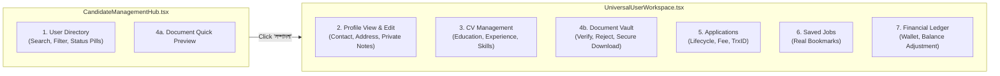

# Admin User & Candidate Management Architecture Map
**Chakri Sheba Complete Candidate Lifecycle Control**

---

## 1. Overview of 7 Core Candidate Sub-Features

In accordance with **Critical Addendum 2 — Complete Admin User Management**, the platform provides complete end-to-end administration of job seekers across 7 discrete sub-features:

---

## 2. Detailed Sub-Feature Specifications

### Sub-Feature 1: User Directory
- **Component:** `CandidateManagementHub.tsx`
- **Capabilities:**
  - Real-time search by candidate name, phone number, and email.
  - Multi-dimensional filters: Division/District, Quota (Freedom Fighter, Disabled, Ethnic, Ansar), Educational Degree, and Account Status (`active`, `suspended`, `banned`).
  - Status indicators: Verified badge (`ভেরিফাইড`), Account status pill, Quota indicator.
  - Quick action toolbar: 1-click Teletalk autofill drawer, CSV export, direct SMS modal trigger, universal edit trigger.

### Sub-Feature 2: User Profile View & Edit
- **Component:** `UniversalUserWorkspace.tsx` (`personal` & `overview` tabs)
- **Capabilities:**
  - Full personal metadata editing: Name (English/Bangla), Father's/Mother's Name, DOB, Gender, NID, Marital Status, Nationality.
  - Present and Permanent address management with Division & District resolution.
  - Internal Admin Notes: Private administrative notes visible only to admins, with author name, timestamp, and immutable audit trail.
  - Profile completion percentage calculation engine (score based on verified fields).

### Sub-Feature 3: CV Management
- **Component:** `UniversalUserWorkspace.tsx` (`education`, `experience`, `skills` tabs)
- **Capabilities:**
  - Academic credentials management: Degree level, Exam title, Board/University, Roll, Reg, Passing Year, Result (GPA/CGPA).
  - Professional employment history: Job title, Company name, Department, Joining/Resignation dates, Key responsibilities.
  - Technical skills and language proficiency chips with add/remove capabilities.
  - Career preferences: Target job types, expected salary, target ministry/organization sectors.

### Sub-Feature 4: Document Management
- **Component:** `UniversalUserWorkspace.tsx` (`documents` tab)
- **Capabilities:**
  - Secure document repository: Candidate photo, signature, NID front/back, nagorik certificate, educational certificates, quota certificates.
  - Document status controls: Approve/Verify or Reject with specific administrative feedback.
  - High-resolution modal preview and direct authenticated download links.

### Sub-Feature 5: Application Management
- **Component:** `UniversalUserWorkspace.tsx` (`applications` tab)
- **Capabilities:**
  - View all job applications submitted by the candidate.
  - Tracking of circular title, organization, application date, final service charge, government fee.
  - Status badges: `pending_payment`, `processing`, `completed`, `rejected`.
  - Transaction identifier (`trxId`) cross-referencing.

### Sub-Feature 6: Saved Jobs (Bookmarks)
- **Component:** `UniversalUserWorkspace.tsx` (`saved_jobs` tab)
- **Capabilities:**
  - Real bookmarks synchronized via `serverDB.getSavedJobs(candidateId)`.
  - Circular cards showing job title, organization, deadline, and direct link to public circular page.

### Sub-Feature 7: Financial / Wallet Ledger
- **Component:** `UniversalUserWorkspace.tsx` (`wallet` tab)
- **Capabilities:**
  - Real-time wallet balance display (`৳${walletBalance}`).
  - **Manual Balance Adjustment Tool:** Administrators can credit (`+`) or debit (`-`) wallet funds with **mandatory reason input**.
  - Complete chronological transaction ledger: Transaction ID, date, type (deposit/fee deduction), description, payment method (bKash, Nagad, Wallet, Bank), amount, and status.
  - System automatically writes an immutable audit log entry for every manual balance change.
