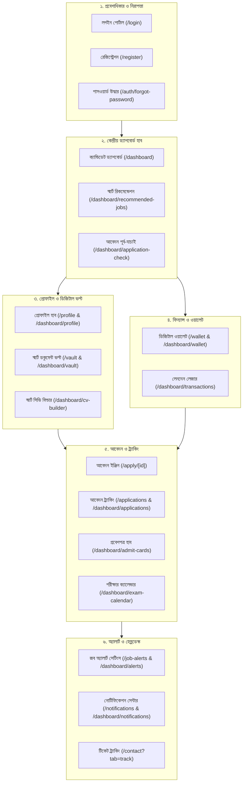
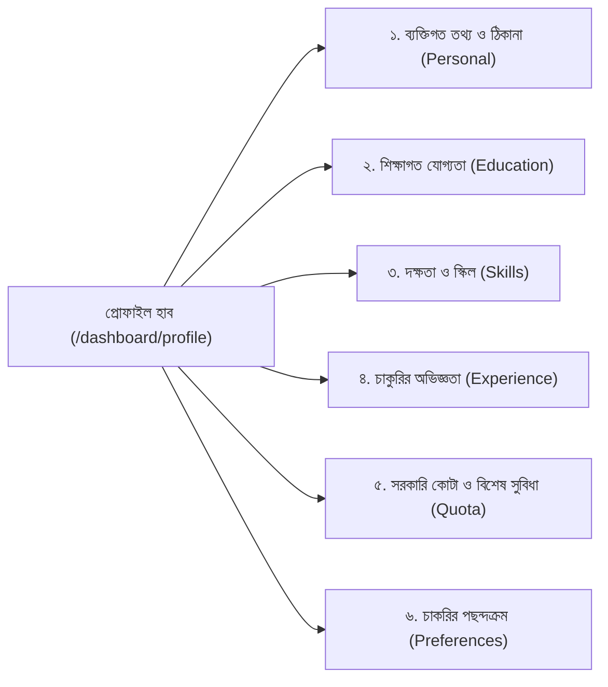
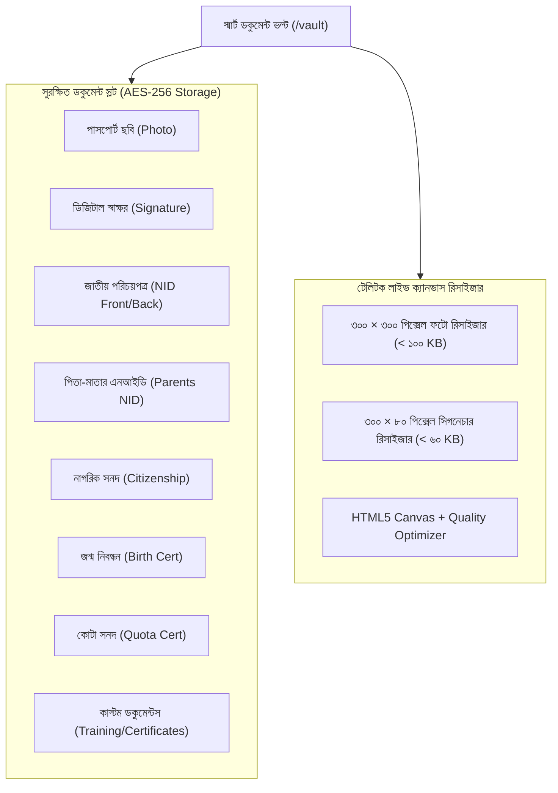
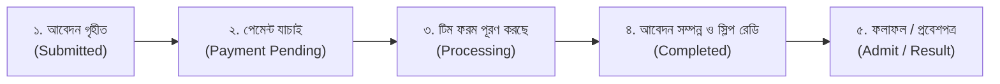

# চাকরি সেবা (Chakri Sheba) — ইউজার/ক্যান্ডিডেট লগইন পোর্টালের সকল পেইজ ও সেকশনের সম্পূর্ণ ফাংশনাল গাইড

> **ডকুমেন্ট তৈরি:** ৯ নভেম্বর ২০২৬  
> **সংস্করণ:** ৩.১.০ (Next.js 15.5.29 • React 19.3.1 • Tailwind CSS 3.4.1)  
> **উদ্দেশ্য:** চাকরি সেবা প্ল্যাটফর্মের ইউজার / প্রার্থী লগইন পোর্টালের (Candidate Logged-in Portal) সকল পেইজ, রাউট, ড্যাশবোর্ড সেকশন, ডিজিটাল ইউটিলিটি টুলস এবং ব্যাকএন্ড এপিআই ইন্টিগ্রেশনের পূর্ণাঙ্গ ও গভীর কারিগরি বিবরণী।

---

## ১. ভূমিকা ও প্রার্থী পোর্টালের স্থাপত্য (Candidate Portal Overview)

চাকরি সেবা প্ল্যাটফর্মের প্রার্থী পোর্টালটি বাংলাদেশের সরকারি ও ব্যাংক চাকরিপ্রার্থীদের যাবতীয় প্রশাসনিক ও আবেদন সংক্রান্ত জটিলতা দূর করার লক্ষ্যে নির্মিত একটি আধুনিক **"অল-ইন-ওয়ান ডিজিটাল ক্যারিয়ার হাব"**।

প্রার্থী লগইন পোর্টালটিতে সর্বমোট **২৫টি ডেডিকেটেড রাউট (Routes/Views)** রয়েছে যা প্রার্থীদের সাইন-ইন থেকে শুরু করে প্রোফাইল তৈরি, ডকুমেন্টের আকার পরিবর্তন, ১-ক্লিকে আবেদন এবং ৫-ধাপের লাইভ ট্র্যাকিং নিশ্চিত করে।

### প্রার্থী জার্নি ও সিস্টেম আর্কিটেকচার (Candidate Lifecycle Flowchart)

---

## ২. ক্লাস্টার ১: প্রবেশাধিকার, অনবোর্ডিং ও নিরাপত্তা (Authentication & Security)

### ১. প্রার্থী সাইন-ইন পোর্টাল (`/login`)
* **রাউট:** [src/app/login/page.tsx](file:///C:/Users/Leon%20Rahman/.gemini/antigravity/scratch/chakri-sheba-workspace/src/app/login/page.tsx)
* **উদ্দেশ্য:** প্রার্থী ও ইউজারদের সুরক্ষিতভাবে অ্যাকাউন্টে প্রবেশের প্রধান গেটওয়ে।
* **মূল সেকশনসমূহ ও কার্যাবলী:**
  1. **ক্যান্ডিডেট ট্যাব সুইচিং ইন্টারফেস:**
     - `লগইন ট্যাব (Login)`: বিদ্যমান প্রার্থীদের মোবাইল নম্বর বা ইমেইল এবং পাসওয়ার্ড দিয়ে দ্রুত লগইন।
     - `নিবন্ধন ট্যাব (Register)`: নতুন প্রার্থীদের জন্য এক ক্লিকে রেজিস্ট্রেশন ইন্টারফেস।
     > [!NOTE] **প্রার্থী ও অ্যাডমিন গেটওয়ের নিরাপদ স্থাপত্য পৃথকীকরণ:** প্রার্থীর পাবলিক সাইন-ইন পোর্টাল (`/login`) সম্পূর্ণভাবে চাকরিপ্রার্থীদের জন্য নির্ধারিত। অ্যাডমিনিস্ট্রেটরদের প্রবেশের জন্য সম্পূর্ণ আলাদা ও সুরক্ষিত গেটওয়ে রয়েছে `/admin`-এ (যেখানে নিজস্ব পিন/পাসওয়ার্ড ও রোল ভ্যালিডেশন রয়েছে)। যদি কোনো ব্যবহারকারী বা বুকমার্ক `/login?tab=admin` কল করে, তবে সিস্টেম স্বয়ংক্রিয়ভাবে তাকে সরাসরি ডেডিকেটেড `/admin` পোর্টালে রিডাইরেক্ট করে দেয়।
  2. **স্মার্ট রিমেম্বার মি ও সেশন রিটেনশন:**
     - ব্রাউজার কুকি (`cs_session_token`) এবং লোকাল স্টোরেজ সিঙ্ক্রোনাইজেশনের মাধ্যমে ৩০ দিনের জন্য সেশন ধরে রাখা।
  3. **রিডাইরেক্ট হ্যান্ডলিং (Deep Linking):**
     - প্রটেক্টেড পেজ (যেমন: `/apply/petrobangla-2026`) থেকে লগইনে আসলে সফল লগইনের পর স্বয়ংক্রিয়ভাবে সেই পেজে ফিরে যাওয়ার সুবিধা (`?redirect=/apply/...`)।
  4. **সামাজিক মাধ্যম লগইন উইন্ডো (Social Auth Picker):**
     - Google One-Tap এবং Facebook Login এর মাধ্যমে সরাসরি তথ্য সিঙ্ক করার এন্টারপ্রাইজ প্রোটোকল।

### ২. নতুন প্রার্থী নিবন্ধন পোর্টাল (`/register`)
* **রাউট:** [src/app/register/page.tsx](file:///C:/Users/Leon%20Rahman/.gemini/antigravity/scratch/chakri-sheba-workspace/src/app/register/page.tsx)
* **উদ্দেশ্য:** নতুন চাকরিপ্রার্থীদের ন্যূনতম প্রয়োজনীয় তথ্য দিয়ে ২ মিনিটে অ্যাকাউন্ট তৈরির ব্যবস্থা।
* **মূল সেকশনসমূহ ও কার্যাবলী:**
  1. **প্রার্থীর প্রাথমিক তথ্য ফরম:**
     - প্রার্থীর পুরো নাম (ইংরেজি ও বাংলায়)।
     - সক্রিয় মোবাইল নম্বর (১১ ডিজিটের ভ্যালিডেশন: `01XXXXXXXXX`)।
     - নিজ জেলা নির্বাচন (৬৪ জেলার ড্রপডাউন যা কোটা ও যোগ্যতার সাথে যুক্ত)।
     - নিরাপদ পাসওয়ার্ড ও কনফার্মেশন।
  2. **স্বয়ংক্রিয় ভল্ট ও ওয়ালেট প্রভিশনিং:**
     - অ্যাকাউন্ট তৈরির সাথে সাথেই ব্যাকএন্ডে শূন্য ব্যালেন্সের ডিজিটাল ওয়ালেট এবং ৮টি স্লটের ডকুমেন্ট ভল্ট ইনিশিয়ালাইজ হয়।
  3. **অটোমেটিক ইনস্ট্যান্ট লগইন:**
     - রেজিস্ট্রেশন সফল হওয়ার পর কোনো বাড়তি স্টেপ ছাড়া সরাসরি ক্যান্ডিডেট ড্যাশবোর্ডে রিডাইরেক্ট।

### ৩. পাসওয়ার্ড উদ্ধার ও ওটিপি ভেরিফিকেশন উইজার্ড (`/auth/forgot-password`)
* **রাউট:** [src/app/login/page.tsx](file:///C:/Users/Leon%20Rahman/.gemini/antigravity/scratch/chakri-sheba-workspace/src/app/login/page.tsx) (ইন্টারেক্টিভ ৩-স্টেপ ওটিপি মডাল)
* **উদ্দেশ্য:** পাসওয়ার্ড ভুলে যাওয়া প্রার্থীদের ওটিপি (One-Time Password) এর মাধ্যমে নিরাপদ রিকভারি।
* **ধাপসমূহ (3-Step Wizard):**
  - **ধাপ ১ (আইডেন্টিফায়ার ইনপুট):** প্রার্থীর নিবন্ধিত ফোন নম্বর বা ইমেইল প্রদান।
  - **ধাপ ২ (ওটিপি যাচাই):** এসএমএস বা ইমেইলে প্রেরিত ৬ ডিজিটের ওটিপি কোড এবং কাউন্টডাউন টাইমার।
  - **ধাপ ৩ (নতুন পাসওয়ার্ড সেট):** নতুন পাসওয়ার্ড প্রদান, নিশ্চিতকরণ এবং সেশন রিনিউয়াল।

---

## ৩. ক্লাস্টার ২: কেন্দ্রীয় ক্যান্ডিডেট ড্যাশবোর্ড (Candidate Core Dashboard)

### ১. মূল ড্যাশবোর্ড ওভারভিউ (`/dashboard`)
* **রাউট:** [src/app/dashboard/page.tsx](file:///C:/Users/Leon%20Rahman/.gemini/antigravity/scratch/chakri-sheba-workspace/src/app/dashboard/page.tsx)
* **উদ্দেশ্য:** প্রার্থীর সমস্ত আবেদন, যোগ্যতা, আসন্ন পরীক্ষা ও আর্থিক ব্যালেন্সের পাখির চোখ (Bird's Eye View)।
* **মূল কম্পোনেন্ট ও ফাংশনালিটি:**
  1. **হিরো ওয়েলকাম কার্ড ও প্রোফাইল প্রগ্রেস বার:**
     - প্রার্থীর নাম ও প্রোফাইল সম্পূর্ণতার শতাংশ (Profile Completion %)।
     - নাম, ছবি, স্বাক্ষর, শিক্ষাগত যোগ্যতা ও এনআইডি আপলোড অনুযায়ী রিয়েল-টাইম ক্যালকুলেশন।
     - "প্রোফাইল আপডেট করুন" শর্টকাট।
  2. **৪-ম্যাট্রিক্স স্ন্যাপশট গ্রিড (Key Metrics Snapshot):**
     - **যোগ্য চাকরি (Eligible Jobs):** প্রার্থীর বয়স ও শিক্ষাগত ডিগ্রির সাথে শতভাগ ম্যাচ করা চলতি সার্কুলারের লাইভ সংখ্যা।
     - **সংরক্ষিত সার্কুলার (Saved Jobs):** পরে আবেদনের জন্য বুকমার্ক করা বিজ্ঞপ্তির সংখ্যা।
     - **চলমান আবেদন (Active Applications):** প্রসেসিং ও সাবমিটেড আবেদনের সংখ্যা।
     - **আসন্ন পরীক্ষা (Upcoming Exams):** প্রবেশপত্র ইস্যুকৃত বা তারিখ নির্ধারিত পরীক্ষার সংখ্যা।
  3. **কুইক অ্যাকশন টুলবার (Quick Action Bar):**
     - ছবি ও স্বাক্ষর রিসাইজার (`/dashboard/vault`)
     - আবেদন পূর্ববর্তী ভুল শনাক্তকরণ (`/dashboard/application-check`)
     - স্মার্ট সিভি জেনারেট (`/dashboard/cv-builder`)
  4. **জরুরি ডেডলাইন অ্যালার্ট (Urgent Deadlines Carousel):**
     - আগামী ১ থেকে ৫ দিনের মধ্যে শেষ হতে যাওয়া সার্কুলারগুলোর জন্য লাল কাউন্টডাউন ব্যাজ ও সরাসরি আবেদন বাটন।
  5. **স্মার্ট রিকমেন্ডেড জবস ফিড (Top Matches Preview):**
     - প্রার্থীর প্রোফাইল তথ্যের ভিত্তিতে এলিজিবিলিটি স্কোর অনুযায়ী শীর্ষ ম্যাচকৃত ৩টি চাকরির কার্ড।

### ২. ড্যাশবোর্ড লেআউট ফ্রেমওয়ার্ক (`/dashboard/layout.tsx`)
* **রাউট:** [src/app/dashboard/layout.tsx](file:///C:/Users/Leon%20Rahman/.gemini/antigravity/scratch/chakri-sheba-workspace/src/app/dashboard/layout.tsx)
* **ফাংশন:**
  - রেসপনসিভ সাইডবার নেভিগেশন (৫টি প্রধান সেকশন ও ১৭টি আইটেম)।
  - মোবাইল ড্রয়ার নেভিগেশন ও ব্যালেন্স ব্যাজ।
  - অ্যাডমিন ইমপারসোনেশন ব্যানার (অ্যাডমিন যখন সাপোর্ট দেওয়ার জন্য কোনো প্রার্থীর অ্যাকাউন্টে ঢোকেন তখন শীর্ষে সোনালী সতর্কবার্তা ও এক-ক্লিকে অ্যাডমিন প্যানেলে ফেরার ব্যবস্থা)।
  - আনঅথোরাইজড রিডাইরেক্ট গার্ড।

---

## ৪. ক্লাস্টার ৩: ব্যক্তিগত প্রোফাইল ও বায়োডাটা হাব (Candidate Profile & Credentials)

### ১. ব্যক্তিগত প্রোফাইল ও বায়োডাটা ম্যানেজার (`/profile` ও `/dashboard/profile`)
* **রাউট:** [src/app/dashboard/profile/page.tsx](file:///C:/Users/Leon%20Rahman/.gemini/antigravity/scratch/chakri-sheba-workspace/src/app/dashboard/profile/page.tsx)
* **উদ্দেশ্য:** সরকারি ও ব্যাংক চাকরির জন্য টেলিটক ফরম্যাট ও বাংলাদেশ ব্যাংক ই-রিক্রুটমেন্টের সকল তথ্যের সমন্বিত মাস্টার ডাটাবেজ।
* **৬টি ডেডিকেটেড ট্যাব ও কার্যাবলী:**

#### ট্যাব ১: ব্যক্তিগত তথ্য ও ক্যাসকেডেড ঠিকানা (Personal & Structured Address)
- **মৌলিক তথ্য:** প্রার্থীর পূর্ণ নাম (বাংলা ও ইংরেজি), পিতার নাম, মাতার নাম, জন্মতারিখ (স্বয়ংক্রিয় বয়স গণনাসহ), লিঙ্গ, বৈবাহিক অবস্থা, ধর্ম, জাতীয় পরিচয়পত্র (NID) নম্বর / জন্ম নিবন্ধন (BRN) নম্বর।
- **টেলিটক ও সরকারি স্ট্যান্ডার্ড ক্যাসকেডেড অ্যাড্রেস সিস্টেম:**
  - বর্তমান ঠিকানা (Present Address) এবং স্থায়ী ঠিকানা (Permanent Address)।
  - `Care of / প্রযত্নে`, গ্রাম/রাস্তা/বাসা নম্বর।
  - বিভাগ ড্রপডাউন (Dhaka, Chittagong, Rajshahi, Khulna, Barisal, Sylhet, Rangpur, Mymensingh)।
  - বিভাগ নির্বাচনের সাথে সাথে সংশ্লিষ্ট জেলার তালিকা লোড।
  - জেলা নির্বাচনের সাথে সাথে সংশ্লিষ্ট উপজেলা / থানার রিয়েল-টাইম লোড।
  - পোস্ট অফিস ও পোস্টাল কোড ইনপুট।
  - "বর্তমান ঠিকানা ও স্থায়ী ঠিকানা একই" (Same as Present) চেকবক্স সিঙ্ক।

#### ট্যাব ২: শিক্ষাগত যোগ্যতা (Academic Credentials)
- এসএসসি (SSC/Dakhil/O-Level), এইচএসসি (HSC/Alim/A-Level), স্নাতক/সম্মান (Bachelor/Honours), স্নাতকোত্তর (Masters), ডিপ্লোমা ও পিএইচডি।
- প্রতিটি রেকর্ডের জন্য:
  - পরীক্ষার নাম ও পাসের বছর।
  - শিক্ষা বোর্ড / বিশ্ববিদ্যালয়।
  - বিষয় / গ্রুপ / মেজর।
  - রোল ও রেজিস্ট্রেশন নম্বর।
  - রেজাল্ট টাইপ (CGPA আউট অফ ৪.০০/৫.০০ অথবা বিভাগ)।

#### ট্যাব ৩: প্রযুক্তিগত ও ভাষা দক্ষতা (Skills & Competencies)
- কম্পিউটার চালনা (MS Office, টাইপিং গতি বাংলা ও ইংরেজি), প্রোগ্রামিং, গ্রাফিক্স ডিজাইন, ড্রাইভিং, ভাষা দক্ষতা ইত্যাদি।
- দক্ষতার মাত্রা নির্বাচন: `BEGINNER`, `INTERMEDIATE`, `ADVANCED`, `EXPERT`।

#### ট্যাব ৪: চাকুরির অভিজ্ঞতা (Work Experience)
- পূর্ববর্তী ও বর্তমান চাকরির রেকর্ড: পদবি, প্রতিষ্ঠানের নাম, যোগদানের তারিখ, সমাপ্তির তারিখ, "বর্তমানে কর্মরত" চেকবক্স এবং কাজের সংক্ষিপ্ত দায়িত্বাবলী।

#### ট্যাব ৫: সরকারি কোটা ও বিশেষ সুযোগ-সুবিধা (Quota Affirmative Action)
- মুক্তিযোদ্ধা কোটা (সন্তান / নাতি-নাতনি), শারীরিক প্রতিবন্ধী কোটা, ক্ষুদ্র নৃ-গোষ্ঠী / উপজাতি কোটা, আনসার ও ভিডিপি কোটা, এতিম ও শারীরিক প্রতিবন্ধী কোটা, মহিলা কোটা।
- কোটার সপক্ষে প্রমাণক সনদ ভল্টে সংযুক্তির সরাসরি লিংক।

#### ট্যাব ৬: ক্যারিয়ার পছন্দক্রম (Career Preferences)
- পছন্দের চাকরির খাত (সরকারি, রাষ্ট্রায়ত্ত ব্যাংক, বিসিএস, এনজিও, স্বায়ত্তশাসিত সংস্থা)।
- কর্মস্থলের পছন্দের বিভাগ ও ন্যূনতম প্রত্যাশিত বেতন পরিসীমা।

---

## ৫. ক্লাস্টার ৪: স্মার্ট ডকুমেন্ট ভল্ট ও ইমেজ রিসাইজার (Master Digital Vault)

### ১. স্মার্ট ডকুমেন্ট ভল্ট পোর্টাল (`/vault` ও `/dashboard/vault`)
* **রাউট:** [src/app/dashboard/vault/page.tsx](file:///C:/Users/Leon%20Rahman/.gemini/antigravity/scratch/chakri-sheba-workspace/src/app/dashboard/vault/page.tsx)
* **উদ্দেশ্য:** সরকারি আবেদনের জন্য প্রয়োজনীয় যাবতীয় সনদ ও কাগজের নিরাপদ এনক্রিপ্টেড রিপোজিটরি এবং টেলিটক স্ট্যান্ডার্ড প্রিসেট রিসাইজার।
* **মূল সেকশনসমূহ ও কার্যাবলী:**

#### ২. টেলিটক অফিসিয়াল ইমেজ রিসাইজার ইঞ্জিন (Built-in Canvas Resizer)
1. **৩০০×৩০০ পিক্সেল প্রার্থীর ফটো রিসাইজার:**
   - সরকারি ও টেলিটক আবেদনের বাধ্যতামূলক শর্ত: ঠিক ৩০০×৩০০ পিক্সেল এবং ফাইলের আকার ১০০ KB এর কম হতে হবে।
   - যেকোনো ছবি আপলোড করলে ব্রাউজারেই HTML5 Canvas এর মাধ্যমে অটোমেটিক ক্রপ, অ্যাসপেক্ট রেশিও লক এবং রিয়েল-টাইম কোয়ালিটি অ্যাডজাস্ট করে ১০০ KB এর নিচে নামিয়ে আনা হয়।
   - এক ক্লিকে "ভল্টে সেভ করুন" এবং প্রার্থীর প্রোফাইল ছবিতে অটো-আপডেট।
2. **৩০০×৮০ পিক্সেল ডিজিটাল স্বাক্ষর রিসাইজার:**
   - সরকারি আবেদনের শর্ত: ৩০০×৮০ পিক্সেল এবং ৬০ KB এর কম।
   - সাদা কাগজের ওপর করা স্বাক্ষরের ছবি আপলোড করলে স্বয়ংক্রিয়ভাবে ব্যাকগ্রাউন্ড অ্যাডজাস্ট এবং ৩০০×৮০ ফরম্যাটে এক্সপোর্ট।
3. **কাস্টম ডকুমেন্ট আপলোডার:**
   - কম্পিউটার প্রশিক্ষণ সনদ, প্রফেশনাল মেম্বারশিপ, ড্রাইভিং লাইসেন্স ইত্যাদির মতো অতিরিক্ত পিডিএফ বা ইমেজ ফাইল আলাদা শিরোনাম দিয়ে ভল্টে সেভ করে রাখার ব্যবস্থা।

---

## ৬. ক্লাস্টার ৫: ডিজিটাল ওয়ালেট ও ক্যাশ ম্যানেজমেন্ট (Wallet & Transactions)

### ১. প্রার্থী ওয়ালেট হাব (`/wallet` ও `/dashboard/wallet`)
* **রাউট:** [src/app/dashboard/wallet/page.tsx](file:///C:/Users/Leon%20Rahman/.gemini/antigravity/scratch/chakri-sheba-workspace/src/app/dashboard/wallet/page.tsx)
* **উদ্দেশ্য:** সরকারি ফি পরিশোধ এবং আবেদন সার্ভিস চার্জের জন্য প্রার্থীর ব্যক্তিগত ডিজিটাল ব্যালেন্স ম্যানেজমেন্ট।
* **মূল সেকশনসমূহ ও কার্যাবলী:**
  1. **লাইভ ওয়ালেট ব্যালেন্স কার্ড:**
     - প্রার্থীর বর্তমান উপলব্ধ ব্যালেন্স প্রদর্শন (টাকায়)।
     - এনক্রিপ্টেড লেজারের সাথে রিয়েল-টাইম সিঙ্ক।
  2. **তাৎক্ষণিক রিচার্জ মডিউল (Instant Recharge System):**
     - বিকাশ (bKash) ও নগদ (Nagad) এর মাধ্যমে ব্যালেন্স টপ-আপের সুবিধা।
     - দ্রুত টাকার অপশন: ৳৩০০, ৳৫০০, ৳১০০০, ৳২০০০ বা কাস্টম অ্যামাউন্ট।
     - ট্রানজেকশন আইডি (TrxID) ইনপুট ও সাবমিশন।
     - প্রেরক ফোন নম্বর ইনপুট ও পেমেন্ট স্ক্রিনশট আপলোডের বিকল্প।
  3. **স্বয়ংক্রিয় ব্যালেন্স ডিডাকশন (0-Wait Application Payment):**
     - ওয়ালেটে পর্যাপ্ত টাকা থাকলে যেকোনো সার্কুলারে আবেদনের সময় কোনো প্রকার থার্ড-পার্টি গেটওয়েতে না গিয়ে সরাসরি এক-ক্লিকে সেকেন্ডের মধ্যে ফি পরিশোধ ও আবেদন নিশ্চিত করা যায়।
  4. **স্প্লিট পেমেন্ট সমর্থন (Split Wallet + MFS):**
     - যদি সরকারি ফি ৳৫০০ হয় এবং প্রার্থীর ওয়ালেটে ৳২০০ থাকে, তবে বাকি ৳৩০০ টাকা সরাসরি বিকাশ/নগদের মাধ্যমে দিয়ে আবেদন সম্পন্ন করা যায়।

### ২. লেনদেন লেজার ও স্টেটমেন্ট (`/dashboard/transactions`)
* **রাউট:** [src/app/dashboard/transactions/page.tsx](file:///C:/Users/Leon%20Rahman/.gemini/antigravity/scratch/chakri-sheba-workspace/src/app/dashboard/transactions/page.tsx)
* **ফাংশন:**
  - বিগত সকল ডিপোজিট, আবেদন ফি কর্তন, ক্যাশব্যাক এবং রিফান্ডের বিস্তারিত টাইমলাইন।
  - প্রতিটি ট্রানজেকশনের ধরন (Credit/Debit), তারিখ, ট্রানজেকশন আইডি, বিবরণ ও বর্তমান স্ট্যাটাস (Approved / Pending / Refunded)।
  - অফিশিয়াল পেমেন্ট ভাউচার ও স্লিপ ভিউ।

---

## ৭. ক্লাস্টার ৬: চাকরির আবেদন দাখিল ও লাইভ ট্র্যাকিং হাব (Applications & Tracking)

### ১. ওয়ান-ক্লিক অনলাইন আবেদন ইঞ্জিন (`/apply/[id]`)
* **রাউট:** [src/app/apply/[id]/page.tsx](file:///C:/Users/Leon%20Rahman/.gemini/antigravity/scratch/chakri-sheba-workspace/src/app/apply/[id]/page.tsx) এবং [src/components/ApplyClient.tsx](file:///C:/Users/Leon%20Rahman/.gemini/antigravity/scratch/chakri-sheba-workspace/src/components/ApplyClient.tsx)
* **উদ্দেশ্য:** যেকোনো সরকারি, ব্যাংক বা স্বায়ত্তশাসিত সার্কুলারে প্রার্থীর ভল্টের তথ্য ব্যবহার করে নির্ভুলভাবে আবেদন দাখিল।
* **মূল ফিচার ও ধাপসমূহ:**
  1. **পদ নির্বাচন ও স্বয়ংক্রিয় গ্রেড-ফি ক্যালকুলেটর:**
     - একই সার্কুলারে একাধিক পদ থাকলে ড্রপডাউন থেকে পদ নির্বাচন (যেমন: সহকারী পরিচালক, অফিসার ক্যাশ)।
     - পদের গ্রেড ও নির্ধারিত সরকারি ফি স্বয়ংক্রিয়ভাবে প্রদর্শিত হওয়া।
  2. **ভল্ট থেকে অটো-পপুলেশন:**
     - প্রার্থীর নাম, ঠিকানা, শিক্ষাগত রেকর্ড, ৩০০×৩০০ ছবি ও স্বাক্ষর স্বয়ংক্রিয়ভাবে ফরমে যুক্ত হওয়া।
     - প্রয়োজনবোধে ফরমের ভেতরেই অন-দ্য-স্পট ছবি/স্বাক্ষর রিসাইজ করার টুল।
  3. **স্বচ্ছ ফি ব্রেকডাউন প্যানেল:**
     - অফিশিয়াল সরকারি ফি (Govt Fee)।
     - চাকরি সেবা আবেদন সহায়তা সার্ভিস চার্জ (Platform Processing Fee)।
     - প্রমো কোড / ডিসকাউন্ট ভাউচার ফিল্ড।
     - মোট প্রদেয় টাকার হিসাব।
  4. **১০০% রিফান্ড গ্যারান্টি নিরাপত্তা অঙ্গীকার:**
     - আবেদনের কারিগরি ত্রুটি বা ব্যর্থতায় ২৪ ঘণ্টার মধ্যে সম্পূর্ণ টাকা ওয়ালেটে বা মূল একাউন্টে ফেরতের চুক্তিপত্র সম্মতি।

### ২. ৫-ধাপের লাইভ আবেদন ট্র্যাকিং পোর্টাল (`/applications` ও `/dashboard/applications`)
* **রাউট:** [src/app/applications/page.tsx](file:///C:/Users/Leon%20Rahman/.gemini/antigravity/scratch/chakri-sheba-workspace/src/app/applications/page.tsx) এবং [src/components/ApplicationsTrackingClient.tsx](file:///C:/Users/Leon%20Rahman/.gemini/antigravity/scratch/chakri-sheba-workspace/src/components/ApplicationsTrackingClient.tsx)
* **উদ্দেশ্য:** দাখিলকৃত প্রতিটি আবেদনের রিয়েল-টাইম অগ্রগতি, টেলিটক ইউজার আইডি ও প্রবেশপত্রের ট্র্যাকিং।
* **আবেদন প্রগ্রেসের ৫টি লাইভ ধাপ (Live Progress Pipeline):**

* **মূল সেকশন ও সুবিধাসমূহ:**
  1. **টেলিটক ইউজার আইডি ও পাসওয়ার্ড ভল্ট:**
     - আবেদন সম্পন্ন হওয়ার পর টেলিটক থেকে প্রাপ্ত `User ID` এবং `Password` আলাদা সুরক্ষিত বক্সে প্রদর্শন।
     - ১-ক্লিকে ক্লিপবোর্ডে কপি করার বাটন।
  2. **টেলিটক এসএমএস আবেদন হেল্পার বক্স:**
     - টেলিটক সিমে ব্যালেন্স না থাকলে নিজে কীভাবে এসএমএস পাঠাবেন তার প্রি-ফরম্যাটেড কমান্ড জেনারেটর:
       - ১ম এসএমএস: `BBAD <User ID>` পাঠিয়ে দিন ১৬২২২ নম্বরে।
       - ২য় এসএমএস: `BBAD YES <PIN>` পাঠিয়ে দিন ১৬২২২ নম্বরে।
  3. **অফিশিয়াল অ্যাপ্লিকেন্টস কপি (Applicant's Copy PDF):**
     - আবেদন সফলভাবে সাবমিট হলে মূল টেলিটক অ্যাপ্লিকেন্ট স্লিপ বা আবেদনপত্রের রঙিন PDF সরাসরি ডাউনলোড বা দেখার সুযোগ।
  4. **টাকা জমার অফিশিয়াল মানি রিসিট (Printable Money Voucher):**
     - প্ল্যাটফর্মের কিউআর কোডযুক্ত ভেরিফায়েড পেমেন্ট রিসিট যা প্রিন্ট বা পিডিএফ আকারে সেভ করা যায়।
  5. **পেমেন্ট ডিসপিউট ও TrxID সংশোধন মডাল (Dispute Resolution):**
     - কোনো কারণে পেমেন্ট ভেরিফিকেশনে বিলম্ব হলে বা ভুল ট্রানজেকশন আইডি দেওয়া থাকলে প্রার্থী নিজেই এই মডাল থেকে নতুন TrxID এবং প্রেরক নম্বর সাবমিট করে তাৎক্ষণিক সমাধান করতে পারেন।

---

## ৮. ক্লাস্টার ৭: স্মার্ট রিকমেন্ডেশন, যোগ্যতা ও প্রি-চেক ইঞ্জিন (AI Matching & Readiness)

### ১. এআই রিকমেন্ডেড জবস ফিড (`/dashboard/recommended-jobs`)
* **রাউট:** [src/app/dashboard/recommended-jobs/page.tsx](file:///C:/Users/Leon%20Rahman/.gemini/antigravity/scratch/chakri-sheba-workspace/src/app/dashboard/recommended-jobs/page.tsx)
* **উদ্দেশ্য:** প্রার্থীর প্রোফাইল বিশ্লেষণ করে শুধুমাত্র তার জন্য শতভাগ প্রযোজ্য সার্কুলারগুলো ফিল্টার করে প্রদর্শন।
* **ফিল্টারিং ট্যাবসমূহ:**
  - `সেরা ম্যাচ (Best Matches)`: প্রার্থীর বয়স, জিপিএ, ডিগ্রি এবং জেলা—সবগুলোর সাথে মিলে যাওয়া চাকরি।
  - `স্কিল ম্যাচ (Skill Matches)`: প্রার্থীর বিশেষ দক্ষতার (আইটি, অ্যাকাউন্টিং ইত্যাদি) ভিত্তিতে তৈরি তালিকা।
  - `শিক্ষাগত যোগ্যতা ম্যাচ (Education Matches)`: ডিগ্রি অনুযায়ী ফিল্টার করা পদ।
  - `নিজ জেলা ও বিভাগ ম্যাচ (Location Matches)`: প্রার্থীর হোম ডিস্ট্রিক্টের জন্য উন্মুক্ত চাকরি।
  - `দ্রুত শেষ হতে যাওয়া (Closing Soon Matches)`: আবেদনের মেয়াদ ফুরিয়ে আসা ম্যাচিং সার্কুলার।
* **ম্যাচ ব্রেকডাউন মডাল (Match Breakdown Modal):**
  - প্রতিটি সার্কুলারে প্রার্থীর স্কোর কত শতাংশ (যেমন: ৯৫% ম্যাচ) এবং কোন কোন শর্ত পূরণ হয়েছে (বয়স: ওকে, ডিগ্রি: ওকে, জেলা কোটা: ওকে) তা ভিজ্যুয়াল আকারে প্রদর্শন।

### ২. আবেদন পূর্ববর্তী ভুল শনাক্তকরণ চেকার (`/dashboard/application-check`)
* **রাউট:** [src/app/dashboard/application-check/page.tsx](file:///C:/Users/Leon%20Rahman/.gemini/antigravity/scratch/chakri-sheba-workspace/src/app/dashboard/application-check/page.tsx)
* **উদ্দেশ্য:** কোনো সার্কুলারে ফি পরিশোধের আগে প্রার্থীর তথ্যে কোনো ভুল বা শর্তে ঘাটতি আছে কিনা তা স্বয়ংক্রিয়ভাবে যাচাই করা।
* **৬টি স্বয়ংক্রিয় অডিট পয়েন্ট (6-Point Readiness Check):**
  1. প্রার্থীর ছবি ৩০০×৩০০ পিক্সেল এবং <১০০ KB আছে কিনা।
  2. ডিজিটাল স্বাক্ষর ৩০০×৮০ পিক্সেল এবং <৬০ KB আছে কিনা।
  3. পিতা ও মাতার নাম জাতীয় পরিচয়পত্র অনুযায়ী পূর্ণাঙ্গ আছে কিনা।
  4. সার্কুলারে চাওয়া ন্যূনতম শিক্ষাগত ডিগ্রি ভল্টে এন্ট্রি করা আছে কিনা।
  5. সার্কুলারের ডেডলাইন তারিখে প্রার্থীর বয়স ১৮ থেকে ৩০/৩২ বছরের মধ্যে আছে কিনা (কোটা সুবিধা স্বয়ংক্রিয় হিসাব)।
  6. সার্কুলারে প্রার্থীর জেলার আবেদন করার অনুমতি আছে কিনা (জেলা কোটা যাচাই)।

### ৩. স্মার্ট সিভি বিল্ডার ও রিজিউম জেনারেটর (`/dashboard/cv-builder`)
* **রাউট:** [src/app/dashboard/cv-builder/page.tsx](file:///C:/Users/Leon%20Rahman/.gemini/antigravity/scratch/chakri-sheba-workspace/src/app/dashboard/cv-builder/page.tsx)
* **উদ্দেশ্য:** ভল্ট ও প্রোফাইল থেকে স্বয়ংক্রিয়ভাবে বাংলাদেশ স্ট্যান্ডার্ড প্রফেশনাল কারিকুলাম ভিটা (CV) তৈরি।
* **ফিচারসমূহ:**
  - মডার্ন ও ক্লাসিক—২টি আকর্ষণীয় সিভি লেআউট সুইচিং।
  - প্রার্থীর ছবি, ক্যারিয়ার অবজেক্টিভ, শিক্ষাগত যোগ্যতার টেবিল, চাকুরির অভিজ্ঞতা, স্কিল ট্যাগ এবং ব্যক্তিগত তথ্য সম্বলিত সমন্বিত রিজিউম।
  - ব্রাউজার থেকেই সরাসরি এক ক্লিকে "Print / Save as PDF"।

---

## ৯. ক্লাস্টার ৮: পরীক্ষা প্রস্তুতি, ক্যালেন্ডার ও পারফরম্যান্স (Exam, Calendar & Performance)

### ১. পরীক্ষার ক্যালেন্ডার ও সময়সূচি (`/dashboard/exam-calendar`)
* **রাউট:** [src/app/dashboard/exam-calendar/page.tsx](file:///C:/Users/Leon%20Rahman/.gemini/antigravity/scratch/chakri-sheba-workspace/src/app/dashboard/exam-calendar/page.tsx)
* **উদ্দেশ্য:** প্রার্থীর আবেদনের প্রেক্ষিতে অনুষ্ঠিতব্য প্রিলিমিনারি, লিখিত ও ভাইভা পরীক্ষার তারিখ এবং আসনবিন্যাসের সমন্বিত দিনপঞ্জি।
* **ফিচারসমূহ:**
  - ক্যালেন্ডার ভিউ ও তালিকা ভিউ।
  - পরীক্ষার তারিখ, সময়, কেন্দ্র এবং পদের নাম।
  - আবেদনের শেষ তারিখ (Deadline) এবং পরীক্ষার তারিখের আলাদা কালার কোডিং।

### ২. প্রবেশপত্র ট্র্যাকার ও ডাউনলোড (`/dashboard/admit-cards`)
* **রাউট:** [src/app/dashboard/admit-cards/page.tsx](file:///C:/Users/Leon%20Rahman/.gemini/antigravity/scratch/chakri-sheba-workspace/src/app/dashboard/admit-cards/page.tsx)
* **উদ্দেশ্য:** প্রার্থী যেসকল প্রতিষ্ঠানে আবেদন করেছেন তার মধ্যে যেগুলোর প্রবেশপত্র অনলাইনে ইস্যু হয়েছে সেগুলোর লাইভ অ্যালার্ট ও ডাউনলোড লিঙ্ক।
* **ফিচারসমূহ:**
  - টেলিটক এডমিট কার্ড ডাউনলোড পোর্টালের সরাসরি লিঙ্ক।
  - প্রার্থীর ইউজার আইডি ও পাসওয়ার্ড অটো-ফিল কপি করার বাটন।
  - ইউজার আইডি হারিয়ে গেলে রিকভার করার গাইডলাইন।

### ৩. পরীক্ষার প্রস্তুতি হাব (`/dashboard/preparation`)
* **রাউট:** [src/app/dashboard/preparation/page.tsx](file:///C:/Users/Leon%20Rahman/.gemini/antigravity/scratch/chakri-sheba-workspace/src/app/dashboard/preparation/page.tsx)
* **ফাংশন:**
  - বিষয়ভিত্তিক প্রস্তুতি প্রগ্রেস ট্র্যাকার:
    - বাংলা ভাষা ও সাহিত্য
    - ইংরেজি ভাষা ও ব্যাকরণ
    - গাণিতিক যুক্তি ও মানসিক দক্ষতা
    - সাধারণ জ্ঞান (বাংলাদেশ ও আন্তর্জাতিক বিষয়াবলী)
  - প্রতিটি বিষয়ে কতটি প্রশ্ন সমাধান করা হয়েছে এবং প্রগ্রেস বার।
  - পাবলিক মডেল টেস্ট পোর্টালে সরাসরি অংশগ্রহণের লিঙ্ক।

### ৪. পারফরম্যান্স অ্যানালিটিক্স ও দুর্বলতা ট্র্যাকার (`/dashboard/performance`)
* **রাউট:** [src/app/dashboard/performance/page.tsx](file:///C:/Users/Leon%20Rahman/.gemini/antigravity/scratch/chakri-sheba-workspace/src/app/dashboard/performance/page.tsx)
* **ফাংশন:**
  - প্রার্থীর প্রদত্ত অনলাইন মডেল টেস্টসমূহের গড় স্কোর এবং নেগেটিভ মার্কিং ট্রেন্ড অ্যানালাইসিস।
  - প্রার্থীর দুর্বল টপিকসমূহ (Weak Areas) শনাক্তকরণ (যেমন: Preposition, শতকরা বা বীজগণিত)।
  - নির্ভুল উত্তরের হার বৃদ্ধির জন্য কাস্টমাইজড স্টাডি পরামর্শ।

---

## ১০. ক্লাস্টার ৯: ব্যক্তিগত জব অ্যালার্ট, বুকমার্ক ও নোটিফিকেশন হাব

### ১. ব্যক্তিগত জব অ্যালার্ট সাবস্ক্রিপশন (`/job-alerts` ও `/dashboard/alerts`)
* **রাউট:** [src/app/dashboard/alerts/page.tsx](file:///C:/Users/Leon%20Rahman/.gemini/antigravity/scratch/chakri-sheba-workspace/src/app/dashboard/alerts/page.tsx)
* **উদ্দেশ্য:** প্রার্থীকে নতুন সার্কুলার ও ডেডলাইনের খবর সরাসরি মোবাইল ও ইমেইলে পৌঁছে দেওয়ার সেটিংস।
* **ফিচারসমূহ:**
  - মাল্টি-চ্যানেল ডেলিভারি টগল: `এসএমএস (SMS Alert)`, `হোয়াটসঅ্যাপ (WhatsApp Notification)`, `ইমেইল (Email Digest)`।
  - ক্যাটাগরি ফিল্টার: বিসিএস, রাষ্ট্রায়ত্ত ব্যাংক, শিক্ষক নিয়োগ, এনজিও, ইঞ্জিনিয়ারিং, ডিফেন্স ইত্যাদি।
  - জেলা ফিল্টারিং ও নোটিফিকেশন ফ্রিকোয়েন্সি (তাৎক্ষণিক, দৈনিক বা সাপ্তাহিক)।

### ২. নোটিফিকেশন সেন্টার (`/notifications` ও `/dashboard/notifications`)
* **রাউট:** [src/app/dashboard/notifications/page.tsx](file:///C:/Users/Leon%20Rahman/.gemini/antigravity/scratch/chakri-sheba-workspace/src/app/dashboard/notifications/page.tsx)
* **উদ্দেশ্য:** প্রার্থীর অ্যাকাউন্টে আগত যাবতীয় সিস্টেম আপডেট ও অ্যালার্ট প্রদর্শনের কেন্দ্রীয় ইনবক্স।
* **ফিল্টারিং ও কন্ট্রোল:**
  - ট্যাব: `সকল (All)`, `ডেডলাইন সতর্কবার্তা (Deadlines)`, `সিস্টেম নোটিশ (System)`।
  - আনরেড ব্যাজ কাউন্টার।
  - "সব পঠিত হিসেবে চিহ্নিত করুন" (Mark All as Read) এবং একক নোটিফিকেশন ডিলিট।

### ৩. সংরক্ষিত সার্কুলার ও ওয়াচলিস্ট (`/saved-jobs` ও `/dashboard/saved-jobs`)
* **রাউট:** [src/app/dashboard/saved-jobs/page.tsx](file:///C:/Users/Leon%20Rahman/.gemini/antigravity/scratch/chakri-sheba-workspace/src/app/dashboard/saved-jobs/page.tsx)
* **উদ্দেশ্য:** ব্রাউজ করার সময় প্রার্থীর পছন্দ হওয়া বিজ্ঞপ্তিসমূহ একটি সুসংগঠিত ওয়াচলিস্টে সংরক্ষণ।
* **ফিচারসমূহ:**
  - ডেডলাইন আরজেন্সি অনুযায়ী ফিল্টারিং: `আজকের ডেডলাইন`, `আসন্ন শেষ`, `চলমান`, `মেয়াদোত্তীর্ণ`।
  - সরাসরি লাইভ কাউন্টডাউন টাইমার।
  - তালিকা থেকেই সরাসরি "এখনই আবেদন করুন" বাটন।

---

## ১১. ক্লাস্টার ১০: অ্যাকাউন্ট সেটিংস ও হেল্পডেস্ক সেলফ-সার্ভিস (Settings & Support)

### ১. অ্যাকাউন্ট ও নিরাপত্তা সেটিংস (`/dashboard/settings`)
* **রাউট:** [src/app/dashboard/settings/page.tsx](file:///C:/Users/Leon%20Rahman/.gemini/antigravity/scratch/chakri-sheba-workspace/src/app/dashboard/settings/page.tsx)
* **উদ্দেশ্য:** অ্যাকাউন্টের গোপনীয়তা ও লগইন তথ্য নিয়ন্ত্রণ।
* **ফাংশনালিটি:**
  - পাসওয়ার্ড পরিবর্তন মডিউল: বর্তমান পাসওয়ার্ড ভেরিফিকেশন, নতুন পাসওয়ার্ড ও কনফার্মেশন।
  - সেশন ও ডিভাইস ইনফো।
  - অ্যাকাউন্ট লগআউট (`/api/auth/logout`)।

### ২. হেল্পডেস্ক সাপোর্ট টিকেট সেলফ-সার্ভিস ট্র্যাকিং (`/contact?tab=track`)
* **রাউট:** [src/app/contact/page.tsx](file:///C:/Users/Leon%20Rahman/.gemini/antigravity/scratch/chakri-sheba-workspace/src/app/contact/page.tsx)
* **উদ্দেশ্য:** প্রার্থী আবেদন, ফি বা ডকুমেন্ট সংক্রান্ত কোনো অভিযোগ বা ইনকোয়ারি দাখিল করলে তা সরাসরি ট্র্যাক করা।
* **ফাংশনালিটি:**
  - টিকেট ট্র্যাকিং আইডি দিয়ে সার্চ (`TCK-2026-XXXX`)।
  - টিকেটের লাইভ স্ট্যাটাস পর্যবেক্ষণ:
    - 🔵 `new`: নতুন টিকেট নিবন্ধিত হয়েছে।
    - 🟡 `in_progress`: সাপোর্ট টিম বিষয়টি পরীক্ষা করছে।
    - 🟢 `replied`: অ্যাডমিন টিম উত্তর ও সমাধান প্রদান করেছে।
    - ⚫ `closed`: টিকেটটি সফলভাবে সমাধানপূর্বক বন্ধ করা হয়েছে।
  - অ্যাডমিনের অফিসিয়াল বার্তা ও সমাধানের বিস্তারিত সরাসরি ব্রাউজারে প্রদর্শন।

### ৩. ভুয়া নিয়োগ ও সার্কুলার ভুল অভিযোগ পোর্টাল (`/report-a-job`)
* **রাউট:** [src/app/report-a-job/page.tsx](file:///C:/Users/Leon%20Rahman/.gemini/antigravity/scratch/chakri-sheba-workspace/src/app/report-a-job/page.tsx)
* **ফাংশন:**
  - কোনো সার্কুলারে তথ্যের গরমিল, ভুয়া নিয়োগ বিজ্ঞপ্তি বা অতিরিক্ত ফি সংক্রান্ত অভিযোগ সরাসরি এডিটর ও অ্যাডমিন টিমের কাছে পৌঁছানোর জন্য প্রার্থীর রিপোর্টিং টুল।

---

## ১২. প্রার্থী পোর্টালের সম্পূর্ণ রাউট ও ফিচার রেফারেন্স টেবিল (Master Route Matrix)

নিচের টেবিলে ক্যান্ডিডেট / ইউজার লগইন পোর্টালের সকল রাউট, তাদের বাংলা নাম, অ্যাক্সেস রুলস এবং ব্যাকএন্ড এপিআই নির্ভরশীলতার বিস্তারিত তালিকা তুলে ধরা হলো:

| ক্রম | রাউট পাথ (URL) | পাতার নাম (বাংলায়) | অ্যাক্সেস নিয়ম | মূল কার্যাবলী ও বৈশিষ্ট্য | ব্যাকএন্ড এপিআই ডিপেনডেন্সি |
| :---: | :--- | :--- | :---: | :--- | :--- |
| **১** | `/login` | প্রার্থী লগইন পোর্টাল | উন্মুক্ত | মোবাইল/ইমেইল ও পাসওয়ার্ড দিয়ে সাইন-ইন, সেশন সংরক্ষণ, সোশ্যাল লগইন | `/api/auth/login`, `/api/auth/social` |
| **২** | `/register` | নতুন প্রার্থী নিবন্ধন | উন্মুক্ত | নাম, ফোন, জেলা দিয়ে ২-মিনিটে একাউন্ট তৈরি, অটো ভল্ট ও ওয়ালেট প্রভিশনিং | `/api/auth/register` |
| **৩** | `/dashboard` | সেন্ট্রাল ক্যান্ডিডেট ড্যাশবোর্ড | লগইন আবশ্যক | প্রোফাইল সম্পূর্ণতা বার, ৪-ম্যাট্রিক্স স্ট্যাটাস, জরুরি ডেডলাইন, টপ জব ম্যাচ | `/api/auth/me`, `/api/user/recommendations` |
| **৪** | `/profile` ও `/dashboard/profile` | পূর্ণাঙ্গ প্রোফাইল ও বায়োডাটা | লগইন আবশ্যক | ব্যক্তিগত তথ্য, ক্যাসকেডেড বর্তমান ও স্থায়ী ঠিকানা, ডিগ্রি, কোটা, স্কিল | `/api/user/profile`, `/api/user/education` |
| **৫** | `/vault` ও `/dashboard/vault` | স্মার্ট ডকুমেন্ট ভল্ট ও রিসাইজার | লগইন আবশ্যক | ৩০০×৩০০ ফটো ও ৩০০×৮০ স্বাক্ষর ক্যানভাস রিসাইজার, ৮টি সনদ স্লট | `/api/candidate/upload-document` |
| **৬** | `/wallet` ও `/dashboard/wallet` | ডিজিটাল ওয়ালেট হাব | লগইন আবশ্যক | লাইভ ব্যালেন্স, বিকাশ ও নগদ দিয়ে তাৎক্ষণিক রিচার্জ, অটো ফি ডিডাকশন | `/api/wallet/transactions` |
| **৭** | `/dashboard/transactions` | লেনদেন লেজার ও স্টেটমেন্ট | লগইন আবশ্যক | সকল ডিপোজিট ও ফি কাটার বিস্তারিত অডিট ট্রেইল, রিসিট ডাউনলোড | `/api/wallet/transactions` |
| **৮** | `/apply/[id]` | ১-ক্লিক অনলাইন আবেদন ইঞ্জিন | লগইন আবশ্যক | পদ নির্বাচন, ভল্ট থেকে অটো-ফিল, ফি গণনা, ওয়ালেট/বিকাশ পেমেন্ট | `/api/applications`, `/api/discounts` |
| **৯** | `/applications` ও `/dashboard/applications` | আবেদন ও লাইভ স্ট্যাটাস ট্র্যাকিং | লগইন আবশ্যক | ৫-ধাপের লাইভ প্রগ্রেস, টেলিটক User ID/Password ভল্ট, স্লিপ ও ভাউচার ডাউনলোড | `/api/applications`, `/api/applications/[id]` |
| **১০** | `/dashboard/recommended-jobs` | এআই স্মার্ট রিকমেন্ডেড জবস | লগইন আবশ্যক | বয়স, ডিগ্রি ও জেলা ভিত্তিক ১০০% ম্যাচিং সার্কুলার, ম্যাচ ব্রেকডাউন মডাল | `/api/user/recommendations` |
| **১১** | `/dashboard/application-check` | আবেদন পূর্ববর্তী ভুল শনাক্তকরণ | লগইন আবশ্যক | ছবি, স্বাক্ষর, নাম, বয়স, যোগ্যতা ও জেলা কোটার ৬-পয়েন্ট স্বয়ংক্রিয় অডিট | ক্লায়েন্ট ইঞ্জিন + `/lib/store` |
| **১২** | `/dashboard/cv-builder` | স্মার্ট সিভি বিল্ডার ও রিজিউম | লগইন আবশ্যক | প্রোফাইল ডেটা থেকে ইনস্ট্যান্ট প্রফেশনাল বিডি স্ট্যান্ডার্ড সিভি ও PDF প্রিন্ট | ক্লায়েন্ট ইঞ্জিন |
| **১৩** | `/dashboard/exam-calendar` | পরীক্ষার ক্যালেন্ডার ও শিডিউল | লগইন আবশ্যক | প্রিলিমিনারি, লিখিত ও ভাইভার তারিখ, সময় ও কেন্দ্রের টাইমলাইন | `/api/applications`, পাবলিক নোটিশ এপিআই |
| **১৪** | `/dashboard/admit-cards` | প্রবেশপত্র ডাউনলোড ট্র্যাকার | লগইন আবশ্যক | টেলিটক এডমিট কার্ড ডাউনলোড লিঙ্ক, ইউজার আইডি কপি ও রিকভারি সহায়তা | `/api/applications` |
| **১৫** | `/dashboard/preparation` | পরীক্ষার প্রস্তুতি কেন্দ্র | লগইন আবশ্যক | বাংলা, ইংরেজি, গণিত ও সাধারণ জ্ঞানের প্রগ্রেস বার ও মডেল টেস্ট লিঙ্ক | ক্লায়েন্ট স্টোর |
| **১৬** | `/dashboard/performance` | পারফরম্যান্স অ্যানালিটিক্স | লগইন আবশ্যক | মডেল টেস্ট স্কোর ট্রেন্ড, নেগেটিভ মার্কিং ট্র্যাকার, দুর্বল টপিক শনাক্তকরণ | ক্লায়েন্ট অ্যানালিটিক্স ইঞ্জিন |
| **১৭** | `/job-alerts` ও `/dashboard/alerts` | ব্যক্তিগত জব অ্যালার্ট সেটিংস | লগইন আবশ্যক | এসএমএস, হোয়াটসঅ্যাপ ও ইমেইল নোটিফিকেশন টগল, ক্যাটাগরি ও জেলা ফিল্টার | `/api/candidate/alerts` |
| **১৮** | `/notifications` ও `/dashboard/notifications` | নোটিফিকেশন সেন্টার | লগইন আবশ্যক | ডেডলাইন অ্যালার্ট, পেমেন্ট অনুমোদন ও সিস্টেম নোটিশের কেন্দ্রীয় ইনবক্স | `/api/candidate/notifications` |
| **১৯** | `/saved-jobs` ও `/dashboard/saved-jobs` | সংরক্ষিত সার্কুলার ওয়াচলিস্ট | লগইন আবশ্যক | বুকমার্ক করা চাকরির লাইভ কাউন্টডাউন টাইমার ও তাৎক্ষণিক আবেদন বাটন | `/api/candidate/saved-jobs` |
| **২০** | `/dashboard/settings` | অ্যাকাউন্ট ও নিরাপত্তা সেটিংস | লগইন আবশ্যক | নিরাপদ পাসওয়ার্ড পরিবর্তন, সেশন টার্মিনেশন ও নিরাপত্তা কন্ট্রোল | `/api/candidate/change-password` |
| **২১** | `/contact?tab=track` | হেল্পডেস্ক টিকেট ট্র্যাকিং | উন্মুক্ত/লগইন | টিকেট আইডি দিয়ে সাপোর্ট টিকেটের লাইভ স্ট্যাটাস ও অ্যাডমিন রিপ্লাই ভিউ | `/api/contact` |
| **২২** | `/report-a-job` | সার্কুলার অভিযোগ পোর্টাল | উন্মুক্ত/লগইন | কোনো বিজ্ঞপ্তিতে ভুল বা ভুয়া নিয়োগ পাওয়া গেলে সরাসরি অভিযোগ দাখিল | `/api/jobs/report` |

---

## ১৩. ডেটা নিরাপত্তা, এনক্রিপশন ও কারিগরি মানদণ্ড (Security & Quality Standards)

1. **ডকুমেন্ট নিরাপত্তা ও এনক্রিপশন:**
   - ভল্টে সংরক্ষিত জাতীয় পরিচয়পত্র এবং শিক্ষাগত সনদের জন্য ক্লাউড স্টোরেজে AES-256 এনক্রিপশন ও সংরক্ষিত অ্যাক্সেস লিঙ্ক ব্যবহার করা হয়।
2. **জিরো সেশন ফ্লিকারিং (Zero Session Flickering):**
   - ড্যাশবোর্ডে প্রবেশের সময় কোনো পেজ ফ্লিকার বা হঠাৎ লগআউট এড়াতে লোকাল স্টোরেজ ক্যাশ ও ব্যাকএন্ড `/api/auth/me` ব্যাকগ্রাউন্ডে নন-ব্লকিং প্যারালালে সিঙ্ক হয়।
3. **অ্যাডমিন ইমপারসোনেশন কন্ট্রোল (Impersonation Audit):**
   - কোনো প্রার্থীর অনুরোধে সাপোর্ট টিম তার একাউন্টে লগইন করলে শীর্ষে স্থায়ী সোনালী ব্যানার প্রদর্শিত হয় যাতে সব কার্যক্রম দৃশ্যমান ও স্বচ্ছ থাকে।
4. **টাইপস্ক্রিপ্ট টাইপ সেফটি (100% Strict Typecheck):**
   - সমগ্র ক্যান্ডিডেট পোর্টালটি `tsc --noEmit` দ্বারা পরীক্ষিত এবং প্রতিটি ফিল্ড ডিফেন্সিভ প্রোপার্টি অ্যাক্সেস দ্বারা সুরক্ষিত যাতে কোনো রানটাইম ক্র্যাশ না ঘটে।

