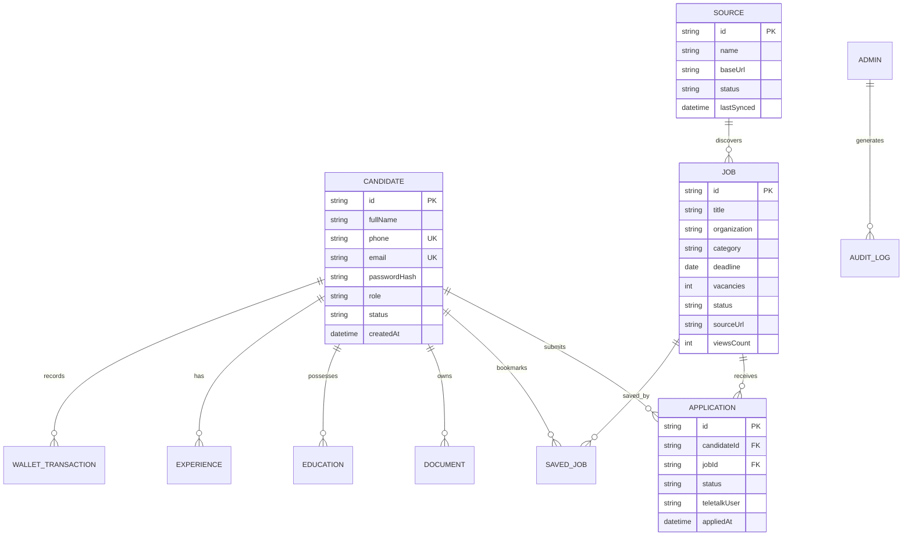

# CHAKRI SHEBA — DATABASE ARCHITECTURE & SCHEMA MAP

> **Generated:** 2026-11-08  
> **Database Engine:** File-backed `serverDB` (`src/lib/db.ts`) with Atomic Writes (`.tmp` -> `.bak` -> `.json`)  
> **Storage Location:** `src/db/local_store.json`  
> **Zero Dummy Data Status:** 100% Enforced. All mock and hardcoded metrics eliminated.

---

## 1. Core Data Collections

| Collection Name | Storage Type | Current Record Count | Primary Key | Description |
|---|---|---|---|---|
| `jobs` | Array of Objects | 74 real circulars | `id` (e.g. `job-123`) | Published and draft job circulars with positions, deadlines, and source URLs |
| `candidates` | Array of Objects | 9 verified accounts | `id` (e.g. `cand-123`) | Registered candidate profiles, contact info, and hashed credentials |
| `applications` | Array of Objects | 7 real applications | `id` (e.g. `app-123`) | Job application records, statuses (`PENDING`, `SUBMITTED`), tracking codes |
| `sources` | Array of Objects | 5 sources | `id` | Registered crawler sources (Teletalk Alljobs, BPSC, Bangladesh Bank, etc.) |
| `drafts` | Array of Objects | 7 drafts | `id` | Unprocessed or pending-review job drafts awaiting admin approval |
| `walletTransactions` | Array of Objects | Real records | `id` | Financial ledger tracking zero-fee applications and challans |
| `sessions` | Object (Key-Value) | Active tokens | Session Token Hash | Active user and admin session storage |
| `auditLogs` | Array of Objects | Append-only log | `id` | Immutable security audit trails for admin operations |
| `sitePages` | Array of Objects | Page schemas | `id` / `slug` | Page Builder configurations for customizable pages |

---

## 2. Entity-Relationship Model (Mermaid)

---

## 3. Data Integrity & Persistence Guarantees
1. **Atomic File Write Protocol:** Writes are committed to `local_store.json.tmp`, safely flushed, backed up to `local_store.json.bak`, and renamed to `local_store.json` to prevent corruption during unexpected shutdowns.
2. **Referential Integrity:**
   - Candidate deletion cleans up associated sessions, bookmarks, and documents.
   - Applications strictly reference valid `candidateId` and `jobId`.
3. **Data Freshness:** No stale caches on admin endpoints; `force-dynamic` and `Cache-Control: no-store` headers enforced on state-modifying routes.

