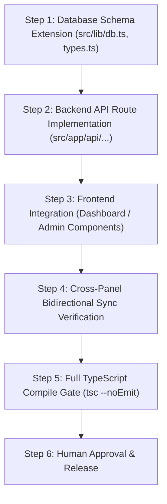

# CHAKRI SHEBA — SYSTEM DEPENDENCY & CONCURRENCY COORDINATION MAP

> **Supervised Hybrid AI Engineering System**  
> **Key Objective:** Identify shared files, concurrency boundaries, independent tasks vs. sequential tasks to prevent race conditions and merge conflicts.

---

## 1. Shared Files Matrix (High-Risk Integration Points)

The following core files are shared across multiple workstreams and **MUST NOT** be edited concurrently by multiple agents:

| Shared File / Resource | Dependent Workstreams | Coordination Policy |
|---|---|---|
| `src/lib/db.ts` | All Agents (C, D, E, B, H) | **Sequential Lock:** Single agent editing at a time; atomic commits. |
| `src/lib/types.ts` | Agents A, B, C, D, E | **Sequential Lock:** Additive changes only; zero breaking type changes. |
| `src/middleware.ts` | Agent G (Security), Agent D (Auth) | **Security Review:** Requires pre-flight verification before push. |
| `src/app/globals.css` | Agent A (Frontend), Agent F (CMS) | **Styling Quarantine:** Protect font stacks & reset rules. |
| `src/db/local_store.json` | All Agents | **Process Boundary:** All writes routed through `serverDB` singleton. Direct manual JSON editing prohibited. |

---

## 2. Independent Tasks (Safe for Parallel Execution)

The following workstreams and tasks touch isolated module trees and may be executed concurrently:

1. **Workstream A (Frontend UI Testing & Responsive Verification):**
   - Testing `/jobs`, `/about`, `/contact` pages in Playwright.
   - Adjusting isolated page layout styles in `src/app/(public)/`.
2. **Workstream F (CMS Visual Page Builder Features):**
   - Testing template blocks in `src/components/admin/builder/blocks/`.
   - Adding new block presets in `src/components/admin/builder/presets/`.
3. **Workstream E (Job Automation & Spider Feeds):**
   - Testing spider parsers in `src/lib/spider/` and `src/app/api/admin/spider/`.
   - Running circular draft extractors against test circulars.
4. **Workstream H (Performance Profiling):**
   - Measuring TTFB and profiling API payload sizes in read-only mode.
5. **Workstream I (Browser QA Journeys):**
   - Running read-only automated user journey tests with Playwright.

---

## 3. Sequential Tasks (Requiring Explicit Coordination)

The following tasks require step-by-step sequential execution:

### Dependency Rules:
- **Rule 1:** Frontend components must never be deployed before the corresponding backend API endpoint is live and verified with HTTP 200/201.
- **Rule 2:** Database migrations or collection structural changes must be executed and validated before APIs begin reading/writing to the new structure.
- **Rule 3:** User/Admin sync repairs require simultaneous verification of both `/api/profile` (candidate side) and `/api/admin/candidates/[id]` (admin side).
