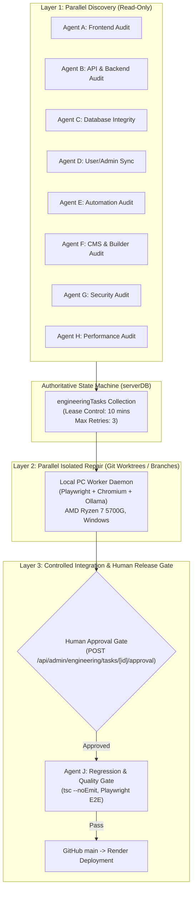

# CHAKRI SHEBA — MASTER PARALLEL AUTONOMOUS ENGINEERING EXECUTION PLAN

> **Version:** 1.0  
> **Mode:** Parallel Supervised Autonomy  
> **Target Scope:** Entire Chakri Sheba Platform (168 APIs, 104 Page Routes, 44 Database Collections)  
> **Runtime Environment:** Windows Local Worker (Playwright + Chromium + Ollama) + GitHub + Render  
> **Primary Rule:** Inspect Before Modifying — Zero Unverified Code — 100% Free for Job Seekers  

---

## 1. Executive Mission & Boundaries

The mission is to audit, repair, integrate, test, and stabilize the existing Chakri Sheba production platform. We are improving, hardening, and coordinating the existing codebase — not replacing it.

### Non-Negotiable Engineering Ground Rules:
1. **Preserve Production Records:** Never reset, drop, or truncate database records in `src/db/local_store.json`.
2. **Zero Dummy Data:** All tests and live views must operate against canonical records.
3. **No UI Masks for Backend Flaws:** Always repair the authoritative data layer and backend route.
4. **Permanent Free Model:** Chakri Sheba core job seeking and application tracking remains 100% free.
5. **Brand & Typography Integrity:** Protect Bengali fonts (`SolaimanLipi`, `Noto Sans Bengali`) and identity colors (`#006a4e`, `#064e3b`).

---

## 2. Master Orchestrator Architecture

Central control is divided into three coordinated execution layers:

---

## 3. Parallel Specialized Agents (A through J)

| Agent | Workstream Domain | Core Responsibility | Write Permission |
|---|---|---|---|
| **Agent A** | Frontend Engineering | Public pages, responsive layouts, forms, buttons, SolaimanLipi typography | Scoped isolated branch |
| **Agent B** | Backend Engineering | API routes, request validation, dynamic route handlers, JSON contracts | Scoped isolated branch |
| **Agent C** | Database & Integrity | `local_store.json` integrity, orphan checks, relational consistency | Read-only / Supervised migration |
| **Agent D** | User/Admin Sync | Candidate profile <-> Admin Workspace bidirectional synchronization | Scoped isolated branch |
| **Agent E** | Job Automation | Spiders, collectors, sources registry, deadline engine | Scoped isolated branch |
| **Agent F** | CMS & Page Builder | Page creation, dynamic slug routes `/[...slug]`, block renderer | Scoped isolated branch |
| **Agent G** | Security & Auth | Middleware gate, token expiration, impersonation protection, RBAC | Supervised approval required |
| **Agent H** | Performance | Latency measurement, TTFB, force-dynamic headers, asset payloads | Scoped isolated branch |
| **Agent I** | Browser QA | Playwright automated journeys, real browser screenshots, console audit | Read-only test execution |
| **Agent J** | Integration & Regression | Cross-module conflict checks, `tsc --noEmit`, release readiness | Gatekeeper / Merging |

---

## 4. Hardware Profile & Adaptive Concurrency

* **Host Machine:** AMD Ryzen 7 5700G (8 Cores, 16 Threads, AVX2 support).
* **RAM Allocation:** 8GB dedicated ceiling for engineering tasks.
* **Concurrency Rules:**
  - Maximum **1 active local browser session** at any time.
  - Maximum **1 local Ollama inference task** at a time.
  - Read-only code inspections and API probes may run up to 3 parallel HTTP tasks.
  - If memory spikes, tasks queue automatically in `serverDB.engineeringTasks`.

---

## 5. Phase-by-Phase Roadmap

1. **Phase 0:** Project Safety Checkpoint & Git Status Baseline *(Completed)*.
2. **Phase 1:** Complete Codebase, Route & Database Discovery *(Completed)*.
3. **Phase 2:** Parallel Read-Only System Audit across 10 Workstreams *(Active)*.
4. **Phase 3:** Issue & Dependency Mapping *(Active)*.
5. **Phase 4:** Prioritized Repair Planning (P0 -> P1 -> P2 -> P3).
6. **Phase 5:** Parallel Isolated Repairs via Local Worker.
7. **Phase 6:** Database & API Consistency Verification.
8. **Phase 7:** User / Admin 360-Degree Integration.
9. **Phase 8:** Job Automation & CMS Integration.
10. **Phase 9:** Frontend, Typography & Responsive Repairs.
11. **Phase 10:** Security & Performance Review.
12. **Phase 11:** Integration & Conflict Resolution.
13. **Phase 12:** Full End-to-End Regression Testing.
14. **Phase 13:** Human Release Approval Signoff.
15. **Phase 14:** GitHub main push & Render Deployment Readiness.
16. **Phase 15:** Post-Deployment Production Verification.
