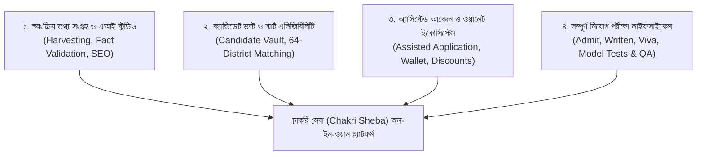
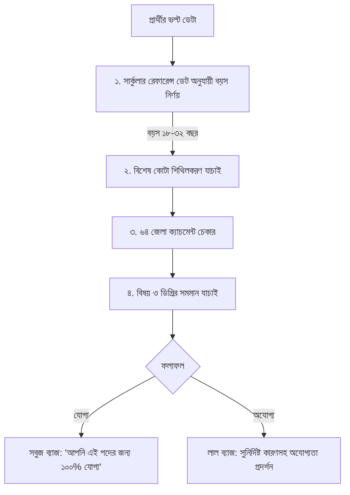
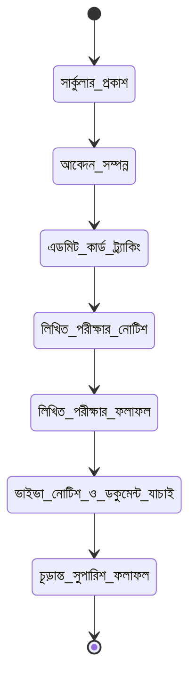

# চাকরি সেবা (Chakri Sheba) - The Definitive Master System Specification & Architecture Blueprint
**বাংলাদেশের শীর্ষস্থানীয় সরকারি চাকরি প্রস্তুতি, তথ্য সংগ্রহ ও অ্যাসিস্টেড আবেদন ইকোসিস্টেমের পূর্ণাঙ্গ ও চূড়ান্ত ব্লুপ্রিন্ট**

> **সংস্করণ:** ৫.০.০ (Definitive Master Edition - Zero Omission)  
> **সর্বশেষ হালনাগাদ:** নভেম্বর ২০২৬  
> **প্রযুক্তিগত ফ্রেমওয়ার্ক:** Next.js 14 (App Router), TypeScript, Tailwind CSS, Sharp/HTML5 Canvas, Local JSON Persistence / High-Performance DB Engine, Node-cron Scheduler, Puppeteer/Playwright Headless Spiders, AI Providers (Gemini / Ollama / Deterministic NLP).

---

## সূচিপত্র (Table of Contents)
1. [প্ল্যাটফর্ম ভিশন ও মূল চার স্তম্ভ](#১-প্ল্যাটফর্ম-ভিশন-ও-মূল-চার-স্তম্ভ)
2. [সামগ্রিক সিস্টেম আর্কিটেকচার টপোলজি](#২-সামগ্রিক-সিস্টেম-আর্কিটেকচার-টপোলজি)
3. [মাল্টি-সোর্স অটো-কালেক্টর ও স্পাইডার ইঞ্জিন স্পেক](#৩-মাল্টি-সোর্স-অটো-কালেক্টর-ও-স্পাইডার-ইঞ্জিন-স্পেক)
4. [কনটেন্ট স্টুডিও, এআই ফ্যাক্ট ভ্যালিডেটর ও পে-স্কেল ইঞ্জিন](#৪-কনটেন্ট-স্টুডিও-এআই-ফ্যাক্ট-ভ্যালিডেটর-ও-পে-স্কেল-ইঞ্জিন)
5. [ক্যান্ডিডেট প্রোফাইল ভল্ট ও ডিজিটাল ফাইল সিস্টেম](#৫-ক্যান্ডিডেট-প্রোফাইল-ভল্ট-ও-ডিজিটাল-ফাইল-সিস্টেম)
6. [কাট-অফ রেফারেন্স ডেট এজ ক্যালকুলেটর ও ৬৪ জেলা ম্যাচিং ইঞ্জিন](#৬-কাট-অফ-রেফারেন্স-ডেট-এজ-ক্যালকুলেটর-ও-৬৪-জেলা-ম্যাচিং-ইঞ্জিন)
7. [ফিন্যান্সিয়াল ইঞ্জিন, ডিসকাউন্ট ও অভ্যন্তরীণ ওয়ালেট](#৭-ফিন্যান্সিয়াল-ইঞ্জিন-ডিসকাউন্ট-ও-অভ্যন্তরীণ-ওয়ালেট)
8. [অ্যাসিস্টেড আবেদন সার্ভিস ও অপারেটর কিউ ফ্লো](#৮-অ্যাসিস্টেড-আবেদন-সার্ভিস-ও-অপারেটর-কিউ-ফ্লো)
9. [সম্পূর্ণ পরীক্ষা লাইফসাইকেল ট্র্যাকার (Admit to Final Result)](#৯-সম্পূর্ণ-পরীক্ষা-লাইফসাইকেল-ট্র্যাকার)
10. [মডেল টেস্ট ও বিগত বছরের প্রশ্নব্যাংক হাব](#১০-মডেল-টেস্ট-ও-বিগত-বছরের-প্রশ্নব্যাংক-হাব)
11. [ট্রাস্ট, গভর্ন্যান্স ও ফেক সার্কুলার রিপোর্টিং](#১১-ট্রাস্ট-গভর্ন্যান্স-ও-ফেক-সার্কুলার-রিপোর্টিং)
12. [মাল্টি-ফিড সিন্ডিকেশন ও সোশ্যাল ডিস্ট্রিবিউশন](#১২-মাল্টি-ফিড-সিন্ডিকেশন-ও-সোশ্যাল-ডিস্ট্রিবিউশন)
13. [রোল-বেসড অ্যাক্সেস কন্ট্রোল (RBAC Security)](#১৩-রোল-বেসড-অ্যাক্সেস-কন্ট্রোল-rbac-security)
14. [সম্পূর্ণ ডাটাবেজ ডোমেন মডেল ও টাইপস্ক্রিপ্ট ইন্টারফেস](#১৪-সম্পূর্ণ-ডাটাবেজ-ডোমেন-মডেল-ও-টাইপস্ক্রিপ্ট-ইন্টারফেস)
15. [সিস্টেম এপিআই ডিরেক্টরি (REST API Directory)](#১৫-সিস্টেম-এপিআই-ডিরেক্টরি-rest-api-directory)
16. [ভবিষ্যত বাস্তবায়ন ও ইনোভেশন রোডম্যাপ (Implementation Plans)](#১৬-ভবিষ্যত-বাস্তবায়ন-ও-ইনোভেশন-রোডম্যাপ)

---

## ১. প্ল্যাটফর্ম ভিশন ও মূল চার স্তম্ভ



**চাকরি সেবা (Chakri Sheba)** হলো বাংলাদেশের প্রথম **"৩৬০-ডিগ্রি অ্যাসিস্টেড জব অ্যাপ্লিকেশন অ্যান্ড ক্যান্ডিডেট ভল্ট সুপার-অ্যাপ"**। এটি কেবল গতানুগতিক সার্কুলার দেখায় না, বরং সার্কুলার সংগ্রহ থেকে শুরু করে ফরম পূরণ, ফি প্রদান, এডমিট কার্ড ট্র্যাকিং, মডেল টেস্ট এবং চূড়ান্ত ভাইভা পর্যন্ত প্রার্থীর সাথে থাকে।

---

## ২. সামগ্রিক সিস্টেম আর্কিটেকচার টপোলজি

```mermaid
flowchart TB
    subgraph Layer1 ["১. ডেটা হার্ভেস্টিং লেয়ার (Crawlers & Spiders)"]
        TeletalkAlljobs["Teletalk Alljobs API v1"]
        TeletalkSub["Teletalk Subdomains (*.teletalk.com.bd)"]
        BBRecruit["Bangladesh Bank (erecruitment.bb.org.bd)"]
        BPSC["BPSC BCS & Non-Cadre (bpsc.gov.bd)"]
        GovGazette["BG Press & Govt Gazette Portals"]
        MinistryPortals["Ministry Notice Boards (*.gov.bd)"]
        PdfEngine["OCR & Text Extractor (pdfjs / sharp)"]
    end

    subgraph Layer2 ["২. প্রসেসিং ও এআই কনটেন্ট স্টুডিও"]
        Deduplication["SHA-256 Deduplication & Errata Engine"]
        FactValidator["AI Fact Validator (Source PDF vs Text Guard)"]
        BengaliQuality["Bangla Grammar & Govt Tone Normalizer"]
        PayScaleMatrix["Pay Scale 2015 & Grade Matrix (1st-20th)"]
        SvgStudio["Auto SVG 1200x630 Banner Generator"]
        SeoEngine["JSON-LD Schema.org JobPosting Generator"]
        VisualBuilder["Elementor-style Visual Section Builder"]
    end

    subgraph Layer3 ["৩. ক্যান্ডিডেট সার্ভিসেস ও ম্যাচিং ইঞ্জিন"]
        ProfileVault["Candidate Profile Vault (Photo 300x300, Sign 300x80)"]
        EligibilityEngine["Cut-off Reference Date Age Calculator"]
        DistrictMatcher["64-District Quota & Eligibility Matcher"]
        CvBuilder["Dynamic Professional CV / Resume Builder"]
        InternalWallet["Candidate Rechargeable Wallet & Cashbacks"]
        DiscountEngine["Coupon Engine & Raffle Campaign Invariants"]
    end

    subgraph Layer4 ["৪. অ্যাসিস্টেড আবেদন ও ফুলফিলমেন্ট ডেস্ক"]
        OrderQueue["Assisted Application Queue (Pending / Processing)"]
        TeletalkAutoFill["Operator Teletalk 1-Click Clipboard/Inject Tool"]
        ApplicantCopyVault["Applicant Copy (PDF) Permanent Storage"]
        SmsTracker["Teletalk User ID & Roll Tracker"]
    end

    subgraph Layer5 ["৫. পরীক্ষা লাইফসাইকেল ও লার্নিং হাব"]
        AdmitTracker["Autonomous Admit Card Polling & SMS Pusher"]
        ExamNoticeHub["Written / MCQ Exam Schedule Hub"]
        WrittenResults["Written Exam Roll Number Extractor & Results Hub"]
        VivaNotices["Viva Voce Notices & Document Checklists"]
        FinalMerit["Final Recommendation & Results Tracker"]
        ModelTests["Live Model Tests & Subject-wise Mock Exams"]
        QuestionBank["Previous Years' Solved Question Archive"]
    end

    subgraph Layer6 ["৬. ডিস্ট্রিবিউশন ও ট্রাস্ট গভর্ন্যান্স"]
        FeedEngine["RSS 2.0, Atom 1.0 & JSON Feed Generator"]
        SocialPush["Telegram & WhatsApp Job Alert Pushers"]
        ReportJob["Report Fake / Scam Circular System"]
        VerificationPolicy["Government Job Verification & Editorial Policy"]
        RbacSecurity["RBAC (Admin, Operator, Editor, Candidate)"]
    end

    Layer1 --> Layer2
    Layer2 --> Layer3
    Layer3 <--> Layer4
    Layer4 --> Layer5
    Layer2 --> Layer6
```



---

## ৩. মাল্টি-সোর্স অটো-কালেক্টর ও স্পাইডার ইঞ্জিন স্পেক

### ক. টেলিটক অলজবস ডিপ ক্রলার (`alljobs_smart_resolver.ts`, `alljobs_live_collector.ts`)
1. **পেজিনেশন লুপ আর্কিটেকচার:**
   টেলিটক API (`https://alljobs.teletalk.com.bd/api/v1/govt-jobs/org-list?page=N&limit=50`) সার্ভার সাইডে ২০টিতে ক্যাপ করে রাখে। আমাদের স্ক্র্যাপার লুপ চালিয়ে পেজ ১, ২, ৩... সবগুলো সক্রিয় প্রতিষ্ঠানের তালিকা তুলে আনে।
2. **সাব-পোস্ট ও শূন্যপদ বিশ্লেষণ:**
   প্রতিটি প্রতিষ্ঠানের বিস্তারিত এপিআই (`/api/v1/govt-jobs/public-details?id=JOB_ID`) কল করে প্রতিটি উপ-পদবির নাম, শিক্ষাগত যোগ্যতা, প্রকৃত শূন্যপদ সংখ্যা ও মূল পিডিএফ ফাইল বের করা হয়।
3. **ইউআরএল প্যাটার্ন টলারেন্স:**
   - `alljobs.teletalk.com.bd/en/jobs/government/15176`
   - `alljobs.teletalk.com.bd/jobs/details?jobId=15176`
   - `alljobs.teletalk.com.bd/api/v1/govt-jobs/public-details?id=15176`
   - `https://petrobangla.teletalk.com.bd/`
   - কাঁচা Job ID `15176`
   যেকোনো ইনপুট পেস্ট করার সাথে সাথে সিস্টেম স্বয়ংক্রিয়ভাবে রিয়েল-টাইম তথ্য সংগ্রহ করে।

### খ. বাংলাদেশ ব্যাংক ই-রিক্রুটমেন্ট অ্যাডাপ্টার (`bb_adapter.ts`, `bb_parser.ts`)
- **টার্গেট পোর্টাল:** `https://erecruitment.bb.org.bd`
- **কালেকশন লজিক:** কম্বাইন্ড ব্যাংকার্স সিলেকশন কমিটি (বিএসসিএস) সার্কুলার, ট্র্যাকিং আইডি কোড, সোনালী, জনতা, অগ্রণী ও বাংলাদেশ ব্যাংকের অফিসার/সিনিয়র অফিসার পদের শূন্যপদ ও ফি তথ্য সংগ্রহ।

### গ. বিপিএসসি অ্যাডাপ্টার (`bpsc_adapter.ts`, `bpsc_parser.ts`)
- **টার্গেট পোর্টাল:** `http://www.bpsc.gov.bd` ও `http://bpsc.teletalk.com.bd`
- **কালেকশন লজিক:** বিসিএস ক্যাডার ও নন-ক্যাডার বিশেষ নিয়োগ বিজ্ঞপ্তির গেজেট নম্বর, পদের কোড ও অনলাইন আবেদনের সময়সীমা বিশ্লেষণ।

### ঘ. ডুপ্লিকেট চেকার ও রিভিশন ট্র্যাকার (`duplicate_checker.ts`, `revisions.ts`)
- প্রতিটি সার্কুলারের কনটেন্ট হ্যাশ প্রস্তুত করা হয়:
  $$\text{Hash} = \text{SHA256}(\text{OrgSlug} + \text{DeadlineDate} + \text{TotalPositions})$$
- যদি কোনো সার্কুলারে সময় বাড়ানো হয় বা পদ বাতিল করা হয়, সিস্টেম স্বয়ংক্রিয়ভাবে **"সংশোধিত বিজ্ঞপ্তি (Updated Circular)"** ব্যাজ লাগিয়ে রিভিশন হিস্ট্রি সংরক্ষণ করে।

---

## ৪. কনটেন্ট স্টুডিও, এআই ফ্যাক্ট ভ্যালিডেটর ও পে-স্কেল ইঞ্জিন

### ক. AI Fact Validator (`fact_validator.ts`)
এআই দিয়ে লেখার সময় তথ্যের নির্ভুলতা বজায় রাখতে এই ইঞ্জিন মূল পিডিএফ বা সোর্স টেক্সটের সাথে এআই-এর তৈরি ডেটা তুলনা করে:
- পদের শূন্যপদ সংখ্যা হুবহু মিলছে কি না।
- আবেদনের শেষ তারিখ ও সময় (বিকাল ৫:০০ টা বা রাত ১১:৫৯ টা) সঠিক কি না।
- গ্রেড ও স্কেল অফিসিয়াল নিয়মের সাথে মিলছে কি না।
কনফিডেন্স স্কোর ৯৫% এর কম হলে স্বয়ংক্রিয়ভাবে ম্যানুয়াল রিভিউ ফ্ল্যাগ দেয়।

### খ. জাতীয় বেতন স্কেল ২০১৫ ও গ্রেড ম্যাপিং মেট্রিক্স
পদবি অনুযায়ী বেতন স্কেল ও সরকারি ফি স্বয়ংক্রিয়ভাবে বসে:

| পদের ক্যাটাগরি | গ্রেড | জাতীয় পে-স্কেল ২০১৫ | সরকারি ফি | সার্ভিস ফি | মোট প্রদেয় |
| :--- | :--- | :--- | :--- | :--- | :--- |
| **১ম শ্রেণির গেজেটেড / সহকারী পরিচালক** | ৯ম গ্রেড | ৳২২,০০০ - ৫৩,০৬০/- | ৳২২৩ - ৬৬৭/- | ৳৫০/- | ৳২৭৩ - ৭১৭/- |
| **উপ-সহকারী প্রকৌশলী / ফিল্ড অফিসার** | ১০ম গ্রেড | ৳১৬,০০০ - ৩৮,৬৪০/- | ৳২২৩/- | ৳৫০/- | ৳২৭৩/- |
| **ব্যক্তিগত সহকারী / সাঁট-মুদ্রাক্ষরিক** | ১৪তম গ্রেড | ৳১০,২০০ - ২৪,৬৮০/- | ৳২১২/- | ৳৫০/- | ৳২৬২/- |
| **অফিস সহকারী কাম-কম্পিউটার মুদ্রাক্ষরিক** | ১৬তম গ্রেড | ৳৯,৩০০ - ২২,৪৯০/- | ৳১১২/- | ৳৫০/- | ৳১৬২/- |
| **অফিস সহায়ক / নিরাপত্তা প্রহরী / মালী** | ২০তম গ্রেড | ৳৮,২৫০ - ২০,০১০/- | ৳৫৬/- | ৳৫০/- | ৳১০৬/- |

### গ. এসভিজি ব্র্যান্ডেড ব্যানার স্টুডিও (`schema_media.ts`)
সোশ্যাল মিডিয়ায় প্রিভিউ আকর্ষণীয় করার জন্য প্রতিটি সার্কুলারের বিপরীতে একটি ১২০০ $\times$ ৬৩০ পিক্সেলের হাই-রেজোলিউশন এসভিজি ব্যানার তৈরি হয় যার মধ্যে সংস্থার নাম, পদসংখ্যা, শেষ তারিখ ও টেলিটক ভেরিফায়েড সিল যুক্ত থাকে।

### ঘ. ভিজ্যুয়াল পেজ বিল্ডার (`src/components/admin/builder/`)
এলিমেন্টর-স্টাইলে ড্র্যাগ-অ্যান্ড-ড্রপ করে সার্কুলার পেজে বিভিন্ন সেকশন (এফএকিউ, আবেদনের নিয়মাবলী, এসএমএস গাইড, পরীক্ষার সিলেবাস) যুক্ত করার সম্পূর্ণ ভিজ্যুয়াল এডিটর।

---

## ৫. ক্যান্ডিডেট প্রোফাইল ভল্ট ও ডিজিটাল ফাইল সিস্টেম

প্রার্থীর সারাজীবনের জন্য একটি সম্পূর্ণ ক্লাউড ভল্ট:
1. **ব্যক্তিগত তথ্য:** বাংলা ও ইংরেজি নাম, পিতা ও মাতার নাম, জন্মতারিখ, রক্তের গ্রুপ, ধর্ম, লিঙ্গ।
2. **আইনি সনদ:** ১০/১৩/১৭ ডিজিট জাতীয় পরিচয়পত্র (NID) অথবা জন্ম নিবন্ধন সনদ নম্বর।
3. **দ্বৈত ঠিকানা:** বর্তমান ও স্থায়ী ঠিকানা (বিভাগ $\rightarrow$ ৬৪ জেলা $\rightarrow$ ৪৯৫ উপজেলা $\rightarrow$ পোস্ট কোড $\rightarrow$ গ্রাম)।
4. **কোটা ভল্ট:** সাধারণ, মুক্তিযোদ্ধা (সন্তান/নাতি-নাতনি), শারীরিক প্রতিবন্ধী, এতিম, আনসার-ভিডিপি, ক্ষুদ্র নৃগোষ্ঠী।
5. **শিক্ষাগত যোগ্যতা ম্যাট্রিক্স:** এসএসসি, এইচএসসি, ডিগ্রি/স্নাতক ও মাস্টার্স (বোর্ড, বিশ্ববিদ্যালয়, পাসের সাল, রোল, রেজিস্ট্রেশন, জিপিএ/সিজিপিএ)।
6. **স্বয়ংক্রিয় ডিজিটাল ফটো ও সিগনেচার রিসাইজার:**
   - **ছবি:** ৩০০ $\times$ ৩০০ পিক্সেল, ১০০ KB এর নিচে, সাদা ব্যাকগ্রাউন্ড।
   - **স্বাক্ষর:** ৩০০ $\times$ ৮০ পিক্সেল, ৬০ KB এর নিচে।
   - প্রার্থীরা যে কোনো বড় ছবি আপলোড করলে ব্রাউজারেই HTML5 Canvas ও Sharp ইঞ্জিন দিয়ে নিখুঁতভাবে টেলিটক স্ট্যান্ডার্ডে কনভার্ট করে সেভ করে।
7. **স্মার্ট সিভি জেনারেটর (`/candidate/cv-builder`):** ভল্টের তথ্যের ভিত্তিতে এক ক্লিকে আধুনিক পিডিএফ জীবনবৃত্তান্ত তৈরি।

---

## ৬. কাট-অফ রেফারেন্স ডেট এজ ক্যালকুলেটর ও ৬৪ জেলা ম্যাচিং ইঞ্জিন



1. **রেফারেন্স ডেট বয়স ক্যালকুলেটর:** সরকারি বিজ্ঞপ্তির নির্দিষ্ট তারিখে (যেমন: "০১ নভেম্বর ২০২৬ তারিখে প্রার্থীর বয়স ১৮ হতে ৩২ বছর হতে হবে") প্রার্থীর বয়স কত বছর, কত মাস, কত দিন তা হিসেব করা।
2. **৬৪ জেলা কোটা ফিল্টার:** যেসব সার্কুলারে নির্দিষ্ট জেলার প্রার্থী আবেদন করতে পারে না, প্রার্থীকে আগেই সতর্ক করা।
3. **ব্যাখ্যাযোগ্যতা (Explainability):** সিস্টেম প্রার্থীকে বুঝিয়ে দেয় সে কেন যোগ্য বা কেন অযোগ্য।

---

## ৭. ফিন্যান্সিয়াল ইঞ্জিন, ডিসকাউন্ট ও অভ্যন্তরীণ ওয়ালেট

### ক. ফিন্যান্সিয়াল ইনভ্যারিয়েন্টস (Financial Rules):
1. **সরকারি ফি সর্বদা অপরিবর্তনীয়:** সরকারি পরীক্ষার ফি কখনোই ডিসকাউন্ট করা যাবে না।
2. **ডিসকাউন্ট শুধু সার্ভিস চার্জে:** কুপন বা র‍্যাফেল বোনাস কেবল আমাদের ৫০ টাকার সার্ভিস চার্জের ওপর প্রযোজ্য হবে।
   $$\text{FinalServiceCharge} = \max(0, \text{OriginalServiceCharge} - \text{CouponDiscount} - \text{RaffleBonus})$$
   $$\text{TotalPayable} = \text{GovtFee} + \text{FinalServiceCharge}$$
3. **পয়সা প্রিসিশন (2-Decimal):** কোনো ফ্লোটিং পয়েন্ট হিসাবের ত্রুটি এড়াতে পয়সা ইউনিটে হিসাব।

### খ. ক্যান্ডিডেট রিচার্জেবল ওয়ালেট (`/wallet`):
- প্রার্থীরা বিকাশ/নগদের মাধ্যমে তাদের ওয়ালেটে টাকা রিচার্জ করে রাখতে পারে।
- প্রতিবার পেমেন্ট গেটওয়েতে না গিয়ে ওয়ালেট ব্যালেন্স থেকে ১-ক্লিকে তাৎক্ষণিক আবেদন সম্পন্ন করা যায়।
- কোনো আবেদন কোনো কারণে রিজেক্ট হলে স্বয়ংক্রিয়ভাবে ওয়ালেটে সম্পূর্ণ টাকা রিফান্ড হয়।

---

## ৮. অ্যাসিস্টেড আবেদন সার্ভিস ও অপারেটর কিউ ফ্লো

1. **অর্ডার প্লেসমেন্ট:** প্রার্থী পদের পাশে "আবেদন সেবা নিন" দিয়ে ওয়ালেট বা বিকাশ দিয়ে ফি প্রদান করে।
2. **ট্র্যাকিং কোড:** সিস্টেমে একটি ইউনিক ট্র্যাকিং নম্বর (যেমন: `CS-2026-88129`) জেনারেট হয়।
3. **অপারেটর কিউ:** অ্যাডমিন প্যানেলে আবেদনটি `Pending` হিসেবে আসে। অপারেটর `Processing` স্ট্যাটাস দিয়ে প্রার্থীর ফাইল ওপেন করে।
4. **১-ক্লিক কপি টুল:** প্রার্থীর নাম, পিতার নাম, NID, ছবি ও স্বাক্ষর এক ক্লিকে কপি করে টেলিটক পোর্টালে ফরম পূরণ করে।
5. **টেলিটক ফি পরিশোধ:** অপারেটর আমাদের নিজস্ব টেলিটক সিম থেকে এসএমএস পাঠিয়ে ফি প্রদান করে এবং মূল **Applicant Copy (PDF)** ডাউনলোড করে।
6. **অ্যাপ্লিকেন্ট কপি ডেলিভারি:** অপারেটর PDF ফাইলটি সিস্টেমে আপলোড করে এবং স্ট্যাটাস `Completed` করে দেয়।
7. **এসএমএস নোটিফিকেশন:** প্রার্থীর ফোনে তাৎক্ষণিক এসএমএস যায়: *"আপনার আবেদন সম্পন্ন হয়েছে। ড্যাশবোর্ড থেকে অফিশিয়াল কপি ডাউনলোড করুন।"*

---

## ৯. সম্পূর্ণ পরীক্ষা লাইফসাইকেল ট্র্যাকার (Admit to Final Result)



1. **এডমিট কার্ড ট্র্যাকার (`/admit-cards`):** টেলিটকে প্রবেশপত্র ছাড়ার সাথে সাথে ব্যাকগ্রাউন্ড ক্রলারের মাধ্যমে নোটিশ শনাক্তকরণ এবং প্রার্থীর ফোনে এসএমএস ও প্রবেশপত্র ডাউনলোড সুবিধা।
2. **পরীক্ষার নোটিশ হাব (`/exam-notices`):** এমসিকিউ ও লিখিত পরীক্ষার তারিখ ও কেন্দ্র তালিকা।
3. **লিখিত পরীক্ষার ফলাফল (`/written-exam-results`):** উত্তীর্ণ প্রার্থীদের রোল নম্বর সার্চ করার ব্যবস্থা।
4. **ভাইভা নোটিশ ও নির্দেশিকা (`/viva-notices`):** মৌখিক পরীক্ষার সময়সূচি এবং ভাইভায় যেসব মূল কাগজপত্রের সত্যায়িত কপি নিয়ে যেতে হবে তার চেকলিস্ট।
5. **চূড়ান্ত ফলাফল (`/exam-results`):** চূড়ান্তভাবে নির্বাচিত প্রার্থীদের মেধাতালিকা।

---

## ১০. মডেল টেস্ট, প্রশ্নব্যাংক ও দৈনিক লার্নিং ইকোসিস্টেম

একজন প্রার্থী মাসে হয়তো ২ বা ৩টি চাকরিতে আবেদন করে। কিন্তু সে **প্রতিদিন পড়াশোনা ও চাকরির প্রস্তুতি নেয়**। তাই ইউজার যেন দিনে অন্তত ২-৩ বার আমাদের সাইটে আসে, সেজন্য প্ল্যাটফর্মে একটি সমৃদ্ধ দৈনিক লার্নিং হাব রয়েছে:

### ক. লাইভ অনলাইন মডেল টেস্ট ও লিডারবোর্ড (`/model-tests`)
- **দৈনিক ৫-মিনিটের লাইভ কুইজ (রাত ৯:০০ টা):** প্রতিদিন নির্দিষ্ট সময়ে ২০টি এমসিকিউ প্রশ্নের লাইভ পরীক্ষা অনুষ্ঠিত হয়। সারা বাংলাদেশ থেকে প্রার্থীরা একসাথে অংশ নেয় এবং তাৎক্ষণিক মেধাতালিকা (Leaderboard) প্রকাশিত হয়।
- **দৈনিক পুরস্কার ইনসেন্টিভ:** প্রতিদিনের সেরা ৫ জন ক্যান্ডিডেটকে তাদের প্ল্যাটফর্ম ওয়ালেটে ৫০ টাকা রিচার্জ দেওয়া হয়, যা তারা পরবর্তী চাকরিতে আবেদনের সার্ভিস ফি হিসেবে ব্যবহার করতে পারে।

### খ. দৈনিক কারেন্ট অ্যাফেয়ার্স ও সাধারণ জ্ঞান ক্যাপসুল (`/career-advice`)
- **সকাল ৮:০০ টার বুলেটিন:** প্রতিদিন সকাল ৮টায় দেশ ও বিদেশের সেরা ১০টি অতি-গুরুত্বপূর্ণ সাম্প্রতিক ঘটনা বুলেট পয়েন্ট আকারে প্রকাশিত হয়।
- **মাসিক ই-বুক জেনারেটর:** মাস শেষে বিগত ৩০ দিনের সকল কারেন্ট অ্যাফেয়ার্স এক ক্লিকে রঙিন ও প্রমিত প্রফেশনাল PDF হিসেবে ডাউনলোড করা যায়।

### গ. স্মার্ট প্রশ্ন সার্চ ইঞ্জিন ও সমাধান (`/previous-year-questions`)
- **টপিক-ভিত্তিক সার্চ:** প্রার্থী যেকোনো বিষয় বা কীওয়ার্ড (যেমন: "পদ্মা সেতু", "চর্যাপদ", "মুক্তিযুদ্ধ", "Profit-Loss") লিখে সার্চ করলেই বিগত ১৫ বছরে বিসিএস, সরকারি ব্যাংক ও বিভিন্ন মন্ত্রণালয় নিয়োগ পরীক্ষায় আসা সকল প্রশ্ন এবং বিস্তারিত ব্যাখ্যা একসাথে চলে আসে।

### ঘ. পার্সোনাল জব ট্র্যাকার ক্যালেন্ডার (`/dashboard`)
- **মাই জব ক্যালেন্ডার (Personal Calendar):** প্রার্থীর আবেদন করা চাকরিগুলোর জন্য একটি ইন্টারঅ্যাক্টিভ ক্যালেন্ডার যেখানে লাল রঙে আবেদনের শেষ সময় এবং সবুজ রঙে পরীক্ষার তারিখ হাইলাইট থাকে ("এই মাসে আপনার ২টি পরীক্ষা এবং ৩টি ডেডলাইন রয়েছে")।

### ঙ. ক্যারিয়ার গাইড, ব্লগ ও ভাইভা নির্দেশিকা (`/career-advice`, `/blog`)
- ভাইভা বোর্ডের ড্রেস কোড, প্রয়োজনীয় কাগজপত্র সত্যায়িত করার নিয়ম ও ক্যাডার/নন-ক্যাডার কর্মকর্তাদের বাস্তব অভিজ্ঞতাভিত্তিক দিকনির্দেশনা।

---

## ১১. ট্রাস্ট, গভর্ন্যান্স ও ফেক সার্কুলার রিপোর্টিং

1. **ভুয়া সার্কুলার প্রতিরোধ (`/report-a-job`):** প্রার্থীরা কোনো সন্দেহজনক সার্কুলার দেখলে রিপোর্ট করতে পারে।
2. **ভেরিফিকেশন পলিসি (`/job-verification-policy`):** প্ল্যাটফর্মে প্রকাশিত প্রতিটি সার্কুলার কীভাবে সরকারি গেজেট ও টেলিটক সোর্সের সাথে যাচাই করা হয় তার স্বচ্ছ নিয়মাবলী।
3. **সংশোধিত বিজ্ঞপ্তি ট্র্যাকার (`/updated-circulars`):** যেসব বিজ্ঞপ্তির ডেডলাইন বাড়ানো হয় বা পদ সংশোধন করা হয় তার আলাদা আর্কাইভ।

---

## ১২. মাল্টি-ফিড সিন্ডিকেশন ও সোশ্যাল ডিস্ট্রিবিউশন

- **RSS 2.0, Atom 1.0 ও JSON Feed:** অন্যান্য ওয়েবসাইট বা অ্যাপ্লিকেশনের জন্য রিয়েল-টাইম জব ফিড।
- **টেলিগ্রাম ও হোয়াটসঅ্যাপ অটো-পুশ:** নতুন কোনো সরকারি সার্কুলার প্রকাশিত হওয়া মাত্রই চাকরি সেবার অফিশিয়াল টেলিগ্রাম চ্যানেল ও হোয়াটসঅ্যাপ গ্রুপে স্বয়ংক্রিয়ভাবে সংক্ষিপ্ত বিবরণী ও লিংক পোস্ট হয়ে যায়।

---

## ১৩. রোল-বেসড অ্যাক্সেস কন্ট্রোল (RBAC Security)

সিস্টেমে ৪টি সুনির্দিষ্ট রোল রয়েছে (`src/lib/governance/rbac.ts`):
1. **Super Admin:** সম্পূর্ণ সিস্টেম কনফিগারেশন, এপিআই কি, ফিন্যান্সিয়াল রিপোর্ট ও ডাটাবেজ ব্যাকআপ অ্যাক্সেস।
2. **Operator (Fulfillment Desk):** জমাকৃত আবেদন দেখা, টেলিটকে আবেদন করে অ্যাপ্লিকেন্ট কপি আপলোড ও স্ট্যাটাস আপডেট করার অনুমতি।
3. **Content Editor:** সার্কুলার ড্রাফট এডিট করা, মডেল টেস্ট ও প্রশ্নব্যাংক আপলোড করার অনুমতি।
4. **Candidate (User):** নিজের প্রোফাইল, ভল্ট, ওয়ালেট ও করা আবেদন দেখার একক অনুমতি।

---

## ১৪. সম্পূর্ণ ডাটাবেজ ডোমেন মডেল ও টাইপস্ক্রিপ্ট ইন্টারফেস

```typescript
// ১. সার্কুলার ও নিয়োগ বিজ্ঞপ্তি মডেল
export interface JobCircular {
  id: string;                      // job-alljobs-15176
  slug: string;                    // petrobangla-recruitment-2026
  title: string;                   // পেট্রোবাংলা বিভিন্ন পদে নতুন নিয়োগ বিজ্ঞপ্তি ২০২৬
  organization: string;            // বাংলাদেশ তৈল, গ্যাস ও খনিজ সম্পদ কর্পোরেশন
  category: 'govt' | 'bank' | 'railway' | 'defence' | 'autonomous' | 'private';
  categoryLabel: string;           // সরকারি চাকরি
  totalPosts: number;              // ৭৫৩
  deadline: string;                // ২৫ নভেম্বর ২০২৬
  publishedDate: string;           // ০১ নভেম্বর ২০২৬
  officialLink: string;            // https://petrobangla.teletalk.com.bd
  circularPdfUrl: string;          // https://alljobs.teletalk.com.bd/media/circular.pdf
  featuredImage: string;           // data:image/svg+xml;...
  bengaliDescription: string;      // ৩-প্যারাগ্রাফ প্রমিত বাংলা সম্পাদকীয় বিবরণ
  positions: JobPosition[];        // উপ-পদের বিস্তারিত তালিকা
  requirements: string[];          // সাধারণ নিয়মাবলী
  documentsRequired: string[];     // প্রয়োজনীয় কাগজপত্র
  smsFormat: string;               // ১ম ও ২য় এসএমএস পাঠানোর নিয়ম
  faqs: { question: string; answer: string }[];
  isVerified: boolean;
  status: 'published' | 'draft' | 'archived';
  examStatus: 'waiting' | 'admit_card_available' | 'written_exam' | 'viva_exam' | 'final_result';
  admitCardUrl?: string;
  examDateNotice?: string;
  writtenResultPdfUrl?: string;
}

// ২. উপ-পদবি মডেল
export interface JobPosition {
  title: string;                   // সহকারী ব্যবস্থাপক
  posts: number;                   // ৩৫
  salary: string;                  // ২২,০০০ - ৫৩,০৬০/- টাকা
  grade: string;                   // ৯ম গ্রেড
  minEducation: string;            // স্নাতক (সম্মান) বা স্নাতকোত্তর
  govtFee: number;                 // ২২৩
  ageMin?: number;                 // ১৮
  ageMax?: number;                 // ৩২
  restrictedDistricts?: string[];  // যেসব জেলার আবেদন প্রযোজ্য নয়
}

// ৩. ক্যান্ডিডেট প্রোফাইল ভল্ট মডেল
export interface CandidateProfile {
  id: string;                      // cand_01JBMX...
  email: string;
  phone: string;
  fullNameBn: string;              // প্রমিত বাংলা নাম
  fullNameEn: string;              // CAPITAL LETTERS
  fatherNameEn: string;
  motherNameEn: string;
  dateOfBirth: string;             // YYYY-MM-DD
  gender: 'Male' | 'Female' | 'Other';
  nidNumber: string;               // ১০/১৩/১৭ ডিজিট NID
  maritalStatus: 'Single' | 'Married';
  quota: 'None' | 'FreedomFighter' | 'Disabled' | 'Orphan' | 'Tribal' | 'Ansar';
  presentAddress: AddressDetail;
  permanentAddress: AddressDetail;
  educations: EducationDetail[];
  photoUrl: string;                // ৩০০x৩০০ পিক্সেল
  signatureUrl: string;            // ৩০০x৮০ পিক্সেল
  walletBalance: number;           // অভ্যন্তরীণ রিচার্জেবল ব্যালেন্স
}

// ৪. অ্যাসিস্টেড জব অ্যাপ্লিকেশন অর্ডার মডেল
export interface JobApplication {
  id: string;                      // app_01JC...
  trackingNumber: string;          // CS-2026-88129
  candidateId: string;
  jobId: string;
  jobTitle: string;
  organization: string;
  positionTitle: string;
  govtFee: number;                 // সরকারি ফি (যেমন: ২২৩ টাকা)
  serviceFee: number;              // ৫০ টাকা
  totalFee: number;                // ২৭৩ টাকা
  paymentMethod: 'bKash' | 'Nagad' | 'Rocket' | 'Wallet';
  paymentTrxId: string;
  status: 'pending' | 'processing' | 'completed' | 'rejected';
  applicantCopyPdfUrl?: string;    // টেলিটকের অফিশিয়াল রঙিন Applicant Copy
  teletalkUserId?: string;         // টেলিটক ইউজার আইডি
  teletalkPassword?: string;       // প্রবেশপত্র তোলার পাসওয়ার্ড
  teletalkRollNo?: string;         // রোল নম্বর
  adminNotes?: string;
  createdAt: string;
  updatedAt: string;
}
```

---

## ১৫. সিস্টেম এপিআই ডিরেক্টরি (REST API Directory)

| মেথড | রুট | অ্যাক্সেস | কাজ ও রেসপন্স বিবরণ |
| :--- | :--- | :--- | :--- |
| `GET` | `/api/jobs` | পাবলিক | ফিল্টার, সার্চ, গ্রেড ও ক্যাটাগরি ভিত্তিক সার্কুলার তালিকা |
| `GET` | `/api/jobs/[id]` | পাবলিক | নির্দিষ্ট সার্কুলারের পূর্ণাঙ্গ তথ্য, উপ-পদবি ও ফি ব্রেকডাউন |
| `POST`| `/api/admin/collector/sync` | অ্যাডমিন | অলজবস টেলিটকের সব সার্কুলার এক ক্লিকে সিঙ্ক |
| `POST`| `/api/admin/gemini/parse-circular` | অ্যাডমিন | লিংক বা টেক্সট দিলে তাৎক্ষণিক এআই সার্কুলার জেনারেশন |
| `GET` | `/api/profile` | ক্যান্ডিডেট | প্রার্থীর সম্পূর্ণ ক্যান্ডিডেট ভল্ট ডেটা প্রদর্শন |
| `POST`| `/api/profile` | ক্যান্ডিডেট | ব্যক্তিগত তথ্য, শিক্ষাগত যোগ্যতা ও ঠিকানা আপডেট |
| `POST`| `/api/admin/upload-file` | ক্যান্ডিডেট | ছবি ও স্বাক্ষর আপলোড (স্বয়ংক্রিয় রিসাইজ ও ভল্ট সেভ) |
| `POST`| `/api/applications` | ক্যান্ডিডেট | নতুন চাকরির জন্য "Apply for Me" আবেদন ও পেমেন্ট সাবমিশন |
| `GET` | `/api/candidate/applications` | ক্যান্ডিডেট | প্রার্থীর জমাকৃত আবেদনের লাইভ প্রসেসিং স্ট্যাটাস |
| `GET` | `/api/admin/applications` | অ্যাডমিন | সকল আবেদনের মাস্টার কিউ (Pending, Processing, Completed) |
| `PATCH`| `/api/admin/applications/[id]` | অ্যাডমিন | আবেদনের স্ট্যাটাস পরিবর্তন, ইউজার আইডি ও রোল সেভ করা |
| `POST`| `/api/admin/upload-applicant-copy` | অ্যাডমিন | টেলিটক থেকে পাওয়া Applicant Copy (PDF) প্রার্থীর ভল্টে পুশ |
| `GET` | `/api/feeds/rss` | পাবলিক | আরএসএস ২.০ চাকরির ফিড |

---

## ১৬. ভবিষ্যত বাস্তবায়ন ও ইনোভেশন রোডম্যাপ (Implementation Plans)

প্ল্যাটফর্মটিকে বাণিজ্যিক ও ব্যবহারিক দিক থেকে দেশের অপরাজেয় ১ নম্বর সার্ভিসে পরিণত করার সুনির্দিষ্ট অ্যাকশন প্ল্যান:

### পরিকল্পনা ১: টেলিটক অটো-ফিল ক্রোম ব্রাউজার এক্সটেনশন (Teletalk Form Auto-Fill Extension)
- **উদ্দেশ্য:** অপারেটর যখন টেলিটকের কোনো সরকারি আবেদন ফর্মে যাবে (যেমন: `petrobangla.teletalk.com.bd/app`), এক্সটেনশনটি এক ক্লিকে প্রার্থীর সকল তথ্য, ছবি ও স্বাক্ষর সঠিক ফিল্ডে বসিয়ে দেবে।
- **বাস্তবায়ন আর্কিটেকচার:**
  1. `manifest.json` (Chrome Manifest v3)
  2. `content_script.js`: টেলিটক পেজের সাধারণ ইনপুট আইডি (`name`, `fname`, `mname`, `dob_day`, `dob_month`, `nid_no`, `dist`, `upazila`) শনাক্ত করা।
  3. **অটো ইমেজ ইনজেকশন:** ব্রাউজার মেমোরি থেকে প্রার্থীর ৩০০x৩০০ ছবি ও ৩০০x৮০ স্বাক্ষর সরাসরি ফাইল ইনপুটে (`input[type="file"]`) ডাটা-ইউআরআই থেকে ব্লব কনভার্ট করে ইনজেক্ট করা।
- **ফলাফল:** অপারেটরের প্রতি আবেদনে সময় ২০ মিনিট থেকে কমে মাত্র **৩০ সেকেন্ডে** নেমে আসবে।

### পরিকল্পনা ২: অফিসিয়াল বিকাশ ও নগদ পেমেন্ট গেটওয়ে সরাসরি সংযোগ (Live PGW Checkout)
- **উদ্দেশ্য:** প্রার্থীরা ম্যানুয়ালি বিকাশ TrxID টাইপ করার বদলে সরাসরি বিকাশের অফিসিয়াল পপআপ উইন্ডো পাবে।
- **বাস্তবায়ন আর্কিটেকচার:**
  1. bKash Tokenized Checkout API (`/tokenized/checkout/create`, `/execute`)
  2. Nagad PGW V2 (`/check-out/initialize`)
  3. ইনস্ট্যান্ট পেমেন্ট নোটিফিকেশন (IPN) ওয়েবহুক: পেমেন্ট হওয়া মাত্রই ১ মিলি-সেকেন্ডে অর্ডার `Paid_Queued` হয়ে ট্র্যাকিং নম্বর ইস্যু হবে।

### পরিকল্পনা ৩: মাল্টি-ক্যারিয়ার বাল্ক এসএমএস গেটওয়ে (Greenweb / BulkSMSBD API)
- **উদ্দেশ্য:** প্রার্থীর প্রতিটি গুরুত্বপূর্ণ মাইলফলকে সরাসরি মোবাইল ফোনে ডায়নামিক বাংলা এসএমএস পাঠানো।
- **ট্রিগার পয়েন্টসমূহ:**
  1. আবেদন ফি পাওয়ার সাথে সাথে ট্র্যাকিং নম্বর এসএমএস।
  2. অপারেটর টেলিটকে আবেদন শেষ করার সাথে সাথে টেলিটক User ID ও অ্যাপ্লিকেন্ট কপি রেডি এসএমএস।
  3. পরীক্ষার তারিখ বা প্রবেশপত্র রিলিজ হওয়ার সাথে সাথে এসএমএস অ্যালার্ট।

### পরিকল্পনা ৪: এআই মক ভাইভা ভয়েস ট্রেইনার (AI Voice-Based Viva Coach)
- **উদ্দেশ্য:** সরকারি চাকরির ভাইভা প্রার্থীদের ঘরে বসেই ভাইভার প্রস্তুতি নেওয়া।
- **বাস্তবায়ন আর্কিটেকচার:**
  - এআই প্রার্থীর পদের নাম (যেমন: অডিটর বা সহকারী পরিচালক) অনুযায়ী বাংলা অডিওতে ৩-৫টি প্রাসঙ্গিক প্রশ্ন করবে এবং প্রার্থীর উত্তর শুনে কনফিডেন্স স্কোর ও ফিডব্যাক দেবে।

### পরিকল্পনা ৫: অফিসিয়াল হোয়াটসঅ্যাপ জব অ্যালার্ট বট (WhatsApp Daily Job Alert Bot)
- **উদ্দেশ্য:** বাংলাদেশের চাকরিপ্রার্থীদের কাছে সরাসরি হোয়াটসঅ্যাপে প্রতিদিনের নতুন সার্কুলার ও ডেডলাইন রিমাইন্ডার পৌঁছে দেওয়া।
- **বাস্তবায়ন আর্কিটেকচার:**
  - WhatsApp Business Cloud API সংযোগ।
  - সাইটে "হোয়াটসঅ্যাপে চাকরির খবর নিন" বোতামে ক্লিক করলে প্রার্থী তার নম্বর দিয়ে সাবস্ক্রাইব করবে।
  - প্রতিদিন সকাল ৯:০০ টায় সারসংক্ষেপ এবং যে পদের আবেদনের শেষ সময় আজ, তার সতর্কতা প্রার্থীর হোয়াটসঅ্যাপে স্বয়ংক্রিয়ভাবে চলে যাবে।

### পরিকল্পনা ৬: প্রগ্রেসিভ ওয়েব অ্যাপ ও অফলাইন ক্যান্ডিডেট ভল্ট (PWA & Offline Vault)
- **উদ্দেশ্য:** ইন্টারনেট না থাকলেও প্রার্থী যেন তার এনআইডি, ছবি, স্বাক্ষর ও ডাউনলোডকৃত অ্যাপ্লিকেন্ট কপি ফোনের মেমোরিতে নিরাপদে দেখতে ও দেখাতে পারে।
- **বাস্তবায়ন আর্কিটেকচার:**
  - Next-PWA সার্ভিস ওয়ার্কার ক্যাশিং।
  - IndexedDB দিয়ে লোকাল এনক্রিপ্টেড ভল্ট সিঙ্ক।
  - নতুন চাকরির নোটিশ সরাসরি অ্যান্ড্রয়েড / আইওএস পুশ নোটিফিকেশনে পাঠানো।

---
*এই চূড়ান্ত ব্লুপ্রিন্টটি চাকরি সেবা প্ল্যাটফর্মের সম্পূর্ণ কারিগরি, প্রাতিষ্ঠানিক ও বাণিজ্যিক রূপরেখা। এটি অনুসরণ করে যেকোনো ইঞ্জিনিয়ার পুরো সিস্টেমের ব্যাকএন্ড, ফ্রন্টএন্ড ও অটোমেশন নির্ভুলভাবে পরিচালনা ও সম্প্রসারণ করতে পারবেন।*
