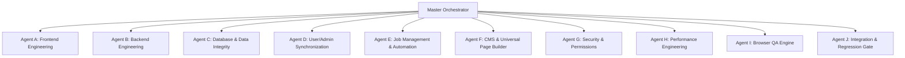

# CHAKRI SHEBA — SPECIALIZED PARALLEL AGENT RESPONSIBILITY MAP

> **Supervised Hybrid AI Engineering System**  
> **Host Environment:** Windows Local Worker (AMD Ryzen 7 5700G, 32GB RAM) + Playwright + Chromium  
> **Concurrency Rule:** Maximum 1 Local Browser Session & 1 Ollama Process at any time.  

---

## Agent Allocation & Workstream Domain

---

### Detailed Agent Profiles

#### 1. Agent A — Frontend Engineering
* **Scope:** Public routes (`src/app/(public)/*`, `src/app/jobs/*`), UI components (`src/components/ui/*`, `src/components/shared/*`), styling (`src/app/globals.css`, `tailwind.config.ts`).
* **Key Tasks:** SolaimanLipi and Bengali fallback rendering, responsive layouts (mobile 375px to desktop 1440px), modal behaviors, form validations.
* **Prohibited:** Modifying backend business logic or database schemas.

#### 2. Agent B — Backend Engineering
* **Scope:** API routes (`src/app/api/*`), API contract validation, dynamic route handlers (`[id]`, `[...slug]`).
* **Key Tasks:** Ensure HTTP status codes follow REST semantics (400 for bad input, 401/403 for unauthorized, 404 for missing, 200/201 for success). Prevent unhandled 500 exceptions.
* **Prohibited:** Modifying frontend presentation components.

#### 3. Agent C — Database & Data Integrity
* **Scope:** `src/db/local_store.json`, `src/lib/db.ts`, relational integrity.
* **Key Tasks:** Verify integrity across 44 collections, detect orphaned applications or documents, validate wallet ledger balances against transaction sums.
* **Prohibited:** Destructive schema migrations or manual deletion of user records without human signoff.

#### 4. Agent D — User Panel & Admin Panel Synchronization
* **Scope:** Candidate Profile (`src/app/dashboard/profile/page.tsx`), Candidate API (`src/app/api/profile/route.ts`), Admin Candidate Workspace (`src/components/admin/UniversalUserWorkspace.tsx`), Dynamic Admin Route (`src/app/api/admin/candidates/[id]/route.ts`), 1-Click Impersonation (`src/app/api/admin/impersonate/route.ts`).
* **Key Tasks:** 100% bidirectional sync of all 10 candidate data vectors: Personal, Bengali name, DOB, Education array, Experience, Technical Skills, Address/District, Quotas, Verification notes, Wallet balance.

#### 5. Agent E — Job Management & Automation
* **Scope:** Spiders (`src/app/api/admin/spider/*`), Job sources registry (`src/app/api/admin/sources/*`), Circular drafts (`src/app/api/admin/publishing/*`), Central Deadline Engine (`src/lib/deadlines/engine.ts`).
* **Key Tasks:** Ensure circular drafts follow the canonical `JobCircular` schema. Unverified jobs must remain in `draft` status until admin review.

#### 6. Agent F — CMS & Universal Page Builder
* **Scope:** Page Builder (`src/components/admin/builder/*`), Dynamic slug handler (`src/app/[...slug]/page.tsx`), Media library (`src/app/api/admin/media/*`), System pages (`home`, `about`, `terms`, `privacy`).
* **Key Tasks:** Ensure all block types (`hero`, `jobs`, `features`, `faq`, `cta`) render cleanly on mobile and desktop without breaking typography.

#### 7. Agent G — Security & Permissions
* **Scope:** Middleware (`src/middleware.ts`), Auth utilities (`src/lib/auth.ts`), Session store.
* **Key Tasks:** Ensure `/api/admin/*` and `/dashboard/*` are strictly protected. Prevent privilege escalation, token hijacking, and arbitrary candidate impersonation without admin secret.

#### 8. Agent H — Performance Engineering
* **Scope:** Server response times, `Cache-Control: no-store` on dynamic endpoints, image optimization, payload sizes.
* **Key Tasks:** Maintain sub-200ms API response latency on local development, audit preconnects and font preloads.

#### 9. Agent I — Browser QA Engine
* **Scope:** Local Playwright suite (`scripts/local_worker_daemon.js`, `scripts/*_audit.js`).
* **Key Tasks:** Execute automated user journeys: Registration -> Login -> Profile Edit -> Job Search -> Application Submission -> Admin Workspace Verification -> Impersonation. Capture screenshots and assert zero console errors.

#### 10. Agent J — Integration & Regression Gate
* **Scope:** Pre-commit and pre-push validation (`npm run typecheck`, `tsc --noEmit`).
* **Key Tasks:** Detect conflicting edits across parallel workstreams. Verify that repairs in one module do not break dependencies in another. Block unverified pushes to `origin/main`.

