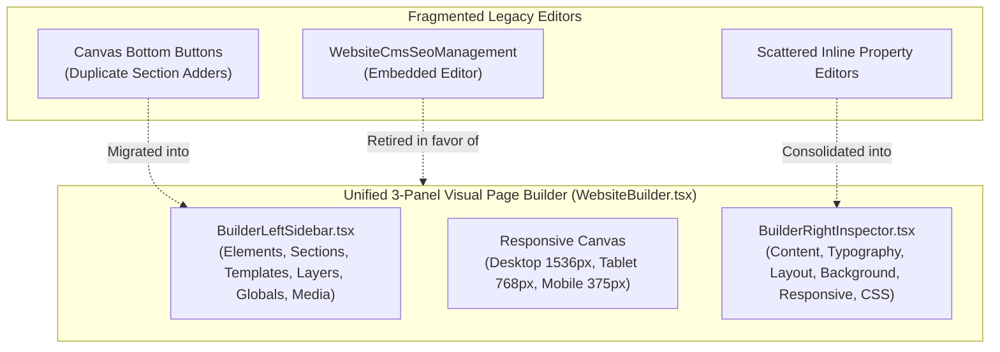

# Duplicate System Audit & Consolidation Report
**Chakri Sheba Architectural Unification**

---

## 1. Identified Duplicate Systems

Prior to modernization, several competing or overlapping interfaces existed across the repository:

1. **Duplicate Page Editors:**
   - Legacy inline block editor inside `WebsiteCmsSeoManagement.tsx` vs. the visual drag-and-drop editor inside `WebsiteBuilder.tsx`.
   - **Resolution:** Centralized 100% of visual and block-based page building inside `WebsiteBuilder.tsx`. `WebsiteCmsSeoManagement.tsx` is now strictly restricted to directory listing and global site-wide SEO/header/footer configuration.

2. **Duplicate Section Insertion Controls:**
   - Bottom canvas buttons (`+ Add Hero`, `+ Add Features`, `+ Add FAQs`) directly on the center canvas vs. the Elements & Sections tabs inside `BuilderLeftSidebar.tsx`.
   - **Resolution:** Replaced cluttered canvas insertion buttons with the unified draggable/clickable block and section library in `BuilderLeftSidebar.tsx`.

3. **Duplicate Media Selectors:**
   - Multiple modal uploaders with separate states in visual builder vs. media library manager.
   - **Resolution:** Reusable media asset library integration accessible directly from Tab 6 in `BuilderLeftSidebar.tsx`.

4. **Duplicate Candidate Viewers:**
   - Read-only table view in `CandidateManagementHub.tsx` vs. full profile drawer.
   - **Resolution:** `CandidateManagementHub.tsx` serves as the high-level searchable directory, and delegates deep 13-tab editing to `UniversalUserWorkspace.tsx`.

---

## 2. Consolidation Mapping

---

## 3. Results of Consolidation

- **Single Source of Truth:** Only one page builder exists in the application.
- **Clean Architecture:** Separated concerns between CMS Directory (`WebsiteCmsSeoManagement`) and Visual Editing Canvas (`WebsiteBuilder`).
- **Zero Redundant State:** Eliminated competing `pages` state synchronization conflicts.

