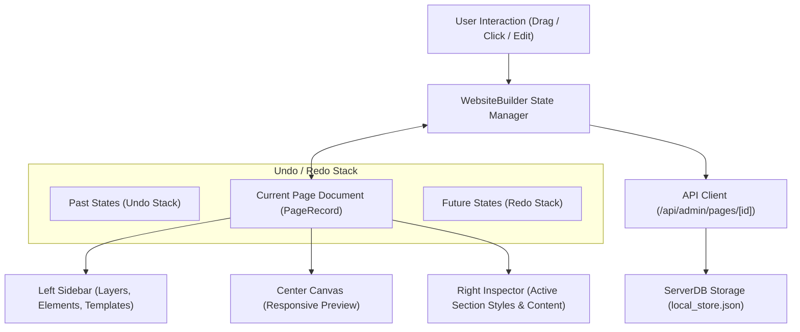

# CHAKRI SHEBA — PAGE BUILDER ARCHITECTURE (PHASE 1)

> **Document Version:** 1.0.0  
> **Status:** APPROVED ARCHITECTURAL SPECIFICATION  
> **Date:** 2026-11-08  

---

## 1. COMPONENT & MODULE ARCHITECTURE

The Page Builder is structured as a modular, extensible, and high-performance React component suite:

```
src/components/admin/
├── WebsiteBuilder.tsx               <-- Main orchestrator & state container
├── builder/
│   ├── BuilderTypes.ts              <-- Unified builder interfaces, block definitions & template schemas
│   ├── BuilderToolbar.tsx           <-- Top navigation, viewport controls, undo/redo, actions
│   ├── BuilderLeftSidebar.tsx       <-- Elements, Sections, Templates, Layers, Globals, Media
│   ├── BuilderCanvas.tsx            <-- Live responsive visual canvas with interactive selection
│   ├── BuilderRightInspector.tsx    <-- Advanced property inspector (Content, Typography, Spacing, Background)
│   ├── BuilderPublishModal.tsx      <-- Pre-publishing validation & confirmation modal
│   └── templates/
│       └── presetTemplates.ts       <-- Pre-built page & section templates (Home, About, Contact, Job Details)
```

---

## 2. STATE & DATA FLOW ARCHITECTURE



### Core State Entities:
1. **`currentPage` (`PageRecord`)**: The single source of truth for the active document.
2. **`activeSectionId` (`string | null`)**: Currently selected section or block highlighted in the canvas and inspected in the right sidebar.
3. **`historyStack` (`PageSection[][]`)**: Past snapshot array enabling instant Undo (`Ctrl + Z`).
4. **`redoStack` (`PageSection[][]`)**: Future snapshot array enabling instant Redo (`Ctrl + Y`).
5. **`viewport` (`'desktop' | 'tablet' | 'mobile'`)**: Active preview width (100% / 1440px, 768px, 375px).
6. **`viewMode` (`'editor' | 'preview' | 'live'`)**: Interactive editing canvas vs clean presentation vs embedded real SSR preview.

---

## 3. DYNAMIC DATA BINDINGS & CANONICAL DATA PROTECTION

For database-driven pages (Job Details, Job Categories, Organizations, Search Results):
- **Template Schema:** The builder defines presentation slots, layouts, typography, and styling.
- **Canonical Fetching:** Dynamic content blocks (e.g. `jobs`, `categories`, `organizations`) query the canonical database via `serverDB.getPublicJobs()`, `serverDB.getCategories()`, and `serverDB.getCompanies()`.
- **Zero Mock Data Injection:** Production databases are never replaced with static blocks.

---

## 4. PRE-PUBLISH VALIDATION PIPELINE

Before committing changes to the live published state:
1. **Title & Slug Validation:** Verifies non-empty title and valid URL slug.
2. **H1 Presence Check:** Ensures the page contains exactly one primary heading (`H1`) for SEO compliance.
3. **Meta Description:** Confirms presence of meta description (recommended 120-160 characters).
4. **Media Alt-Text:** Validates that images have descriptive Bengali alt-text.
5. **Section Visibility:** Checks whether at least one section is set to visible.

---

## 5. ROBUST PERMISSION & SECURITY ENFORCEMENT
- Admin credentials verified through secure headers (`x-admin-secret`).
- Rich text and custom HTML blocks sanitized to prevent stored XSS attacks.
- Strict server-side verification in `/api/admin/pages` and `/api/admin/pages/[id]`.

