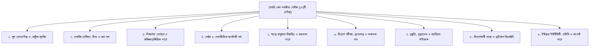

# চাকরি সেবা (Chakri Sheba) — পাবলিক পোর্টালের সকল পেইজ ও সেকশনের সম্পূর্ণ ফাংশনাল গাইড

> **ডকুমেন্ট তৈরি:** ৯ নভেম্বর ২০২৬  
> **সংস্করণ:** ৩.০.০ (Next.js 15.5.29 • React 19.3.1)  
> **উদ্দেশ্য:** চাকরি সেবা প্ল্যাটফর্মের শুধুমাত্র পাবলিক প্যানেলের (ব্যবহারকারী ও চাকরিপ্রার্থীদের জন্য উন্মুক্ত) সকল পেইজ, সেকশন এবং তাদের অভ্যন্তরীণ কার্যাবলীর গভীর ও পূর্ণাঙ্গ বিবরণ।

---

## ১. ভূমিকা ও পাবলিক পোর্টালের রূপরেখা

চাকরি সেবা প্ল্যাটফর্মের পাবলিক প্যানেলে সর্বমোট **৮৩টি সুনির্দিষ্ট রাউট (Pages/Routes)** রয়েছে। কোনো প্রকার অ্যাডমিন পিন বা স্পেশাল প্রিভিলেজ ছাড়াই যেকোনো সাধারণ চাকরিপ্রার্থী, পরীক্ষার্থী ও দর্শনার্থী এই পাতাগুলো ব্রাউজ করতে পারেন।

সমগ্র পাবলিক পোর্টালটিকে মূল কাজের ধরন অনুসারে **৯টি প্রধান ফাংশনাল ক্লাস্টারে (Core Functional Clusters)** ভাগ করা হয়েছে:

---

## ২. ক্লাস্টার ১: মূল হোমপেইজ ও সেন্ট্রাল ল্যান্ডিং (Homepage & Global Hub)

### ১. হোমপেইজ (`/`)
* **রাউট:** `src/app/page.tsx`
* **উদ্দেশ্য:** প্ল্যাটফর্মের প্রধান প্রবেশদ্বার। প্রতিদিনের নতুন চাকরি, আসন্ন ডেডলাইন, ট্রেন্ডিং ক্যাটাগরি ও শীর্ষ সরকারি/কোম্পানি সার্কুলারগুলো একনজরে প্রদর্শন করে।
* **মূল সেকশনসমূহ ও কার্যাবলী:**
  1. **হিরো সেকশন (Hero Banner):**
     - প্ল্যাটফর্মের মূল স্লোগান ও বিশ্বাসযোগ্যতার বার্তা ("শতভাগ যাচাইকৃত সরকারি ও বেসরকারি চাকরির পোর্টাল")।
     - লাইভ কাউন্টার: কতটি সক্রিয় চাকরি আছে, কতটি পদে আবেদন চলছে এবং আজকের ডেডলাইন সংখ্যা।
  2. **স্মার্ট লাইভ সার্চ বার (JobSearchSection):**
     - পদবি, সংস্থা বা জেলা লিখে টাইপ করার সাথে সাথে ক্লায়েন্ট-সাইড ফিল্টারিং।
     - ক্যাটাগরি ড্রপডাউন (সরকারি, ব্যাংক, কোম্পানি, এনজিও, শিক্ষকতা ইত্যাদি)।
  3. **ট্রেন্ডিং ক্যাটাগরি ব্যাজ (Quick Category Filters):**
     - এক ক্লিকে বিসিএস, মন্ত্রণালয়, রাষ্ট্রায়ত্ত ব্যাংক, বিদ্যুৎ ও জ্বালানি কোম্পানি, রেলওয়ে, শিক্ষকতা ইত্যাদির পাতায় যাওয়ার শর্টকাট।
  4. **আজকের নতুন সার্কুলার (Today's New Jobs Feed):**
     - বিগত ২৪ ঘণ্টায় অলজবস টেলিটক বা গেজেট থেকে প্রকাশিত তাজা সার্কুলারগুলোর তালিকা।
  5. **আসন্ন ডেডলাইন কাউন্টডাউন (Closing Soon Alerts):**
     - যেসকল সার্কুলারের আবেদনের মেয়াদ আগামী ১ থেকে ৩ দিনের মধ্যে শেষ হয়ে যাচ্ছে সেগুলোর জন্য রেড অ্যালার্ট কাউন্টডাউন ব্যাজ।
  6. **ফিচার্ড হট জবস (Featured Hot Jobs Carousel/Grid):**
     - বড় বড় আকর্ষণীয় নিয়োগ (যেমন: পেট্রোবাংলা, বিসিআইসি, সিএজি, বাংলাদেশ ব্যাংক) বিশেষ হাইলাইট আকারে প্রদর্শন।
  7. **শীর্ষ নিয়োগকারী সংস্থা (Top Recruiting Organizations):**
     - বিপিএসসি, বাংলাদেশ ব্যাংক, পেট্রোবাংলা, সিটি কর্পোরেশন, বিভিন্ন ডিসি অফিসের লোগোসহ সরাসরি লিংক।
  8. **টেলিটক এসএমএস আবেদন হেল্পার ব্যানার (Teletalk SMS Banner):**
     - টেলিটকে নির্ভুলভাবে এসএমএস পাঠিয়ে আবেদন ফি পরিশোধ করার নির্দেশিকার শর্টকাট।
  9. **প্ল্যাটফর্ম পরিসংখ্যান ও নির্ভরযোগ্যতা ব্যাজ (Trust & Metrics):**
     - কতজন চাকরিপ্রার্থী সেবা নিচ্ছেন, দৈনিক ভিজিটর এবং ডেটা নির্ভুলতার সিস্টেম স্কোর।
  10. **এসইও ফুটার ও ডিসক্লেইমার (SEO Footer):**
      - জাতীয় বেতন স্কেল ২০১৫ লিংক, গুরুত্বপূর্ণ সরকারি ওয়েবসাইটের ডিরেক্টরি এবং নীতিমালার পাতা।

### ২. ডাইনামিক সিএমএস ও কাস্টম ল্যান্ডিং (`/[...slug]` ও `/p/[slug]`)
* **রাউট:** `src/app/[...slug]/page.tsx` ও `src/app/p/[slug]/page.tsx`
* **ফাংশন:**
  - প্ল্যাটফর্মের ব্যাকএন্ড সিএমএস (Content Studio) থেকে তৈরি করা যেকোনো বিশেষ প্রচারণামূলক ল্যান্ডিং পেইজ (যেমন: বিশেষ পরীক্ষার সিলেবাস, গাইডলাইন, বা ক্যাম্পেইন) ক্যাশে রেখে ফাস্ট রেন্ডার করে।
  - স্বয়ংক্রিয় ক্যানোনিকাল ও এসইও মেটাডাটা হ্যান্ডলিং।

---

## ৩. ক্লাস্টার ২: চাকরির তালিকা, ফিড ও সার্চ হাব (Job Feeds & Search)

### ১. মূল চাকরির ডিরেক্টরি (`/jobs`)
* **রাউট:** `src/app/jobs/page.tsx`
* **ফাংশন:** প্ল্যাটফর্মের কেন্দ্রীয় সার্কুলার আর্কাইভ। এখানে সকল লাইভ সার্কুলার গ্রিড আকারে প্রদর্শিত হয়।
* **সেকশন ও ফিচারসমূহ:**
  - **মাল্টি-লেভেল ফিল্টার প্যানেল:** ক্যাটাগরি, বেতন স্কেল (৯ম গ্রেড, ১০ম গ্রেড ইত্যাদি), কর্মস্থল (বিভাগ/জেলা), চাকরির ধরন (ফুল-টাইম, চুক্তিভিত্তিক)।
  - **রিয়েল-টাইম সার্চ ইনপুট:** কি-ওয়ার্ড টাইপ করলেই মুহূর্তে এপিআই থেকে ডেটা ফেচ করে ফিল্টার করে।
  - **পেজিনেশন ও সর্টিং:** নতুন থেকে পুরনো, আবেদনের শেষ তারিখ অনুযায়ী সর্টিং।

### ২. সর্বশেষ প্রকাশিত সার্কুলার (`/latest-jobs`)
* **রাউট:** `src/app/latest-jobs/page.tsx`
* **ফাংশন:** প্রকাশের তারিখ (`publishedDate`) অনুযায়ী সর্বাধুনিক সার্কুলারগুলো ক্রমানুসারে সাজিয়ে প্রদর্শন করে।

### ৩. আজকের নতুন চাকরি (`/todays-jobs`)
* **রাউট:** `src/app/todays-jobs/page.tsx`
* **ফাংশন:** আজকের ক্যালেন্ডার তারিখে যেসকল সার্কুলার অনলাইনে এসেছে শুধুমাত্র সেগুলো ফিল্টার করে চাকরিপ্রার্থীদের সময় বাঁচায়।

### ৪. দৈনিক আর্কাইভ হাব (`/daily-jobs` এবং `/daily-jobs/[date]`)
* **রাউট:** `src/app/daily-jobs/page.tsx` ও `src/app/daily-jobs/[date]/page.tsx`
* **ফাংশন:** অতীতের যেকোনো নির্দিষ্ট তারিখে (যেমন: `2026-11-08`) কোন কোন নিয়োগ প্রকাশিত হয়েছিল তা ক্যালেন্ডার থেকে তারিখ বাছাই করে দেখার আর্কাইভ ব্যবস্থা।

### ৫. হট ও ফিচার্ড চাকরি (`/featured-jobs`)
* **রাউট:** `src/app/featured-jobs/page.tsx`
* **ফাংশন:** সরকারি ও স্বায়ত্তশাসিত খাতের সবচেয়ে বেশি শূন্যপদবিশিষ্ট বা গুরুত্বপূর্ণ এ-গ্রেড সার্কুলারগুলোর কিউরেটেড তালিকা।

### ৬. সংশোধিত ও আপডেট বিজ্ঞপ্তি (`/updated-circulars`)
* **রাউট:** `src/app/updated-circulars/page.tsx`
* **ফাংশন:** যেসকল সার্কুলারের ডেডলাইন বাড়ানো হয়েছে, পদসংখ্যা পরিবর্তন হয়েছে বা সংশোধনী গেজেট (Corrigendum) এসেছে, সেগুলোর রিয়েল-টাইম নোটিশ প্রদর্শন।

### ৭. ডেডলাইন সতর্কবার্তা হাব (`/closing-soon`, `/deadline-approaching`, `/deadline-today`)
* **রাউট:** `src/app/closing-soon/page.tsx`, `src/app/deadline-approaching/page.tsx`, `src/app/deadline-today/page.tsx`
* **ফাংশন:**
  - `/deadline-today`: আজ রাত ১১:৫৯ মিনিটে যেসকল আবেদনের সময় শেষ হয়ে যাবে।
  - `/closing-soon`: আগামী ৪৮ ঘণ্টার মধ্যে শেষ হতে যাওয়া সার্কুলার।
  - সরাসরি "এখনই আবেদন করুন" অ্যাকশন বাটন যুক্ত থাকে যাতে প্রার্থী কোনো সুযোগ মিস না করেন।

---

## ৪. ক্লাস্টার ৩: শিক্ষাগত যোগ্যতা ও অভিজ্ঞতাকেন্দ্রিক ফিল্টার পাতা (Education & Experience Feeds)

চাকরিপ্রার্থীদের নিজ নিজ শিক্ষাগত যোগ্যতা অনুযায়ী সঠিক চাকরি দ্রুত খুঁজে পাওয়ার জন্য ডেডিকেটেড পাতা:

| রাউট (Route) | বাংলা নাম | ফিল্টারিং লজিক ও ফাংশন |
|:---|:---|:---|
| `/jobs/ssc-pass` | এসএসসি পাস চাকরি | ন্যূনতম শিক্ষাগত যোগ্যতা এসএসসি বা সমমান চাওয়া সকল সার্কুলার স্বয়ংক্রিয়ভাবে ফিল্টার করে। |
| `/jobs/hsc-pass` | এইচএসসি পাস চাকরি | উচ্চ মাধ্যমিক বা আলিম পাস প্রার্থীদের উপযোগী ক্লারিক্যাল ও মাঠপর্যায়ের পদ। |
| `/jobs/diploma-pass` | ডিপ্লোমা প্রকৌশলী চাকরি | পলিটেকনিক ইনস্টিটিউট হতে সিভিল, ইলেকট্রিক্যাল, মেকানিক্যাল ডিপ্লোমাধারীদের জন্য উপ-সহকারী প্রকৌশলী পদের বিশেষ ফিড। |
| `/jobs/bachelor-degree` | স্নাতক পাস চাকরি | যেকোনো বিষয়ে ডিগ্রি বা অনার্স পাস অফিসার, শিক্ষক ও করপোরেট পদ। |
| `/jobs/masters-degree` | স্নাতকোত্তর পাস চাকরি | প্রথম শ্রেণির গেজেটেড কর্মকর্তা, সহকারী পরিচালক, গবেষণা ও প্রভাষক পদ। |
| `/jobs/no-experience` | অভিজ্ঞতা ছাড়া চাকরি | কোনো পূর্ব অভিজ্ঞতা প্রয়োজন নেই এমন এন্ট্রি-লেভেল চাকরির তালিকা। |
| `/fresher-jobs` | ফ্রেশার জবস হাব | নতুন গ্র্যাজুয়েটদের ক্যারিয়ার শুরুর উপযোগী পদ ও ইন্টারভিউ পরামর্শ। |
| `/internships` | ইন্টার্নশিপ হাব | সরকারি প্রতিষ্ঠান, ব্যাংক ও বহুজাতিক কোম্পানির পেইড ইন্টার্নশিপ নোটিশ। |
| `/part-time-jobs` | পার্ট-টাইম চাকরি | পড়াশোনার পাশাপাশি খণ্ডকালীন কাজের সুযোগ। |

---

## ৫. ক্লাস্টার ৪: সেক্টর ও পেশাভিত্তিক স্পেশালাইজড ক্যাটাগরি পাতা (Industry & Sector Hubs)

### ১. মূল ক্যাটাগরি ডিরেক্টরি (`/categories` ও `/job-categories`)
* **রাউট:** `src/app/categories/page.tsx`, `src/app/job-categories/page.tsx`
* **ফাংশন:** বাংলাদেশের সকল সরকারি, ব্যাংক ও প্রাইভেট সেক্টরের ২০টি মূল ক্যাটাগরি এবং ৭টি সাব-ক্যাটাগরির সচিত্র গ্রিড ও লাইভ চাকরির সংখ্যা প্রদর্শন।

### ২. ডাইনামিক ক্যাটাগরি ল্যান্ডিং (`/categories/[slug]`)
* **রাউট:** `src/app/categories/[slug]/page.tsx`
* **ফাংশন:** যেকোনো ক্যাটাগরি স্লাগ (যেমন: `bcs`, `government-jobs`, `private-jobs`, `bank-jobs`) এর জন্য স্বয়ংক্রিয় এসইও হেডার, সাব-ক্যাটাগরি পিলস, এবং লাইভ জব ফিড লোড করে।

### ৩. সেক্টরভিত্তিক নির্দিষ্ট ল্যান্ডিং পেইজসমূহ:
* `/government-jobs`: সকল সরকারি মন্ত্রণালয়, অধিদপ্তর ও রাজস্ব খাতের চাকরি।
* `/bank-jobs`: বাংলাদেশ ব্যাংক, সমন্বিত ৯ ব্যাংক (BSCS) ও বেসরকারি ব্যাংকের চাকরি।
* `/private-jobs`: কোল পাওয়ার, আশুগঞ্জ পাওয়ার, কেবল শিল্প, পেট্রোবাংলাসহ কোম্পানি ও স্বায়ত্তশাসিত চাকরি।
* `/engineering-jobs`: সহকারী ও উপ-সহকারী প্রকৌশলী (পুর, তড়িৎ, যান্ত্রিক, কম্পিউটার) পদের ফিল্টার।
* `/it-jobs`: সফটওয়্যার ইঞ্জিনিয়ার, ডাটাবেজ এডমিন, নেটওয়ার্ক ইঞ্জিনিয়ার ও আইটি সহকারী পদ।
* `/medical-jobs`: মেডিকেল অফিসার, নার্স, ফার্মাসিস্ট ও স্বাস্থ্য সহকারী সার্কুলার।
* `/teacher-jobs` ও `/tutoring-jobs`: এনটিআরসিএ, প্রাথমিক সহকারী শিক্ষক ও কলেজ প্রভাষক নিয়োগ।
* `/ngo-jobs`: ব্র্যাক, আশা, টিএমএসএসসহ জাতীয় ও আন্তর্জাতিক এনজিও সার্কুলার।
* `/accounting-finance-jobs`: হিসাবরক্ষক, ক্যাশিয়ার, অডিটর ও ফাইন্যান্সিয়াল এনালিস্ট পদ।
* `/marketing-jobs`: সেলস অফিসার, ব্র্যান্ড ম্যানেজার ও টেরিটরি অফিসার পদ।

---

## ৬. ক্লাস্টার ৫: স্বতন্ত্র চাকরির বিস্তারিত পাতা ও আবেদন প্রবাহ (Job Detail & Candidate Apply Flow)

### ১. স্বতন্ত্র চাকরির বিস্তারিত পাতা (`/jobs/[id]`)
* **রাউট:** `src/app/jobs/[id]/page.tsx` ও `src/components/JobDetailClient.tsx`
* **ফাংশন:** একটি সুনির্দিষ্ট পদের যাবতীয় অফিসিয়াল ও পুঙ্খানুপুঙ্খ তথ্য প্রদর্শনকারী সবচেয়ে গুরুত্বপূর্ণ পাতা।
* **অভ্যন্তরীণ ৭টি প্রধান সেকশন:**
  1. **টপ হেডার ও কি-ইনফো কার্ড:** পদের নাম, সংস্থা, লোগো, ক্যাটাগরি ব্যাজ, ভেরিফিকেশন টিক (`VERIFIED_ACCURATE`)।
  2. **এআই যোগ্যতা যাচাইকারী (Eligibility Evaluator):** প্রার্থীর বয়স ও যোগ্যতা এই পদের সাথে মেলে কিনা তার ওয়ান-ক্লিক ফিডব্যাক।
  3. **নিয়োগ বিজ্ঞপ্তির সারসংক্ষেপ (Job Summary Facts Grid):**
     - গ্রেড ও মূল বেতন (যেমন: ৯ম গ্রেড: ২২,০০০ - ৫৩,০৬০/- টাকা)
     - মোট শূন্যপদ সংখ্যা
     - শিক্ষাগত যোগ্যতা
     - বয়সসীমা ও বয়স গণনার কাট-অফ ডেট
     - কর্মস্থল ও জেলার প্রাপ্যতা
     - আবেদনের শুরুর তারিখ ও শেষ সময়
  4. **পদের বিস্তারিত তালিকা (Designation Breakdown Table):** পদসংখ্যা, নির্ধারিত গ্রেড ও পরীক্ষার সরকারি ফি।
  5. **অফিসিয়াল সার্কুলার নোটিশ ভিউয়ার (Dual PDF/Image Viewer):**
     - টেলিটক সিডিএন-এর আসল সার্কুলার সরাসরি ব্রাউজারেই জুম করে পড়ার সুবিধা।
     - "মূল PDF ডাউনলোড করুন" বাটন।
  6. **টেলিটক এসএমএস ও পেমেন্ট নির্দেশিকা (SMS Instructions):**
     - টেলিটক প্রিপেইড সিম থেকে ১ম ও ২য় এসএমএস পাঠানোর হুবহু টেক্সট ফরম্যাট (`ORG <Space> User_ID to 16222`)।
  7. **সরাসরি আবেদন বাটন ও সম্পর্কিত চাকরি (Direct Apply CTA & Related Jobs):**
     - এক ক্লিকে সংশ্লিষ্ট প্রতিষ্ঠানের অফিসিয়াল সাবডোমেইনে (`cpgcbl.teletalk.com.bd` বা `fri.teletalk.com.bd`) নিয়ে যাওয়ার বোতাম।
     - নিচে একই ধরনের ৩টি প্রাসঙ্গিক সার্কুলার রিকমেন্ডেশন।

### ২. অনলাইন আবেদন সহকারী পাতা (`/apply/[id]`)
* **রাউট:** `src/app/apply/[id]/page.tsx`
* **ফাংশন:** প্রার্থীরা কীভাবে ধাপে ধাপে আবেদন করবেন, ছবি ও স্বাক্ষরের সাইজ (৩০০×৩০০ এবং ৩০০×৮০ পিক্সেল) ঠিক করবেন তার ইন্টারেক্টিভ গাইড।

### ৩. প্রার্থীর আবেদন ট্র্যাকিং (`/applications`)
* **রাউট:** `src/app/applications/page.tsx`
* **ফাংশন:** প্রার্থী প্ল্যাটফর্মের মাধ্যমে যেসকল চাকরিতে আবেদন করেছেন বা সেভ করে রেখেছেন তার স্ট্যাটাস ট্র্যাকিং।

---

## ৭. ক্লাস্টার ৬: নিয়োগ পরীক্ষা, প্রবেশপত্র ও ফলাফল হাব (Exam, Admit Card & Result Portal)

### ১. প্রবেশপত্র ডাউনলোড পোর্টাল (`/admit-cards`)
* **রাউট:** `src/app/admit-cards/page.tsx`
* **ফাংশন:** যেসকল সরকারি ও ব্যাংক নিয়োগের এডমিট কার্ড ইস্যু করা হয়েছে তার তালিকা, টেলিটক প্রবেশপত্র ডাউনলোড লিঙ্ক ও ইউজার আইডি রিকভারির উপায়।

### ২. পরীক্ষার নোটিশ ও সময়সূচি (`/exam-notices`)
* **রাউট:** `src/app/exam-notices/page.tsx`
* **ফাংশন:** প্রিলিমিনারি, লিখিত ও ব্যবহারিক পরীক্ষার তারিখ, আসনবিন্যাস (Seat Plan) ও কেন্দ্র সংক্রান্ত নোটিশ।

### ৩. ভাইভা সময়সূচি (`/viva-notices`)
* **রাউট:** `src/app/viva-notices/page.tsx`
* **ফাংশন:** বিভিন্ন মন্ত্রণালয়ের মৌখিক পরীক্ষার তারিখ ও রোল নম্বরভিত্তিক শিডিউল নোটিশ।

### ৪. লিখিত ও চূড়ান্ত ফলাফল (`/written-exam-results` ও `/exam-results`)
* **রাউট:** `src/app/written-exam-results/page.tsx`, `src/app/exam-results/page.tsx`
* **ফাংশন:** পরীক্ষার ফলাফল প্রকাশের সাথে সাথে অফিশিয়াল রেজাল্ট শিট ও উত্তীর্ণ রোল নম্বরের তালিকা প্রদর্শন।

---

## ৮. ক্লাস্টার ৭: প্রস্তুতি, প্রশ্নব্যাংক ও ক্যারিয়ার গাইডেন্স (Preparation, Question Bank & Guides)

### ১. নিয়োগ পরীক্ষার প্রস্তুতি হাব (`/exam-preparation`)
* **রাউট:** `src/app/exam-preparation/page.tsx`
* **ফাংশন:** বাংলা, ইংরেজি, গণিত, সাধারণ জ্ঞান ও আইসিটি বিষয়ের সিলেবাস ও পূর্ণাঙ্গ স্টাডি প্ল্যান।

### ২. বিগত বছরের প্রশ্নব্যাংক (`/previous-year-questions` ও `/questions`)
* **রাউট:** `src/app/previous-year-questions/page.tsx`, `src/app/questions/page.tsx`
* **ফাংশন:** বিগত ১০ থেকে ২০ বছরের বিসিএস প্রিলিমিনারি, প্রাথমিক শিক্ষক নিয়োগ এবং সরকারি ব্যাংকের প্রশ্ন ও ব্যাখ্যাসহ সমাধান।

### ৩. অনলাইন লাইভ মডেল টেস্ট (`/model-tests`)
* **রাউট:** `src/app/model-tests/page.tsx`
* **ফাংশন:** টাইমারভিত্তিক রিয়েল-টাইম এমসিকিউ মডেল টেস্ট। পরীক্ষা শেষে স্বয়ংক্রিয় মার্কস, ভুল উত্তর সংশোধন ও মেরিট লিস্ট প্রদর্শন।

### ৪. ক্যারিয়ার গাইডেন্স ও টিপস হাব (`/career-advice` ও `/career-guides/*`)
* **রাউট:** `src/app/career-advice/page.tsx`, `src/app/career-guides/page.tsx`
* **সাব-পেইজসমূহ:**
  1. `/career-guides/cv-writing`: আন্তর্জাতিক মানের প্রফেশনাল জীবনবৃত্তান্ত লেখার কৌশল।
  2. `/career-guides/interview-preparation`: ভাইভা বোর্ডের সাধারণ প্রশ্নের উত্তর দেওয়ার নিয়ম।
  3. `/career-guides/job-exam-preparation`: প্রথম চান্সেই সরকারি চাকরি পাওয়ার কৌশল।
  4. `/career-guides/online-job-application`: ছবি, স্বাক্ষর ও কোটা সংক্রান্ত ভুলের সমাধান।
  5. `/career-guides/job-search-tips`: অনলাইনে দ্রুত ও সঠিক চাকরি খুঁজে পাওয়ার ফিল্টারিং টিপস।
  6. `/career-guides/viva-preparation`: ভাইভার পোশাক, বডি ল্যাঙ্গুয়েজ ও আত্মবিশ্বাস বাড়ানোর উপায়।

### ৫. ব্লগ ও আর্টিকেল পোর্টাল (`/blog` ও `/blog/[slug]`)
* **রাউট:** `src/app/blog/page.tsx`, `src/app/blog/[slug]/page.tsx`
* **ফাংশন:** চাকরি বাজারের সাম্প্রতিক ট্রেন্ড, বয়স বৃদ্ধি সংক্রান্ত গেজেট আপডেট এবং শিক্ষণীয় ব্লগ পোস্ট।

---

## ৯. ক্লাস্টার ৮: নিয়োগকারী সংস্থা ও প্রতিষ্ঠান ডিরেক্টরি (Employer & Organization Directory)

### ১. সকল নিয়োগকারী প্রতিষ্ঠানের তালিকা (`/organizations`)
* **রাউট:** `src/app/organizations/page.tsx`
* **ফাংশন:** বাংলাদেশে নিয়োগ বিজ্ঞপ্তি প্রকাশকারী সকল মন্ত্রণালয়, অধিদপ্তর, ব্যাংক ও স্বায়ত্তশাসিত সংস্থার বর্ণানুক্রমিক ডিরেক্টরি।

### ২. নির্দিষ্ট সংস্থার প্রোফাইল পাতা (`/organizations/[slug]`)
* **রাউট:** `src/app/organizations/[slug]/page.tsx`
* **ফাংশন:** কোনো নির্দিষ্ট প্রতিষ্ঠানের আওতাধীন (যেমন: পেট্রোবাংলা) বর্তমানে কতটি চাকরি চলমান আছে এবং পূর্বে কতটি নিয়োগ হয়েছিল তার সমন্বিত ফিড।

### ৩. প্রি-বিল্ট সরকারি হাবসমূহ:
* `/organizations/bangladesh-bank`: বাংলাদেশ ব্যাংক ও ব্যাংকার্স সিলেকশন কমিটির সার্কুলার হাব।
* `/organizations/bpsc`: বাংলাদেশ সরকারি কর্ম কমিশনের নন-ক্যাডার ও বিসিএস সার্কুলার হাব।
* `/organizations/government-ministries`: সকল মন্ত্রণালয়ের নিয়োগ বিজ্ঞপ্তি।
* `/organizations/government-directorates`: সকল সরকারি অধিদপ্তরের নিয়োগ বিজ্ঞপ্তি।

---

## ১০. ক্লাস্টার ৯: ইউজার ইউটিলিটি, পলিসি ও সাপোর্ট পাতা (Utilities, Contact & Policy Pages)

### ১. প্রার্থীর ডিজিটাল টুলস:
* `/job-alerts`: এসএমএস ও ইমেইলে নতুন চাকরির অ্যালার্ট চালু করার সাবস্ক্রিপশন পাতা।
* `/report-a-job`: যদি কোনো সার্কুলারে ভুল তথ্য বা ভুয়া নিয়োগ পাওয়া যায়, তবে সরাসরি অভিযোগ সাবমিট করার ব্যবস্থা।
* `/vault` ও `/wallet`: প্রার্থীর ডিজিটাল শিক্ষাগত সনদ, ভোটার আইডি ও আবেদন ফি ওয়ালেট ব্যবস্থা।
* `/profile`: প্রার্থীর ব্যক্তিগত শিক্ষাগত তথ্য ও দক্ষতা ব্যবস্থাপনা পাতা।
* `/notifications`: সিস্টেম আপডেট ও নিয়োগ নোটিফিকেশন সেন্টার।
* `/login` ও `/register`: প্রার্থীর অ্যাকাউন্ট তৈরি ও সাইন-ইন পোর্টাল।

### ২. প্রাতিষ্ঠানিক তথ্য ও সহায়তা পাতা:
* `/about-us`: চাকরি সেবা প্ল্যাটফর্মের লক্ষ্য, উদ্দেশ্য ও টিম পরিচিতি।
* `/contact` ও `/contact-us`: চাকরিপ্রার্থীদের সরাসরি হেল্পডেস্ক সাপোর্ট ও ফিডব্যাক ফর্ম।
* `/faq`: পেমেন্ট, আবেদন ও নোটিফিকেশন সম্পর্কিত বহুল জিজ্ঞাসিত প্রশ্ন ও সমাধান।

### ৩. সরকারি ও আন্তর্জাতিক মানদণ্ডের আইনি পলিসি পাতাসমূহ:
* `/privacy-policy`: ব্যবহারকারীর তথ্যের সর্বোচ্চ গোপনীয়তা রক্ষা নীতি।
* `/terms-and-conditions`: প্ল্যাটফর্মের ব্যবহারের শর্তাবলী ও নিয়মনীতি।
* `/disclaimer`: আইনি তথ্য দায়মুক্তি ও অফিসিয়াল গেজেট সম্পর্কিত ঘোষণা।
* `/editorial-policy`: সম্পাদকীয় নীতিমালা এবং নির্ভুল তথ্য উপস্থাপনের প্রতিশ্রুতি।
* `/corrections-policy`: তথ্যে কোনো ত্রুটি দেখা দিলে তা দ্রুত সংশোধন ও প্রত্যাহার করার নিয়মাবলী।
* `/job-verification-policy`: প্রতিটি সার্কুলার কীভাবে এআই ও ম্যানুয়াল অডিটের মাধ্যমে গেজেট মিলিয়ে যাচাই করা হয় তার বিবরণী।

---

## ১১. সম্পূর্ণ পাবলিক পেইজসমূহের একনজরে রেফারেন্স ম্যাট্রিক্স (Quick Reference Table)

| ক্রম | রাউট পাথ (URL) | পাতার নাম (বাংলায়) | প্রধান ফাংশন ও বৈশিষ্ট্য |
|:---:|:---|:---|:---|
| ১ | `/` | হোমপেইজ | লাইভ সার্চ, আজকের নতুন চাকরি, ডেডলাইন অ্যালার্ট, টপ অর্গানাইজেশন |
| ২ | `/jobs` | চাকরির মূল ডিরেক্টরি | সকল সার্কুলারের গ্রিড, অ্যাডভান্সড ফিল্টার, সর্টিং ও পেজিনেশন |
| ৩ | `/jobs/[id]` | স্বতন্ত্র চাকরির পাতা | গ্রেড, বেতন, শূন্যপদ, যোগ্যতা, সরাসরি আবেদন বাটন, মূল PDF ভিউয়ার |
| ৪ | `/categories` | সকল ক্যাটাগরি | সরকারি, ব্যাংক, কোম্পানি, ডিফেন্স, আইটিসহ সকল সেক্টরের সচিত্র তালিকা |
| ৫ | `/categories/[slug]` | ক্যাটাগরি লাইভ ফিড | নির্দিষ্ট ক্যাটাগরির অন্তর্ভুক্ত সকল চলমান নিয়োগের তালিকা |
| ৬ | `/government-jobs` | সরকারি চাকরি হাব | মন্ত্রণালয় ও রাজস্ব খাতের সকল সার্কুলার |
| ৭ | `/private-jobs` | কোম্পানি ও স্বায়ত্তশাসিত হাব | বিদ্যুৎ, জ্বালানি ও শিল্প খাতের সকল কোম্পানির সার্কুলার |
| ৮ | `/bank-jobs` | ব্যাংক চাকরি হাব | রাষ্ট্রায়ত্ত ও বেসরকারি ব্যাংকের সকল সার্কুলার |
| ৯ | `/admit-cards` | এডমিট কার্ড ডাউনলোড | চলমান নিয়োগ পরীক্ষার প্রবেশপত্র ডাউনলোড লিংক ও ইউজার আইডি রিকভারি |
| ১০ | `/exam-results` | পরীক্ষার ফলাফল | প্রিলিমিনারি, লিখিত ও চূড়ান্ত পরীক্ষার ফলাফল ও উত্তীর্ণদের তালিকা |
| ১১ | `/exam-notices` | পরীক্ষার তারিখ ও রুটিন | পরীক্ষার সময়সূচি, আসনবিন্যাস ও কেন্দ্র সম্পর্কিত জরুরি বিজ্ঞপ্তি |
| ১২ | `/previous-year-questions` | বিগত সালের প্রশ্নব্যাংক | বিসিএস ও ব্যাংক পরীক্ষার বিগত বছরের ব্যাখ্যাসহ প্রশ্ন সমাধান |
| ১৩ | `/model-tests` | অনলাইন মডেল টেস্ট | টাইমারভিত্তিক এমসিকিউ মক টেস্ট ও স্বয়ংক্রিয় রেজাল্ট |
| ১৪ | `/career-guides` | ক্যারিয়ার গাইডেন্স হাব | সিভি লেখা, ভাইভা প্রস্তুতি, ও আবেদন করার পূর্ণাঙ্গ নির্দেশিকা |
| ১৫ | `/organizations` | নিয়োগকারী সংস্থা তালিকা | সকল সরকারি মন্ত্রণালয়, অধিদপ্তর ও কোম্পানির ডিরেক্টরি |
| ১৬ | `/job-alerts` | জব অ্যালার্ট সিস্টেম | এসএমএস ও ইমেইলে নতুন চাকরির অ্যালার্ট সাবস্ক্রিপশন |
| ১৭ | `/about-us` | আমাদের সম্পর্কে | প্ল্যাটফর্ম পরিচিতি, লক্ষ্য ও সেবা সম্পর্কিত তথ্য |
| ১৮ | `/contact-us` | যোগাযোগ ও সহায়তা | চাকরিপ্রার্থীদের সাপোর্ট ও ফিডব্যাক ফর্ম |
| ১৯ | `/faq` | সচরাচর জিজ্ঞাসা | সাধারণ প্রশ্ন ও বিস্তারিত সমাধান |
| ২০ | `/privacy-policy` | গোপনীয়তা নীতিমালা | তথ্য সুরক্ষা ও ডেটা ব্যবহারের সার্বিক নিয়মাবলী |

