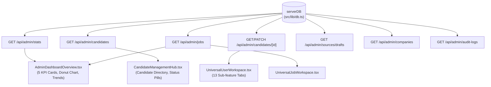

# Real Data Source Map
**Chakri Sheba Administrative Platform**
*Architecture: Single Source of Truth (`serverDB`)*

---

## 1. Architectural Binding Architecture

All administrative statistics, tables, widgets, and modal workspaces are strictly wired to canonical backend endpoints powered by `serverDB` (`src/lib/db.ts`).

---

## 2. Metric & Widget Source Matrix

| UI Metric / Widget | Admin Component | API Endpoint | `serverDB` Method | Return Field |
| :--- | :--- | :--- | :--- | :--- |
| **Total Jobs (মোট চাকরি)** | `AdminDashboardOverview.tsx` | `/api/admin/stats` | `serverDB.getJobs()` | `stats.totalJobs` / `jobs.length` |
| **Registered Candidates (নিবন্ধিত প্রার্থী)** | `AdminDashboardOverview.tsx` | `/api/admin/stats` | `serverDB.getAllCandidates()` | `stats.totalCandidates` / `candidates.length` |
| **Pending Review (পর্যালোচনায় অপেক্ষমাণ)** | `AdminDashboardOverview.tsx` | `/api/admin/stats` | `serverDB.getCircularDrafts()` | `stats.pendingDrafts` |
| **Active Scrapers (সক্রিয় সংগ্রহকারী)** | `AdminDashboardOverview.tsx` | `/api/admin/stats` | `serverDB.getJobSources()` | `stats.activeSpiders` |
| **Total Views (মোট ভিউ)** | `AdminDashboardOverview.tsx` | `/api/admin/stats` | `serverDB.getJobs()` | `stats.totalViews` |
| **Jobs by Status (Donut Chart)** | `AdminDashboardOverview.tsx` | `/api/admin/jobs` | `serverDB.getJobs()` | Breakdown of `published`, `draft`, `review`, `expired` |
| **Recent Jobs Table** | `AdminDashboardOverview.tsx` | `/api/admin/jobs` | `serverDB.getJobs()` | `jobs.slice(0, 5)` |
| **Candidate Directory Table** | `CandidateManagementHub.tsx` | `/api/admin/candidates` | `serverDB.getAllCandidates()` | Array of `CandidateProfile` |
| **Candidate 360 Documents** | `UniversalUserWorkspace.tsx` | `/api/admin/candidates/[id]` | `serverDB.getDocuments(id)` | `documents` |
| **Candidate Applications** | `UniversalUserWorkspace.tsx` | `/api/admin/candidates/[id]` | `serverDB.getApplications(id)` | `applications` |
| **Candidate Saved Jobs** | `UniversalUserWorkspace.tsx` | `/api/admin/candidates/[id]` | `serverDB.getSavedJobs(id)` | `savedJobs` |
| **Candidate Wallet Ledger** | `UniversalUserWorkspace.tsx` | `/api/admin/candidates/[id]` | `serverDB.getTransactions(id)` | `transactions` |
| **Candidate Audit History** | `UniversalUserWorkspace.tsx` | `/api/admin/candidates/[id]` | `serverDB.getAdminAuditLogs(id)` | `auditLogs` |
| **Revenue & Service Fees** | `FinancialTransactionsLedger.tsx` | `/api/admin/stats` | `serverDB.getAllApplications()` | `stats.totalRevenue` |

---

## 3. Data Integrity Invariant Guarantees

1. **No Simulated Local State:** Metrics never increment or decrement using ephemeral client timer intervals (`setInterval`).
2. **Deterministic Refresh:** The "সিস্টেমের বর্তমান অবস্থা" refresh button triggers authentic network calls to `/api/admin/stats`.
3. **Audit Logged Modifications:** Any mutation performed via administrative modals writes an immutable record to `serverDB.recordAdminAudit(...)` with timestamp, `adminId`, and mandatory change reasoning.
